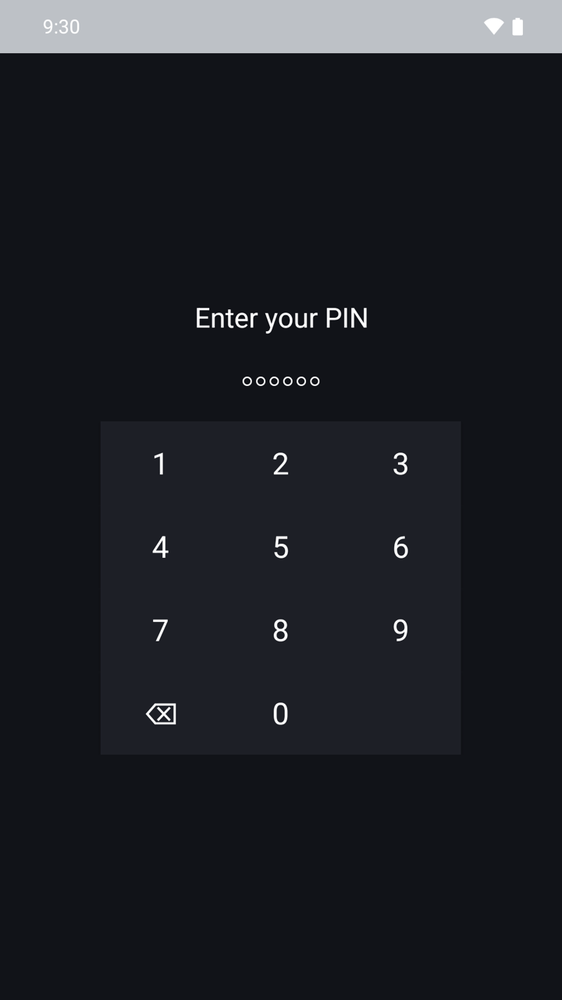

## Was die App kann

AppLock setzt einen Sperrbildschirm vor die Apps, die Sie auswählen. Wer eine gesperrte App öffnet, muss zuerst Ihre PIN, Ihr Muster oder Ihr Passwort eingeben oder Ihren Fingerabdruck nutzen. In der App steht der Name als "App Lock".

- Kein Konto. Ihre PIN, die Liste der gesperrten Apps, das Sicherheitsprotokoll und die Eindringling-Fotos bleiben auf Ihrem Handy und werden nie hochgeladen.
- Die App kann ein Foto von jemandem machen, der immer wieder den falschen Code eingibt.
- Mit einem Wiederherstellungscode kommen Sie wieder hinein, wenn Sie Ihre PIN vergessen haben.
- Kostenlos mit Werbung. Apps zu sperren ist immer gratis. Ein einmaliger Kauf von Premium entfernt die Werbung und bietet Extras.

## Erste Schritte

1. Öffnen Sie AppLock und tippen Sie auf **Get started**.
2. Wählen Sie unter **How do you want to unlock?** die Option **PIN**, **Pattern** oder **Password**.
3. Geben Sie den Code ein und bestätigen Sie ihn durch eine zweite Eingabe. Eine PIN hat 6 Ziffern. Ein Muster verbindet mindestens 4 Punkte. Ein Passwort hat mindestens 4 Zeichen. Bei Muster und Passwort tippen Sie nach jeder Eingabe auf **Continue**.
4. Notieren Sie auf **Save your recovery code** den 8-stelligen Code und bewahren Sie ihn sicher auf. Sie sehen ihn nur einmal. Er ist der einzige Weg zurück, wenn Sie Ihre PIN, Ihr Muster oder Ihr Passwort vergessen.
5. Setzen Sie ein Häkchen bei **I’ve saved this code somewhere safe** und tippen Sie auf **Continue**.

Jetzt sind Sie auf dem Startbildschirm. Dort steht **Protection off**, bis Sie die Berechtigungen erteilt und Ihre erste App gesperrt haben.

## Berechtigungen erteilen

AppLock kann eine App nur sperren, wenn Android es merken lässt, dass die App geöffnet wurde, und es den Sperrbildschirm darüberlegen darf. Dafür braucht die App zwei Berechtigungen: **Accessibility** und **Display over other apps**. Die übrigen Berechtigungen sind optional.

1. Tippen Sie auf dem Startbildschirm auf **Finish setup** oder **Permissions**.
2. Tippen Sie auf **Accessibility**. AppLock zeigt zuerst eine Seite mit dem Titel **What Accessibility access does**. Lesen Sie sie durch.
3. Tippen Sie auf **I understand — open settings**. Wenn Sie nicht einverstanden sind, tippen Sie auf **Not now**: Es wird nichts geändert und es öffnen sich keine Einstellungen.
4. Schalten Sie in den Android-Einstellungen, die sich öffnen, den Dienst für AppLock ein. Gehen Sie dann zurück zu AppLock.
5. Tippen Sie auf **Display over other apps** und erlauben Sie es in den Android-Einstellungen.
6. Tippen Sie auf jede weitere Zeile, die Sie erlauben möchten. Eine erledigte Zeile zeigt **Granted**.

**Warum AppLock Accessibility braucht.** AppLock nutzt den Android-Dienst Accessibility nur für einen Zweck: zu erkennen, welche App gerade nach vorn kommt, damit der Sperrbildschirm über den geschützten Apps erscheinen kann.

- Was die App tut: Sie beobachtet nur den Namen der App, die gerade geöffnet wurde. Wird eine gesperrte App entsperrt oder ein falscher Code eingegeben, speichert die App deren Namen im **Security log** auf Ihrem Handy, damit Sie ihn nachsehen können.
- Was die App nie tut: Sie liest nie Bildschirminhalte, Tastatureingaben, Passwörter, Nachrichten oder andere Daten auf dem Bildschirm, weder in AppLock noch in anderen Apps. Nichts wird von Ihrem Gerät gesendet.
- Sie können den Dienst jederzeit in den Android-Einstellungen ausschalten. AppLock kann dann den Sperrbildschirm nicht mehr anzeigen.

**Wofür die anderen Berechtigungen da sind.**

- **Display over other apps**: Der Sperrbildschirm kann über einer gesperrten App erscheinen.
- **Usage access**: Hilft zu prüfen, ob der Schutz zuverlässig arbeitet.
- **Notifications**: Meldet Sperraufforderungen und Einbruchsversuche.
- **Camera** (optional): Macht ein Foto von jemandem, der das Entsperren nicht schafft.
- **Notification access**: Blendet den Inhalt von Benachrichtigungen gesperrter Apps aus.
- **Ignore battery optimization**: Hält den Schutz im Hintergrund aktiv.

Jede Berechtigung wird nur auf Ihrem Handy genutzt.

## Apps zum Sperren auswählen

1. Tippen Sie auf dem Startbildschirm auf **Lock apps**.
2. Suchen Sie die App. Geben Sie ihren Namen in **Search apps** ein oder wechseln Sie zwischen den Tabs **User**, **System** und **Recent**. **Recent** zeigt die zuletzt installierten Apps zuerst.
3. Schalten Sie den Schalter neben jeder App ein, die Sie sperren möchten.
4. Gehen Sie zurück. Der Startbildschirm zeigt **Protected** und die Anzahl der gesperrten Apps.

Um eine App dauerhaft zu entsperren, öffnen Sie **Lock apps** erneut und schalten ihren Schalter aus.

## Eine gesperrte App öffnen

1. Öffnen Sie eine App, die Sie gesperrt haben. Der Sperrbildschirm deckt sie sofort ab.
2. Geben Sie Ihre PIN, Ihr Muster oder Ihr Passwort ein. Wenn Sie **Unlock with biometrics** eingeschaltet haben, können Sie stattdessen Ihren Fingerabdruck nutzen.
3. Nach einer falschen Eingabe können Sie es erneut versuchen. Nach zu vielen falschen Eingaben müssen Sie einen Moment warten.

AppLock selbst ist auf dieselbe Weise gesperrt, sodass niemand sonst Ihre Einstellungen ändern kann.

## Die Sperre anpassen

1. Tippen Sie auf dem Startbildschirm auf **Settings**.
2. Wählen Sie unter **Appearance** die Option **System**, **Light** oder **Dark**.
3. Legen Sie unter **Re-lock** fest, wann eine entsperrte App wieder gesperrt wird: **Immediately**, sobald Sie sie verlassen, **On screen off** oder **After 5 min**.
4. Schalten Sie unter **Security** die Option **Unlock with biometrics** ein. Sie bestätigen zuerst Ihre PIN, Ihr Muster oder Ihr Passwort. Dafür muss auf Ihrem Handy bereits ein Fingerabdruck oder Gesicht eingerichtet sein.
5. Schalten Sie unter **Protection** die Option **Scramble the PIN pad** ein. Die Zifferntasten werden dann durchmischt, sodass niemand Ihre PIN daran erraten kann, wo Sie tippen.
6. Schalten Sie **Hide notification content for locked apps** ein, damit Nachrichten gesperrter Apps privat bleiben. Dafür brauchen Sie **Notification access** unter **Permissions**.
7. Schalten Sie unter **Disguise** die Option **Hide from Recents** ein, damit AppLock nicht in der Liste der zuletzt verwendeten Apps erscheint.

## Sehen, wer hinein wollte

1. Öffnen Sie **Settings** und schalten Sie **Intruder photo after failed attempts** ein.
2. Öffnen Sie **Permissions** und erlauben Sie **Camera**.
3. Ab jetzt macht die Frontkamera ein Foto, wenn auf dem Sperrbildschirm dreimal hintereinander falsch eingegeben wurde.
4. Tippen Sie auf dem Startbildschirm auf **Intruder photos**, um die Fotos zu sehen, jeweils mit der App, die geöffnet wurde.
5. Tippen Sie auf **Security log**, um Entsperrungen, fehlgeschlagene Versuche und Änderungen an den Einstellungen zu sehen.

## Wieder hineinkommen, wenn Sie die PIN vergessen haben

1. Öffnen Sie AppLock. Tippen Sie auf dem Entsperrbildschirm auf **Can’t get in?**
2. Geben Sie den gespeicherten 8-stelligen Wiederherstellungscode ein und tippen Sie auf **Continue**.
3. Legen Sie eine neue PIN, ein neues Muster oder ein neues Passwort fest. Danach erhalten Sie einen neuen Wiederherstellungscode. Der alte funktioniert nicht mehr.

Wenn Sie einen neuen Wiederherstellungscode möchten, solange Sie Ihre PIN noch kennen, öffnen Sie **Settings** und tippen auf **Replace recovery code**.

## Premium

Premium ist eine Einmalzahlung, kein Abo. Öffnen Sie **Settings** und tippen Sie auf **Unlock Premium**. Apps zu sperren bleibt auch ohne Premium kostenlos. Premium bietet Ihnen:

- Keine Werbung.
- **Fake crash screen (long-press to unlock)**: Eine gesperrte App sieht aus, als wäre sie abgestürzt, statt den Sperrbildschirm zu zeigen.
- Tarn-Symbole: Ändern Sie Symbol und Namen von AppLock auf Ihrem Startbildschirm in **Calculator**, **Notes** oder **Weather**. Bei **Calculator** können Sie **Open a real calculator instead** einschalten und einen **Secret code** festlegen: Geben Sie den Code ein und drücken Sie =, um AppLock zu öffnen. Ihre PIN funktioniert immer auch.
- Den vollständigen Verlauf der Eindringling-Fotos. Die kostenlose Version zeigt die neuesten 5.
- **Export backup**: eine verschlüsselte Kopie Ihrer Einstellungen und der Sperrliste, geschützt durch ein Passwort, das Sie selbst wählen. **Restore backup** ist kostenlos.

Wenn Sie Premium schon einmal gekauft haben, tippen Sie in **Settings** auf **Restore purchases**.

## Fragen

**Warum braucht AppLock die Berechtigung Accessibility?**
Nur um zu erkennen, welche App gerade geöffnet wurde, damit der Sperrbildschirm über den gesperrten Apps erscheinen kann. Die App liest nie, was auf Ihrem Bildschirm steht oder was Sie eingeben. Siehe oben "Berechtigungen erteilen".

**Auf dem Startbildschirm steht "Protection off". Was ist los?**
Entweder ist **Accessibility** oder **Display over other apps** nicht erlaubt, oder es ist noch keine App gesperrt. Tippen Sie auf **Finish setup**, um die Liste der Berechtigungen zu öffnen, und prüfen Sie dann **Lock apps**.

**Kann ich AppLock komplett verstecken?**
Nein. Android behält für jede installierte App immer ein Symbol. Mit Premium können Sie stattdessen Symbol und Namen gegen eine Tarnung austauschen.

**Ich habe meine PIN und den Wiederherstellungscode verloren. Können Sie sie zurücksetzen?**
Nein. AppLock arbeitet offline und ohne Konto, daher gibt es kein Zurücksetzen per E-Mail. Der Wiederherstellungscode ist der einzige Weg zurück. Bewahren Sie ihn sicher auf.

**Enthält ein Backup meine PIN oder die Eindringling-Fotos?**
Nein. Nachdem Sie ein Backup wiederhergestellt haben, bittet die App Sie zuerst, eine neue PIN, ein neues Muster oder ein neues Passwort festzulegen.

## Datenschutz

Ihre PIN, Ihre gesperrten Apps, das Sicherheitsprotokoll und die Eindringling-Fotos bleiben auf Ihrem Gerät und werden nie hochgeladen. Die kostenlose Version zeigt Werbung von Google AdMob. Lesen Sie die vollständige [Datenschutzerklärung](https://varian1.github.io/privacy.html).
