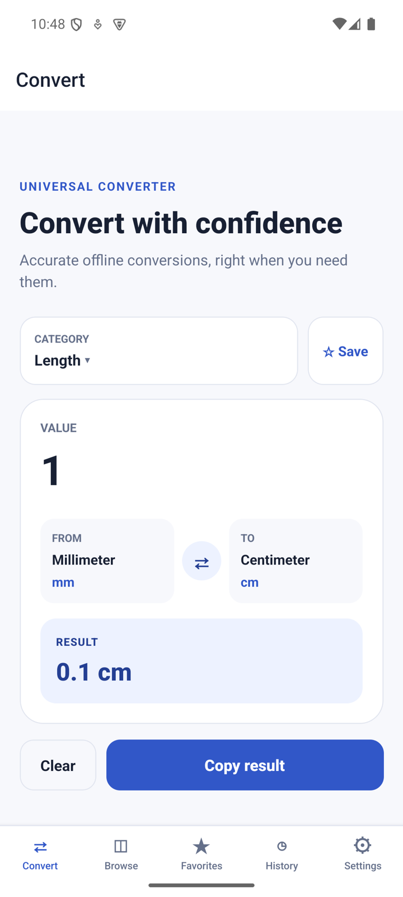

## Fungsi aplikasi

AppLock memasang layar kunci di depan aplikasi yang Anda pilih. Saat seseorang membuka aplikasi yang terkunci, ia harus memasukkan PIN, pola, atau sandi Anda, atau memakai sidik jari Anda, sebelum bisa melihat isinya. Di dalam aplikasi, namanya tertulis "App Lock".

- Tanpa akun. PIN, daftar aplikasi terkunci, log keamanan, dan foto penyusup tetap ada di ponsel Anda dan tidak pernah diunggah.
- Aplikasi bisa memotret orang yang terus memasukkan kode yang salah.
- Kode pemulihan membantu Anda masuk kembali jika lupa PIN.
- Gratis dengan iklan. Mengunci aplikasi selalu gratis. Sekali bayar untuk Premium menghapus iklan dan menambah fitur ekstra.

## Mulai

1. Buka AppLock, lalu ketuk **Get started**.
2. Di bawah **How do you want to unlock?**, pilih **PIN**, **Pattern**, atau **Password**.
3. Masukkan, lalu masukkan sekali lagi untuk konfirmasi. PIN terdiri dari 6 angka. Pola menghubungkan minimal 4 titik. Sandi minimal 4 karakter. Untuk pola atau sandi, ketuk **Continue** setelah tiap pengisian.
4. Di **Save your recovery code**, catat kode 8 angka itu dan simpan di tempat aman. Kode ini hanya tampil sekali, dan satu-satunya jalan masuk kembali jika Anda lupa PIN, pola, atau sandi.
5. Centang **I’ve saved this code somewhere safe**, lalu ketuk **Continue**.

Sekarang Anda berada di layar utama. Layar ini menampilkan **Protection off** sampai Anda memberi izin dan mengunci aplikasi pertama.

## Berikan izin

AppLock hanya bisa mengunci aplikasi jika Android mengizinkannya mengetahui bahwa aplikasi dibuka dan menampilkan layar kunci di atasnya. Untuk itu diperlukan dua izin: **Accessibility** dan **Display over other apps**. Izin lainnya bersifat opsional.

1. Di layar utama, ketuk **Finish setup** atau **Permissions**.
2. Ketuk **Accessibility**. AppLock lebih dulu menampilkan halaman **What Accessibility access does**. Bacalah.
3. Ketuk **I understand — open settings**. Jika Anda tidak setuju, ketuk **Not now**: tidak ada yang diubah dan pengaturan tidak dibuka.
4. Di layar pengaturan Android yang terbuka, aktifkan layanan untuk AppLock, lalu kembali ke AppLock.
5. Ketuk **Display over other apps** dan izinkan di layar pengaturan Android.
6. Ketuk baris lain yang ingin Anda izinkan. Baris akan menampilkan **Granted** jika sudah selesai.

**Mengapa AppLock meminta Accessibility.** AppLock memakai layanan Aksesibilitas Android hanya untuk satu tujuan: mengetahui aplikasi mana yang baru muncul di depan, agar layar kunci bisa ditampilkan di atas aplikasi yang Anda lindungi.

- Yang dilakukan: memantau nama aplikasi yang baru dibuka, tidak lebih. Saat aplikasi terkunci dibuka atau kode yang salah dimasukkan, nama aplikasi itu disimpan di **Security log** di ponsel Anda agar bisa Anda tinjau.
- Yang tidak pernah dilakukan: tidak pernah membaca isi layar, ketikan, sandi, pesan, atau data lain di layar, baik di AppLock maupun di aplikasi lain. Tidak ada yang dikirim keluar dari perangkat Anda.
- Anda bisa mematikannya kapan saja di Pengaturan Android. AppLock lalu tidak bisa lagi menampilkan layar kunci.

**Kegunaan izin lainnya.**

- **Display over other apps**: memungkinkan layar kunci muncul di atas aplikasi yang terkunci.
- **Usage access**: membantu memastikan perlindungan berjalan dengan andal.
- **Notifications**: memberi tahu Anda tentang permintaan kunci dan upaya pembobolan.
- **Camera** (opsional): memotret orang yang gagal membuka kunci.
- **Notification access**: menyembunyikan isi notifikasi aplikasi terkunci.
- **Ignore battery optimization**: menjaga perlindungan tetap berjalan di latar belakang.

Setiap izin hanya dipakai di ponsel Anda.

## Pilih aplikasi yang dikunci

1. Di layar utama, ketuk **Lock apps**.
2. Cari aplikasinya. Ketik namanya di **Search apps**, atau pindah antara tab **User**, **System**, dan **Recent**. **Recent** menampilkan aplikasi yang paling baru dipasang lebih dulu.
3. Aktifkan sakelar di samping setiap aplikasi yang ingin Anda kunci.
4. Kembali ke layar utama. Layar utama menampilkan **Protected** dan jumlah aplikasi yang terkunci.

Untuk membuka kunci sebuah aplikasi secara permanen, buka **Lock apps** lagi dan matikan sakelarnya.

## Buka aplikasi yang terkunci

1. Buka aplikasi yang Anda kunci. Layar kunci langsung menutupinya.
2. Masukkan PIN, pola, atau sandi Anda. Jika Anda mengaktifkan **Unlock with biometrics**, Anda bisa memakai sidik jari.
3. Setelah salah memasukkan, Anda bisa mencoba lagi. Jika salah terlalu sering, Anda harus menunggu sebentar.

AppLock sendiri dikunci dengan cara yang sama, sehingga orang lain tidak bisa mengubah pengaturan Anda.

## Ubah cara kerja kunci

1. Di layar utama, ketuk **Settings**.
2. Di bawah **Appearance**, pilih **System**, **Light**, atau **Dark**.
3. Di bawah **Re-lock**, pilih kapan aplikasi yang sudah Anda buka dikunci lagi: **Immediately** saat Anda keluar darinya, **On screen off**, atau **After 5 min**.
4. Di bawah **Security**, aktifkan **Unlock with biometrics**. Anda akan diminta memasukkan PIN, pola, atau sandi lebih dulu. Fitur ini memerlukan sidik jari atau wajah yang sudah terdaftar di ponsel Anda.
5. Di bawah **Protection**, aktifkan **Scramble the PIN pad** untuk mengacak tombol angka, sehingga tidak ada yang bisa menebak PIN Anda dari posisi ketukan.
6. Aktifkan **Hide notification content for locked apps** agar pesan dari aplikasi terkunci tetap pribadi. Fitur ini memerlukan **Notification access** di **Permissions**.
7. Di bawah **Disguise**, aktifkan **Hide from Recents** agar AppLock tidak muncul di daftar aplikasi terbaru.

## Lihat siapa yang mencoba masuk

1. Buka **Settings**, lalu aktifkan **Intruder photo after failed attempts**.
2. Buka **Permissions** dan izinkan **Camera**.
3. Mulai sekarang, setelah tiga kali salah berturut-turut di layar kunci, kamera depan akan mengambil foto.
4. Di layar utama, ketuk **Intruder photos** untuk melihat foto-fotonya, masing-masing disertai aplikasi yang dibuka.
5. Ketuk **Security log** untuk melihat pembukaan kunci, percobaan yang gagal, dan perubahan pengaturan.

## Masuk kembali jika lupa PIN

1. Buka AppLock. Di layar buka kunci, ketuk **Can’t get in?**
2. Masukkan kode pemulihan 8 angka yang Anda simpan, lalu ketuk **Continue**.
3. Buat PIN, pola, atau sandi baru. Anda lalu mendapat kode pemulihan baru; kode lama tidak berlaku lagi.

Untuk mendapat kode pemulihan baru selagi Anda masih ingat PIN, buka **Settings** dan ketuk **Replace recovery code**.

## Premium

Premium adalah sekali bayar, bukan langganan. Buka **Settings** dan ketuk **Unlock Premium**. Tanpa Premium, mengunci aplikasi tetap gratis. Premium memberi Anda:

- Tanpa iklan.
- **Fake crash screen (long-press to unlock)**: aplikasi terkunci tampak seperti mogok, bukan menampilkan layar kunci.
- Ikon penyamaran: ubah ikon dan nama AppLock di layar utama ponsel Anda menjadi **Calculator**, **Notes**, atau **Weather**. Dengan **Calculator**, Anda bisa mengaktifkan **Open a real calculator instead** dan menetapkan **Secret code**: ketik kodenya lalu tekan = untuk membuka AppLock. PIN Anda juga selalu berfungsi.
- Riwayat lengkap foto penyusup. Versi gratis hanya menampilkan 5 foto terbaru.
- **Export backup**: salinan terenkripsi dari pengaturan dan daftar kunci Anda, dilindungi sandi yang Anda pilih. **Restore backup** gratis.

Jika Anda pernah membeli Premium, ketuk **Restore purchases** di **Settings**.

## Pertanyaan

**Mengapa AppLock membutuhkan izin Accessibility?**
Hanya untuk mengetahui aplikasi mana yang baru dibuka, agar layar kunci bisa ditampilkan di atas aplikasi yang Anda kunci. AppLock tidak pernah membaca isi layar atau apa yang Anda ketik. Lihat "Berikan izin" di atas.

**Layar utama menampilkan "Protection off". Apa yang salah?**
Mungkin **Accessibility** atau **Display over other apps** belum diizinkan, atau belum ada aplikasi yang dikunci. Ketuk **Finish setup** untuk membuka daftar izin, lalu periksa **Lock apps**.

**Bisakah saya menyembunyikan AppLock sepenuhnya?**
Tidak. Android selalu menyisakan ikon untuk aplikasi yang terpasang. Dengan Premium, Anda bisa mengganti ikon dan nama dengan penyamaran.

**Saya lupa PIN dan kehilangan kode pemulihan. Bisakah direset?**
Tidak. AppLock bekerja offline tanpa akun, jadi tidak ada reset lewat email. Kode pemulihan adalah satu-satunya jalan masuk kembali. Simpan di tempat aman.

**Apakah cadangan berisi PIN atau foto penyusup saya?**
Tidak. Setelah Anda memulihkan cadangan, aplikasi akan meminta Anda membuat PIN, pola, atau sandi baru lebih dulu.

## Privasi

PIN, aplikasi terkunci, log keamanan, dan foto penyusup Anda tetap ada di perangkat dan tidak pernah diunggah. Versi gratis menampilkan iklan dari Google AdMob. Baca [kebijakan privasi](https://varian1.github.io/privacy.html) selengkapnya.
