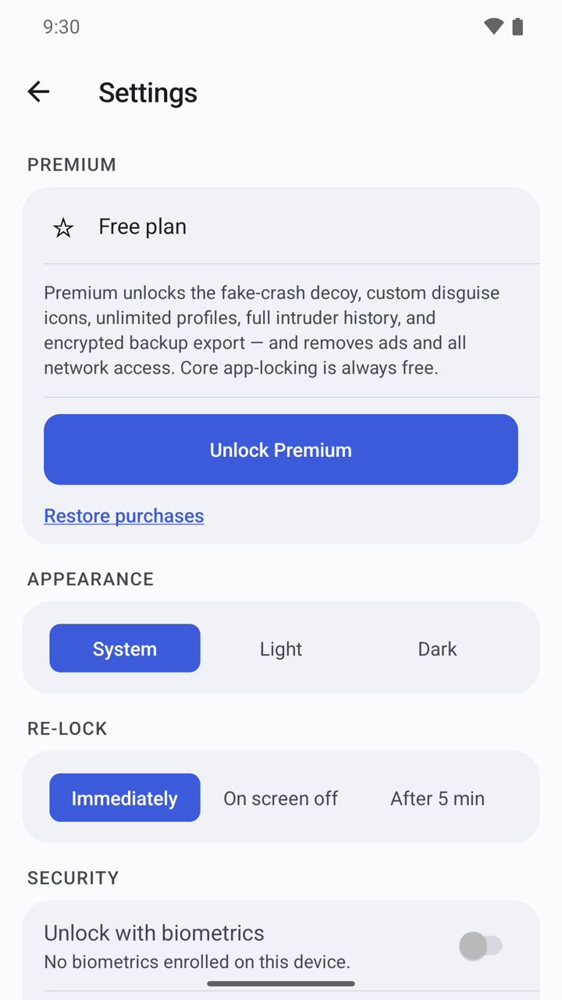

## Cosa fa

AppLock mette una schermata di blocco davanti alle app che scegli. Quando qualcuno apre un'app bloccata, deve inserire il tuo PIN, la tua sequenza o la tua password, oppure usare la tua impronta, prima di poterla vedere. Nell'app il nome è scritto "App Lock".

- Nessun account. Il PIN, l'elenco delle app bloccate, il registro di sicurezza e le foto degli intrusi restano sul tuo telefono e non vengono mai caricati.
- Può scattare una foto a chi continua a inserire il codice sbagliato.
- Un codice di recupero ti fa rientrare se dimentichi il PIN.
- Gratis con pubblicità. Bloccare le app è sempre gratis. Un acquisto Premium una tantum toglie la pubblicità e aggiunge funzioni extra.

## Per iniziare

1. Apri AppLock e tocca **Get started**.
2. In **How do you want to unlock?**, scegli **PIN**, **Pattern** o **Password**.
3. Inseriscilo, poi inseriscilo di nuovo per confermare. Il PIN ha 6 cifre. La sequenza collega almeno 4 punti. La password ha almeno 4 caratteri. Per la sequenza o la password, tocca **Continue** dopo ogni inserimento.
4. In **Save your recovery code**, scrivi il codice di 8 cifre e conservalo in un posto sicuro. Lo vedi una sola volta ed è l'unico modo per rientrare se dimentichi il PIN, la sequenza o la password.
5. Seleziona **I’ve saved this code somewhere safe** e tocca **Continue**.

Ora sei nella schermata iniziale. Mostra **Protection off** finché non consenti i permessi e blocchi la prima app.

## Consenti i permessi

AppLock può bloccare un'app solo se Android gli permette di accorgersi che l'app è stata aperta e di disegnare la schermata di blocco sopra di essa. Servono due permessi: **Accessibility** e **Display over other apps**. Gli altri permessi sono facoltativi.

1. Nella schermata iniziale, tocca **Finish setup** o **Permissions**.
2. Tocca **Accessibility**. AppLock mostra prima una pagina chiamata **What Accessibility access does**. Leggila.
3. Tocca **I understand — open settings**. Se non sei d'accordo, tocca **Not now**: non cambia nulla e non si apre nessuna impostazione.
4. Nella schermata delle impostazioni di Android che si apre, attiva il servizio per AppLock, poi torna in AppLock.
5. Tocca **Display over other apps** e consentilo nella schermata delle impostazioni di Android.
6. Tocca qualsiasi altra riga che vuoi consentire. Quando è fatto, la riga mostra **Granted**.

**Perché AppLock chiede Accessibility.** AppLock usa il servizio di accessibilità di Android per un solo scopo: accorgersi di quale app è appena passata in primo piano, così da mostrare la schermata di blocco sulle app che hai scelto di proteggere.

- Cosa fa: controlla il nome dell'app appena aperta, e nient'altro. Quando un'app bloccata viene sbloccata o viene inserito un codice sbagliato, il nome di quell'app è salvato nel **Security log** sul tuo telefono, così puoi consultarlo.
- Cosa non fa mai: non legge mai il contenuto dello schermo, i tasti premuti, le password, i messaggi o altri dati sullo schermo, né in AppLock né in altre app. Nulla viene inviato fuori dal tuo dispositivo.
- Puoi disattivarlo in qualsiasi momento nelle Impostazioni di Android. In quel caso AppLock non potrà più mostrare la schermata di blocco.

**A cosa servono gli altri permessi.**

- **Display over other apps**: permette alla schermata di blocco di comparire sopra un'app bloccata.
- **Usage access**: aiuta a verificare che la protezione funzioni in modo affidabile.
- **Notifications**: ti avvisa delle richieste di blocco e dei tentativi di accesso non autorizzato.
- **Camera** (facoltativo): scatta una foto a chi non riesce a sbloccare.
- **Notification access**: nasconde il contenuto delle notifiche delle app bloccate.
- **Ignore battery optimization**: mantiene attiva la protezione in background.

Ogni permesso è usato solo sul tuo telefono.

## Scegli le app da bloccare

1. Nella schermata iniziale, tocca **Lock apps**.
2. Trova l'app. Scrivi il suo nome in **Search apps**, oppure passa da una scheda all'altra: **User**, **System** e **Recent**. **Recent** mostra prima le app installate più di recente.
3. Attiva l'interruttore accanto a ogni app che vuoi bloccare.
4. Torna indietro. La schermata iniziale mostra **Protected** e il numero di app bloccate.

Per sbloccare un'app definitivamente, apri di nuovo **Lock apps** e disattiva il suo interruttore.

## Apri un'app bloccata

1. Apri un'app che hai bloccato. La schermata di blocco la copre subito.
2. Inserisci il tuo PIN, la tua sequenza o la tua password. Se hai attivato **Unlock with biometrics**, puoi usare invece la tua impronta.
3. Dopo un inserimento sbagliato puoi riprovare. Dopo troppi errori devi aspettare un po'.

Anche AppLock è bloccato allo stesso modo, quindi nessun altro può cambiare le tue impostazioni.

## Cambia il funzionamento del blocco

1. Nella schermata iniziale, tocca **Settings**.
2. In **Appearance**, scegli **System**, **Light** o **Dark**.
3. In **Re-lock**, scegli quando un'app che hai sbloccato viene bloccata di nuovo: **Immediately** appena la lasci, **On screen off** o **After 5 min**.
4. In **Security**, attiva **Unlock with biometrics**. Prima confermi il tuo PIN, la tua sequenza o la tua password. Serve un'impronta o un volto già configurati sul telefono.
5. In **Protection**, attiva **Scramble the PIN pad** per mescolare i tasti numerici, così nessuno può indovinare il tuo PIN da dove tocchi.
6. Attiva **Hide notification content for locked apps** per mantenere private le notifiche delle app bloccate. Serve **Notification access** in **Permissions**.
7. In **Disguise**, attiva **Hide from Recents** per non far comparire AppLock nell'elenco delle app recenti.

## Scopri chi ha provato a entrare

1. Apri **Settings** e attiva **Intruder photo after failed attempts**.
2. Apri **Permissions** e consenti **Camera**.
3. D'ora in poi, dopo tre inserimenti sbagliati di fila nella schermata di blocco, la fotocamera frontale scatta una foto.
4. Nella schermata iniziale, tocca **Intruder photos** per vedere le foto, ciascuna con l'app che era stata aperta.
5. Tocca **Security log** per vedere sblocchi, tentativi falliti e modifiche alle impostazioni.

## Rientra se hai dimenticato il PIN

1. Apri AppLock. Nella schermata di sblocco, tocca **Can’t get in?**
2. Inserisci il codice di recupero di 8 cifre che hai salvato e tocca **Continue**.
3. Imposta un nuovo PIN, una nuova sequenza o una nuova password. Poi ricevi un nuovo codice di recupero; quello vecchio smette di funzionare.

Per ottenere un nuovo codice di recupero mentre ricordi ancora il PIN, apri **Settings** e tocca **Replace recovery code**.

## Premium

Premium è un pagamento unico, non un abbonamento. Apri **Settings** e tocca **Unlock Premium**. Bloccare le app resta gratis anche senza. Premium ti dà:

- Nessuna pubblicità.
- **Fake crash screen (long-press to unlock)**: un'app bloccata sembra andata in crash invece di mostrare la schermata di blocco.
- Icone mimetizzate: cambia l'icona e il nome di AppLock nella tua schermata Home in **Calculator**, **Notes** o **Weather**. Con **Calculator** puoi attivare **Open a real calculator instead** e impostare un **Secret code**: digita il codice e premi = per aprire AppLock. Anche il tuo PIN funziona sempre.
- La cronologia completa delle foto degli intrusi. La versione gratuita mostra le ultime 5.
- **Export backup**: una copia cifrata delle tue impostazioni e dell'elenco delle app bloccate, protetta da una password che scegli tu. **Restore backup** è gratis.

Se hai già acquistato Premium, tocca **Restore purchases** in **Settings**.

## Domande

**Perché AppLock ha bisogno del permesso Accessibility?**
Solo per accorgersi di quale app è appena stata aperta, così da mostrare la schermata di blocco sulle app che hai bloccato. Non legge mai cosa c'è sul tuo schermo né cosa scrivi. Vedi "Consenti i permessi" sopra.

**La schermata iniziale dice "Protection off". Cosa non va?**
O **Accessibility** o **Display over other apps** non è consentito, oppure non hai ancora bloccato nessuna app. Tocca **Finish setup** per aprire l'elenco dei permessi, poi controlla **Lock apps**.

**Posso nascondere AppLock del tutto?**
No. Android mantiene sempre un'icona per le app installate. Con Premium puoi invece sostituire l'icona e il nome con una versione mimetizzata.

**Ho dimenticato il PIN e perso il codice di recupero. Potete reimpostarlo?**
No. AppLock funziona offline e senza account, quindi non esiste un ripristino via email. Il codice di recupero è l'unico modo per rientrare. Conservalo in un posto sicuro.

**Un backup contiene il mio PIN o le foto degli intrusi?**
No. Dopo aver ripristinato un backup, l'app ti chiede prima di impostare un nuovo PIN, una nuova sequenza o una nuova password.

## Privacy

Il tuo PIN, le app bloccate, il registro di sicurezza e le foto degli intrusi restano sul tuo dispositivo e non vengono mai caricati. La versione gratuita mostra annunci di Google AdMob. Leggi l'[informativa sulla privacy](https://varian1.github.io/privacy.html) completa.
