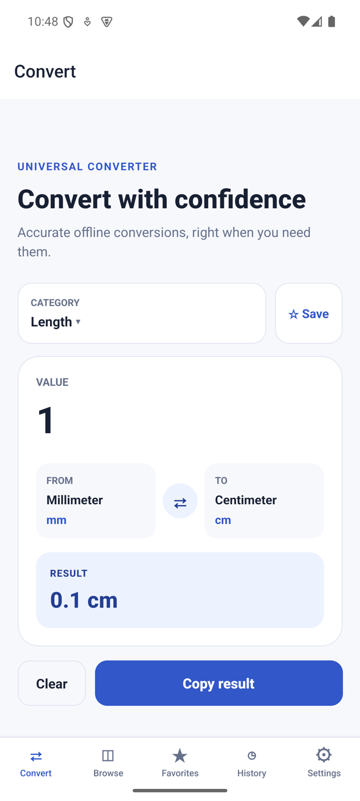
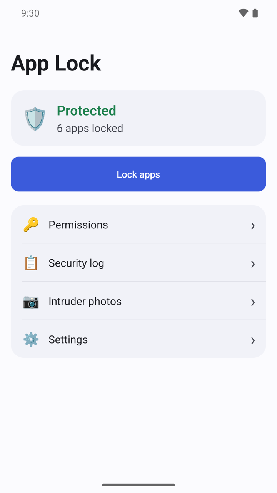
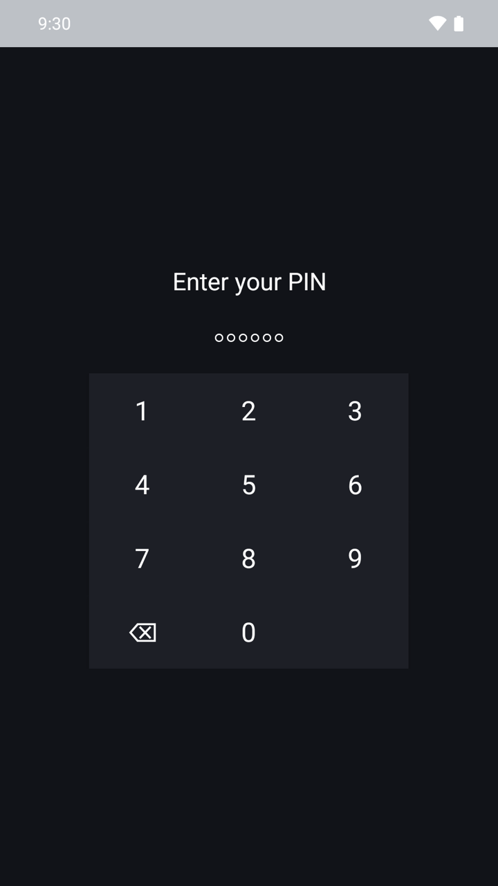
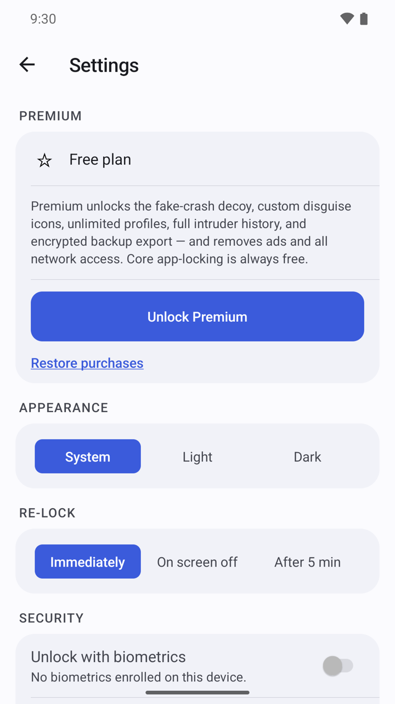

## What it does

AppLock puts a lock screen in front of the apps you choose. When someone opens a locked app, they must enter your PIN, pattern or password, or use your fingerprint, before they can see it. Inside the app the name is written "App Lock".

- No account. Your PIN, your list of locked apps, the security log and intruder photos stay on your phone and are never uploaded.
- It can take a photo of someone who keeps entering the wrong code.
- A recovery code gets you back in if you forget your PIN.
- Free with ads. Locking apps is always free. A one-time Premium purchase removes ads and adds extras.

## Get started

1. Open AppLock and tap **Get started**.
2. Under **How do you want to unlock?**, choose **PIN**, **Pattern** or **Password**.
3. Enter it, then enter it again to confirm. A PIN has 6 digits. A pattern connects at least 4 dots. A password has at least 4 characters. For a pattern or password, tap **Continue** after each entry.
4. On **Save your recovery code**, write down the 8-digit code and keep it somewhere safe. You only see it once, and it is the only way back in if you forget your PIN, pattern or password.
5. Tick **I’ve saved this code somewhere safe** and tap **Continue**.

You are now on the home screen. It shows **Protection off** until you allow the permissions and lock your first app.

## Allow the permissions

AppLock can only lock an app if Android lets it notice that the app was opened and lets it draw the lock screen on top. That takes two permissions: **Accessibility** and **Display over other apps**. The other permissions are optional.

1. On the home screen, tap **Finish setup** or **Permissions**.
2. Tap **Accessibility**. AppLock first shows a page called **What Accessibility access does**. Read it.
3. Tap **I understand — open settings**. If you do not agree, tap **Not now**: nothing is changed and no settings are opened.
4. In the Android settings screen that opens, turn the service on for AppLock, then go back to AppLock.
5. Tap **Display over other apps** and allow it in the Android settings screen.
6. Tap any other row you want to allow. A row shows **Granted** when it is done.

**Why AppLock asks for Accessibility.** AppLock uses Android's Accessibility service for one purpose only: noticing which app just came to the front, so it can show the lock screen over the apps you chose to protect.

- What it does: it watches for the name of the app that just opened, and nothing else. When a locked app is unlocked or a wrong code is entered, that app's name is saved in the **Security log** on your phone so you can review it.
- What it never does: it never reads screen content, keystrokes, passwords, messages or any other on-screen data, in AppLock or in any other app. Nothing is sent off your device.
- You can turn it off at any time in Android Settings. AppLock then simply cannot show the lock screen any more.

**What the other permissions are for.**

- **Display over other apps**: lets the lock screen appear on top of a locked app.
- **Usage access**: helps confirm that protection is working reliably.
- **Notifications**: alerts you to lock prompts and break-in attempts.
- **Camera** (optional): takes a photo of whoever fails to unlock.
- **Notification access**: hides notification content for locked apps.
- **Ignore battery optimization**: keeps protection running in the background.

Every permission is used on your phone only.

## Choose the apps to lock

1. On the home screen, tap **Lock apps**.
2. Find the app. Type its name in **Search apps**, or switch between the **User**, **System** and **Recent** tabs. **Recent** shows the newest installs first.
3. Turn on the switch next to each app you want to lock.
4. Go back. The home screen shows **Protected** and the number of locked apps.

To unlock an app for good, open **Lock apps** again and turn its switch off.

## Open a locked app

1. Open an app you have locked. The lock screen covers it straight away.
2. Enter your PIN, pattern or password. If you turned on **Unlock with biometrics**, you can use your fingerprint instead.
3. After a wrong entry you can try again. After too many wrong entries you have to wait a moment.

AppLock itself is locked in the same way, so nobody else can change your settings.

## Change how locking works

1. On the home screen, tap **Settings**.
2. Under **Appearance**, choose **System**, **Light** or **Dark**.
3. Under **Re-lock**, choose when an app you unlocked is locked again: **Immediately** when you leave it, **On screen off**, or **After 5 min**.
4. Under **Security**, turn on **Unlock with biometrics**. You confirm your PIN, pattern or password first. This needs a fingerprint or face already set up on your phone.
5. Under **Protection**, turn on **Scramble the PIN pad** to mix up the number keys, so nobody can guess your PIN from where you tap.
6. Turn on **Hide notification content for locked apps** to keep messages from locked apps private. This needs **Notification access** in **Permissions**.
7. Under **Disguise**, turn on **Hide from Recents** to keep AppLock out of the recent apps list.

## See who tried to get in

1. Open **Settings** and turn on **Intruder photo after failed attempts**.
2. Open **Permissions** and allow **Camera**.
3. From now on, after three wrong entries in a row on the lock screen, the front camera takes a photo.
4. On the home screen, tap **Intruder photos** to see the photos, each with the app that was opened.
5. Tap **Security log** to see unlocks, failed attempts and settings changes.

## Get back in if you forgot your PIN

1. Open AppLock. On the unlock screen, tap **Can’t get in?**
2. Enter the 8-digit recovery code you saved and tap **Continue**.
3. Set a new PIN, pattern or password. You then get a new recovery code; the old one stops working.

To get a new recovery code while you still know your PIN, open **Settings** and tap **Replace recovery code**.

## Premium

Premium is one payment, not a subscription. Open **Settings** and tap **Unlock Premium**. Locking apps stays free without it. Premium gives you:

- No ads.
- **Fake crash screen (long-press to unlock)**: a locked app looks as if it has crashed instead of showing the lock screen.
- Disguise icons: change AppLock's icon and name on your home screen to **Calculator**, **Notes** or **Weather**. With **Calculator** you can turn on **Open a real calculator instead** and set a **Secret code**: type the code and press = to open AppLock. Your PIN always works too.
- The full history of intruder photos. The free version shows the newest 5.
- **Export backup**: an encrypted copy of your settings and lock list, protected by a password you choose. **Restore backup** is free.

If you bought Premium before, tap **Restore purchases** in **Settings**.

## Questions

**Why does AppLock need the Accessibility permission?**
Only to notice which app was just opened, so it can show the lock screen over the apps you locked. It never reads what is on your screen or what you type. See "Allow the permissions" above.

**The home screen says "Protection off". What is wrong?**
Either **Accessibility** or **Display over other apps** is not allowed, or no app is locked yet. Tap **Finish setup** to open the permissions list, then check **Lock apps**.

**Can I hide AppLock completely?**
No. Android always keeps an icon for an installed app. With Premium you can swap the icon and name for a disguise instead.

**I forgot my PIN and lost the recovery code. Can you reset it?**
No. AppLock works offline with no account, so there is no email reset. The recovery code is the only way back in. Keep it somewhere safe.

**Does a backup contain my PIN or the intruder photos?**
No. After you restore a backup, the app asks you to set a new PIN, pattern or password first.

## Privacy

Your PIN, your locked apps, the security log and intruder photos stay on your device and are never uploaded. The free version shows ads from Google AdMob. Read the full [privacy policy](https://varian1.github.io/privacy.html).
