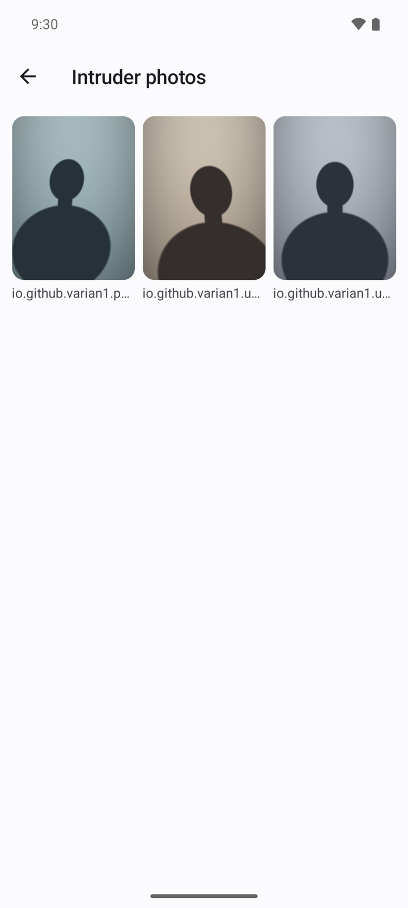

## AppLock ทำอะไรได้บ้าง

AppLock สร้างหน้าจอล็อกคั่นหน้าแอปที่คุณเลือก เมื่อมีคนเปิดแอปที่ล็อกไว้ ต้องใส่ PIN, รูปแบบ หรือรหัสผ่านของคุณ หรือใช้ลายนิ้วมือก่อนจึงจะเห็นแอปนั้น ภายในแอป ชื่อจะเขียนว่า "App Lock"

- ไม่ต้องสมัครบัญชี PIN รายชื่อแอปที่ล็อก บันทึกความปลอดภัย และภาพผู้บุกรุกอยู่ในโทรศัพท์ของคุณเท่านั้น และไม่ถูกอัปโหลด
- ถ่ายภาพคนที่ใส่รหัสผิดซ้ำๆ ได้
- มีรหัสกู้คืนไว้ช่วยให้กลับเข้าแอปได้ถ้าลืม PIN
- ใช้ฟรีโดยมีโฆษณา การล็อกแอปฟรีเสมอ ซื้อ Premium ครั้งเดียวเพื่อเอาโฆษณาออกและได้ฟีเจอร์เพิ่ม

## เริ่มต้นใช้งาน

1. เปิด AppLock แล้วแตะ **Get started**
2. ใต้ **How do you want to unlock?** เลือก **PIN**, **Pattern** หรือ **Password**
3. ใส่รหัส แล้วใส่อีกครั้งเพื่อยืนยัน PIN มี 6 หลัก รูปแบบต้องลากเชื่อมอย่างน้อย 4 จุด รหัสผ่านต้องมีอย่างน้อย 4 ตัวอักษร ถ้าใช้รูปแบบหรือรหัสผ่าน ให้แตะ **Continue** หลังใส่แต่ละครั้ง
4. ที่หน้า **Save your recovery code** จดรหัส 8 หลักไว้และเก็บในที่ปลอดภัย คุณจะเห็นรหัสนี้ครั้งเดียวเท่านั้น และเป็นทางเดียวที่จะกลับเข้าแอปได้หากลืม PIN รูปแบบ หรือรหัสผ่าน
5. ติ๊ก **I’ve saved this code somewhere safe** แล้วแตะ **Continue**

ตอนนี้คุณอยู่ที่หน้าหลัก หน้าหลักจะแสดง **Protection off** จนกว่าคุณจะอนุญาตสิทธิ์และล็อกแอปแรก

## อนุญาตสิทธิ์การใช้งาน

AppLock จะล็อกแอปได้ก็ต่อเมื่อ Android ยอมให้รับรู้ว่ามีการเปิดแอป และยอมให้แสดงหน้าจอล็อกทับแอปนั้น ซึ่งต้องใช้สองสิทธิ์ คือ **Accessibility** และ **Display over other apps** ส่วนสิทธิ์อื่นเป็นตัวเลือก

1. ที่หน้าหลัก แตะ **Finish setup** หรือ **Permissions**
2. แตะ **Accessibility** AppLock จะแสดงหน้า **What Accessibility access does** ก่อน โปรดอ่านให้ละเอียด
3. แตะ **I understand — open settings** ถ้าไม่เห็นด้วย แตะ **Not now** จะไม่มีอะไรเปลี่ยนและไม่เปิดการตั้งค่าใดๆ
4. ในหน้าการตั้งค่า Android ที่เปิดขึ้น ให้เปิดบริการของ AppLock แล้วกลับมาที่ AppLock
5. แตะ **Display over other apps** แล้วอนุญาตในหน้าการตั้งค่า Android
6. แตะแถวอื่นที่คุณต้องการอนุญาต แถวที่เสร็จแล้วจะแสดง **Granted**

**ทำไม AppLock จึงขอสิทธิ์ Accessibility** AppLock ใช้บริการ Accessibility ของ Android เพื่อวัตถุประสงค์เดียว คือรับรู้ว่าแอปใดเพิ่งเปิดขึ้นมา เพื่อแสดงหน้าจอล็อกทับแอปที่คุณเลือกปกป้อง

- สิ่งที่ทำ: ดูเฉพาะชื่อของแอปที่เพิ่งเปิด และไม่ดูอย่างอื่น เมื่อมีการปลดล็อกแอปที่ล็อกไว้ หรือมีการใส่รหัสผิด ชื่อแอปนั้นจะถูกบันทึกใน **Security log** บนโทรศัพท์ของคุณ เพื่อให้คุณตรวจดูได้
- สิ่งที่ไม่ทำเลย: ไม่อ่านเนื้อหาบนหน้าจอ การกดแป้นพิมพ์ รหัสผ่าน ข้อความ หรือข้อมูลอื่นบนหน้าจอ ไม่ว่าใน AppLock หรือในแอปอื่น และไม่มีอะไรถูกส่งออกจากอุปกรณ์ของคุณ
- คุณปิดได้ทุกเมื่อในการตั้งค่า Android แต่ AppLock จะไม่สามารถแสดงหน้าจอล็อกได้อีก

**สิทธิ์อื่นใช้ทำอะไร**

- **Display over other apps**: ให้หน้าจอล็อกแสดงทับแอปที่ล็อกไว้
- **Usage access**: ช่วยยืนยันว่าการป้องกันทำงานได้อย่างเสถียร
- **Notifications**: แจ้งเตือนเมื่อมีการขอปลดล็อกและความพยายามบุกรุก
- **Camera** (ไม่บังคับ): ถ่ายภาพคนที่ปลดล็อกไม่สำเร็จ
- **Notification access**: ซ่อนเนื้อหาการแจ้งเตือนของแอปที่ล็อกไว้
- **Ignore battery optimization**: ให้การป้องกันทำงานต่อเนื่องเบื้องหลัง

ทุกสิทธิ์ใช้งานบนโทรศัพท์ของคุณเท่านั้น

## เลือกแอปที่จะล็อก

1. ที่หน้าหลัก แตะ **Lock apps**
2. หาแอปที่ต้องการ พิมพ์ชื่อใน **Search apps** หรือสลับระหว่างแท็บ **User**, **System** และ **Recent** แท็บ **Recent** แสดงแอปที่ติดตั้งล่าสุดก่อน
3. เปิดสวิตช์ข้างแอปที่คุณต้องการล็อก
4. กดย้อนกลับ หน้าหลักจะแสดง **Protected** และจำนวนแอปที่ล็อกไว้

หากต้องการเลิกล็อกแอปถาวร ให้เปิด **Lock apps** อีกครั้งแล้วปิดสวิตช์ของแอปนั้น

## เปิดแอปที่ล็อกไว้

1. เปิดแอปที่คุณล็อกไว้ หน้าจอล็อกจะปรากฏทับทันที
2. ใส่ PIN รูปแบบ หรือรหัสผ่านของคุณ ถ้าเปิด **Unlock with biometrics** ไว้ ก็ใช้ลายนิ้วมือแทนได้
3. หากใส่ผิด คุณลองใหม่ได้ ถ้าใส่ผิดหลายครั้งเกินไป ต้องรอสักครู่

AppLock เองก็ถูกล็อกในแบบเดียวกัน คนอื่นจึงเปลี่ยนการตั้งค่าของคุณไม่ได้

## เปลี่ยนวิธีการล็อก

1. ที่หน้าหลัก แตะ **Settings**
2. ใต้ **Appearance** เลือก **System**, **Light** หรือ **Dark**
3. ใต้ **Re-lock** เลือกว่าจะให้แอปที่ปลดล็อกแล้วกลับมาล็อกเมื่อใด: **Immediately** เมื่อออกจากแอป, **On screen off** หรือ **After 5 min**
4. ใต้ **Security** เปิด **Unlock with biometrics** คุณต้องยืนยัน PIN รูปแบบ หรือรหัสผ่านก่อน และต้องตั้งค่าลายนิ้วมือหรือใบหน้าไว้ในโทรศัพท์แล้ว
5. ใต้ **Protection** เปิด **Scramble the PIN pad** เพื่อสลับตำแหน่งปุ่มตัวเลข จะได้ไม่มีใครเดา PIN จากตำแหน่งที่คุณแตะ
6. เปิด **Hide notification content for locked apps** เพื่อให้ข้อความจากแอปที่ล็อกไว้เป็นส่วนตัว ต้องมีสิทธิ์ **Notification access** ใน **Permissions**
7. ใต้ **Disguise** เปิด **Hide from Recents** เพื่อไม่ให้ AppLock แสดงในรายการแอปล่าสุด

## ดูว่าใครพยายามเข้าแอป

1. เปิด **Settings** แล้วเปิด **Intruder photo after failed attempts**
2. เปิด **Permissions** แล้วอนุญาต **Camera**
3. จากนี้ไป เมื่อใส่รหัสผิดติดกันสามครั้งที่หน้าจอล็อก กล้องหน้าจะถ่ายภาพไว้
4. ที่หน้าหลัก แตะ **Intruder photos** เพื่อดูภาพ แต่ละภาพจะแสดงแอปที่ถูกเปิด
5. แตะ **Security log** เพื่อดูการปลดล็อก ความพยายามที่ล้มเหลว และการเปลี่ยนการตั้งค่า

## กลับเข้าแอปเมื่อลืม PIN

1. เปิด AppLock ที่หน้าปลดล็อก แตะ **Can’t get in?**
2. ใส่รหัสกู้คืน 8 หลักที่คุณบันทึกไว้ แล้วแตะ **Continue**
3. ตั้ง PIN รูปแบบ หรือรหัสผ่านใหม่ จากนั้นคุณจะได้รหัสกู้คืนใหม่ รหัสเก่าจะใช้ไม่ได้อีก

หากต้องการรหัสกู้คืนใหม่ขณะที่ยังจำ PIN ได้ ให้เปิด **Settings** แล้วแตะ **Replace recovery code**

## Premium

Premium จ่ายครั้งเดียว ไม่ใช่แบบสมัครสมาชิก เปิด **Settings** แล้วแตะ **Unlock Premium** การล็อกแอปยังฟรีโดยไม่ต้องซื้อ Premium ให้คุณได้ดังนี้

- ไม่มีโฆษณา
- **Fake crash screen (long-press to unlock)**: แอปที่ล็อกไว้จะดูเหมือนค้างหรือแครช แทนการแสดงหน้าจอล็อก
- ไอคอนพรางตัว: เปลี่ยนไอคอนและชื่อ AppLock บนหน้าจอโฮมเป็น **Calculator**, **Notes** หรือ **Weather** ถ้าเลือก **Calculator** คุณเปิด **Open a real calculator instead** และตั้ง **Secret code** ได้ แค่พิมพ์รหัสแล้วกด = ก็เปิด AppLock ได้ ส่วน PIN ของคุณก็ใช้ได้เสมอ
- ประวัติภาพผู้บุกรุกทั้งหมด เวอร์ชันฟรีแสดง 5 ภาพล่าสุด
- **Export backup**: สำเนาที่เข้ารหัสของการตั้งค่าและรายการแอปที่ล็อก ป้องกันด้วยรหัสผ่านที่คุณตั้งเอง ส่วน **Restore backup** ใช้ฟรี

หากเคยซื้อ Premium แล้ว แตะ **Restore purchases** ใน **Settings**

## คำถามที่พบบ่อย

**ทำไม AppLock ต้องขอสิทธิ์ Accessibility**
เพื่อรับรู้ว่าแอปใดเพิ่งถูกเปิดเท่านั้น จะได้แสดงหน้าจอล็อกทับแอปที่คุณล็อกไว้ AppLock ไม่อ่านสิ่งที่อยู่บนหน้าจอหรือสิ่งที่คุณพิมพ์เลย ดูหัวข้อ "อนุญาตสิทธิ์การใช้งาน" ด้านบน

**หน้าหลักขึ้น "Protection off" เกิดอะไรขึ้น**
อาจเป็นเพราะยังไม่ได้อนุญาต **Accessibility** หรือ **Display over other apps** หรือยังไม่ได้ล็อกแอปใดเลย แตะ **Finish setup** เพื่อเปิดรายการสิทธิ์ แล้วตรวจสอบที่ **Lock apps**

**ซ่อน AppLock ให้หายไปเลยได้ไหม**
ไม่ได้ Android จะเก็บไอคอนของแอปที่ติดตั้งไว้เสมอ ถ้าใช้ Premium คุณเปลี่ยนไอคอนและชื่อเป็นแบบพรางตัวแทนได้

**ลืม PIN และรหัสกู้คืนหายด้วย รีเซ็ตให้ได้ไหม**
ไม่ได้ AppLock ทำงานแบบออฟไลน์และไม่มีบัญชี จึงไม่มีการรีเซ็ตทางอีเมล รหัสกู้คืนเป็นทางเดียวที่จะกลับเข้าได้ โปรดเก็บไว้ในที่ปลอดภัย

**ข้อมูลสำรองมี PIN หรือภาพผู้บุกรุกอยู่ด้วยไหม**
ไม่มี หลังกู้คืนข้อมูลสำรอง แอปจะให้คุณตั้ง PIN รูปแบบ หรือรหัสผ่านใหม่ก่อน

## ความเป็นส่วนตัว

PIN แอปที่ล็อก บันทึกความปลอดภัย และภาพผู้บุกรุกของคุณอยู่ในอุปกรณ์ของคุณเท่านั้น และไม่ถูกอัปโหลด เวอร์ชันฟรีแสดงโฆษณาจาก Google AdMob อ่าน[นโยบายความเป็นส่วนตัว](https://varian1.github.io/privacy.html)ฉบับเต็ม
