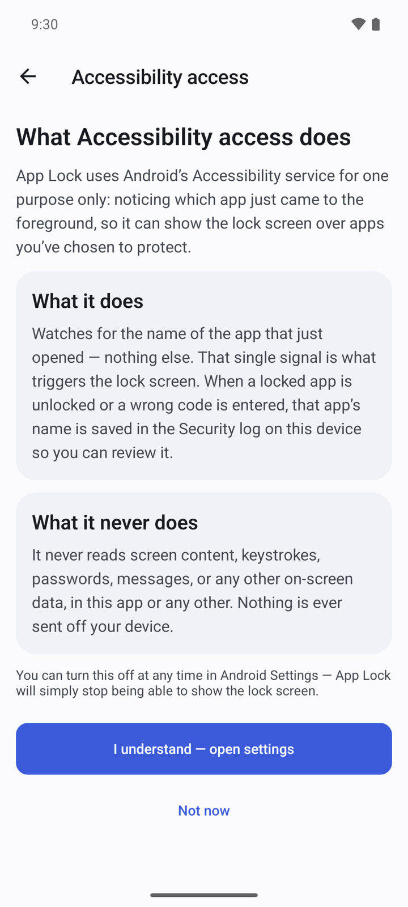
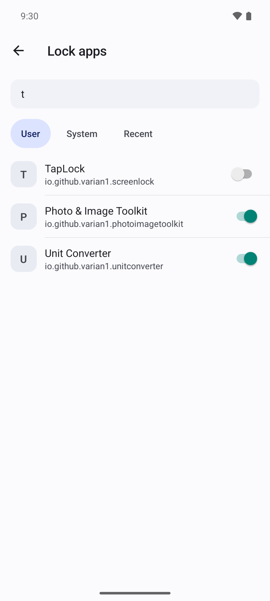

## Ano ang ginagawa nito

Naglalagay ang AppLock ng lock screen sa harap ng mga app na pipiliin mo. Kapag may nagbukas ng naka-lock na app, kailangan muna niyang ilagay ang iyong PIN, pattern o password, o gamitin ang iyong fingerprint, bago niya ito makita. Sa loob ng app, nakasulat ang pangalan bilang "App Lock".

- Walang account. Ang iyong PIN, listahan ng mga naka-lock na app, security log at mga litrato ng nanghimasok ay nasa phone mo lang at hindi ina-upload.
- Kaya nitong kumuha ng litrato ng taong paulit-ulit na mali ang inilalagay na code.
- May recovery code na magbabalik sa iyo sa app kung nakalimutan mo ang PIN.
- Libre na may ads. Laging libre ang pag-lock ng app. Ang minsanang bayad sa Premium ay nag-aalis ng ads at nagdaragdag ng mga extra.

## Pagsisimula

1. Buksan ang AppLock at i-tap ang **Get started**.
2. Sa ilalim ng **How do you want to unlock?**, piliin ang **PIN**, **Pattern** o **Password**.
3. Ilagay ito, tapos ilagay ulit para makumpirma. Ang PIN ay may 6 na digit. Ang pattern ay dapat nagkokonekta ng hindi bababa sa 4 na tuldok. Ang password ay dapat may hindi bababa sa 4 na character. Para sa pattern o password, i-tap ang **Continue** pagkatapos ng bawat paglalagay.
4. Sa **Save your recovery code**, isulat ang 8-digit na code at itago ito sa ligtas na lugar. Isang beses mo lang ito makikita, at ito lang ang paraan para makapasok ka muli kung nakalimutan mo ang iyong PIN, pattern o password.
5. Lagyan ng tsek ang **I’ve saved this code somewhere safe** at i-tap ang **Continue**.

Nasa home screen ka na. Makikita roon ang **Protection off** hanggang hindi mo napapayagan ang mga permission at hindi mo pa na-lo-lock ang una mong app.

## Payagan ang mga permission

Makakapag-lock lang ang AppLock ng app kung pinapayagan ito ng Android na malaman kapag may nagbukas ng app at na maipakita ang lock screen sa ibabaw nito. Kailangan nito ng dalawang permission: **Accessibility** at **Display over other apps**. Opsyonal ang iba pang permission.

1. Sa home screen, i-tap ang **Finish setup** o **Permissions**.
2. I-tap ang **Accessibility**. Unang magpapakita ang AppLock ng pahinang tinatawag na **What Accessibility access does**. Basahin ito.
3. I-tap ang **I understand — open settings**. Kung hindi ka sumasang-ayon, i-tap ang **Not now**: walang mababago at walang bubuksang settings.
4. Sa Android settings screen na magbubukas, i-on ang service para sa AppLock, tapos bumalik sa AppLock.
5. I-tap ang **Display over other apps** at payagan ito sa Android settings screen.
6. I-tap ang iba pang row na gusto mong payagan. Lalabas ang **Granted** sa row kapag tapos na.

**Bakit humihingi ang AppLock ng Accessibility.** Ginagamit ng AppLock ang Accessibility service ng Android para sa isang layunin lang: malaman kung aling app ang kakabukas lang, para maipakita ang lock screen sa ibabaw ng mga app na pinili mong protektahan.

- Ang ginagawa nito: binabantayan nito ang pangalan ng app na kakabukas lang, at wala nang iba. Kapag na-unlock ang isang naka-lock na app o may maling code na inilagay, ang pangalan ng app na iyon ay ise-save sa **Security log** sa phone mo para mabasa mo ito.
- Ang hindi nito ginagawa kailanman: hindi nito binabasa ang laman ng screen, mga tinype, password, mensahe o anumang ibang data sa screen, sa AppLock man o sa ibang app. Walang ipinapadala palabas ng device mo.
- Maaari mo itong patayin anumang oras sa Android Settings. Hindi na maipapakita ng AppLock ang lock screen kapag ginawa mo iyon.

**Para saan ang iba pang permission.**

- **Display over other apps**: para lumabas ang lock screen sa ibabaw ng naka-lock na app.
- **Usage access**: tumutulong na matiyak na maayos ang takbo ng proteksyon.
- **Notifications**: nagbabala sa iyo tungkol sa mga lock prompt at pagtatangkang pumasok.
- **Camera** (opsyonal): kumukuha ng litrato ng sinumang pumalya sa pag-unlock.
- **Notification access**: itinatago ang laman ng notification ng mga naka-lock na app.
- **Ignore battery optimization**: pinapanatiling tumatakbo ang proteksyon sa background.

Sa phone mo lang ginagamit ang bawat permission.

## Piliin ang mga app na ila-lock

1. Sa home screen, i-tap ang **Lock apps**.
2. Hanapin ang app. I-type ang pangalan nito sa **Search apps**, o lumipat sa pagitan ng mga tab na **User**, **System** at **Recent**. Ipinapakita ng **Recent** muna ang pinakabagong na-install.
3. I-on ang switch sa tabi ng bawat app na gusto mong i-lock.
4. Bumalik. Ipapakita ng home screen ang **Protected** at ang bilang ng mga naka-lock na app.

Para tuluyang i-unlock ang isang app, buksan muli ang **Lock apps** at i-off ang switch nito.

## Magbukas ng naka-lock na app

1. Buksan ang app na na-lock mo. Agad itong tatakpan ng lock screen.
2. Ilagay ang iyong PIN, pattern o password. Kung in-on mo ang **Unlock with biometrics**, maaari mong gamitin ang fingerprint mo.
3. Kapag mali ang nailagay, maaari kang sumubok ulit. Kapag sobrang dami ng maling subok, kailangan mong maghintay sandali.

Naka-lock din sa ganitong paraan ang AppLock mismo, kaya walang ibang makakapagbago ng iyong settings.

## Baguhin kung paano gumagana ang lock

1. Sa home screen, i-tap ang **Settings**.
2. Sa ilalim ng **Appearance**, piliin ang **System**, **Light** o **Dark**.
3. Sa ilalim ng **Re-lock**, piliin kung kailan muling ila-lock ang app na na-unlock mo: **Immediately** pag-alis mo rito, **On screen off**, o **After 5 min**.
4. Sa ilalim ng **Security**, i-on ang **Unlock with biometrics**. Kukumpirmahin mo muna ang iyong PIN, pattern o password. Kailangan nito ng fingerprint o mukha na naka-set up na sa phone mo.
5. Sa ilalim ng **Protection**, i-on ang **Scramble the PIN pad** para paghalu-haluin ang mga number key, para walang makahula ng PIN mo base sa kung saan ka nagta-tap.
6. I-on ang **Hide notification content for locked apps** para manatiling pribado ang mga mensahe mula sa mga naka-lock na app. Kailangan nito ng **Notification access** sa **Permissions**.
7. Sa ilalim ng **Disguise**, i-on ang **Hide from Recents** para hindi lumabas ang AppLock sa listahan ng mga kamakailang app.

## Alamin kung sino ang sumubok pumasok

1. Buksan ang **Settings** at i-on ang **Intruder photo after failed attempts**.
2. Buksan ang **Permissions** at payagan ang **Camera**.
3. Mula ngayon, pagkatapos ng tatlong sunod-sunod na maling lagay sa lock screen, kukuha ng litrato ang front camera.
4. Sa home screen, i-tap ang **Intruder photos** para makita ang mga litrato, bawat isa ay may kasamang app na binuksan.
5. I-tap ang **Security log** para makita ang mga unlock, bigong subok at pagbabago sa settings.

## Makapasok muli kapag nakalimutan ang PIN

1. Buksan ang AppLock. Sa unlock screen, i-tap ang **Can’t get in?**
2. Ilagay ang 8-digit na recovery code na sinave mo at i-tap ang **Continue**.
3. Magtakda ng bagong PIN, pattern o password. Makakakuha ka ng bagong recovery code; hindi na gagana ang luma.

Para kumuha ng bagong recovery code habang alam mo pa ang iyong PIN, buksan ang **Settings** at i-tap ang **Replace recovery code**.

## Premium

Isang bayad lang ang Premium, hindi subscription. Buksan ang **Settings** at i-tap ang **Unlock Premium**. Libre pa rin ang pag-lock ng app kahit wala nito. Ito ang makukuha mo sa Premium:

- Walang ads.
- **Fake crash screen (long-press to unlock)**: ang naka-lock na app ay magmumukhang nag-crash sa halip na ipakita ang lock screen.
- Mga disguise icon: palitan ang icon at pangalan ng AppLock sa home screen mo ng **Calculator**, **Notes** o **Weather**. Sa **Calculator**, maaari mong i-on ang **Open a real calculator instead** at magtakda ng **Secret code**: i-type ang code at pindutin ang = para buksan ang AppLock. Gumagana pa rin palagi ang iyong PIN.
- Ang buong history ng mga litrato ng nanghimasok. Ang libreng bersyon ay nagpapakita ng pinakabagong 5.
- **Export backup**: isang naka-encrypt na kopya ng iyong settings at listahan ng lock, na protektado ng password na ikaw ang pipili. Libre ang **Restore backup**.

Kung nakabili ka na ng Premium dati, i-tap ang **Restore purchases** sa **Settings**.

## Mga Tanong

**Bakit kailangan ng AppLock ang Accessibility permission?**
Para lang malaman kung aling app ang kakabukas lang, para maipakita ang lock screen sa ibabaw ng mga app na na-lock mo. Hindi nito binabasa ang laman ng screen mo o ang mga tina-type mo. Tingnan ang "Payagan ang mga permission" sa itaas.

**Sinasabi ng home screen na "Protection off". Ano ang mali?**
Maaaring hindi pinapayagan ang **Accessibility** o ang **Display over other apps**, o wala pang naka-lock na app. I-tap ang **Finish setup** para buksan ang listahan ng permission, tapos tingnan ang **Lock apps**.

**Maaari ko bang itago nang tuluyan ang AppLock?**
Hindi. Laging nag-iiwan ang Android ng icon para sa naka-install na app. Sa Premium, maaari mong palitan ang icon at pangalan ng isang disguise.

**Nakalimutan ko ang PIN ko at nawala ang recovery code. Maaari bang i-reset ninyo ito?**
Hindi. Gumagana ang AppLock offline at walang account, kaya walang email reset. Ang recovery code lang ang paraan para makapasok ka muli. Itago ito sa ligtas na lugar.

**Kasama ba sa backup ang PIN ko o ang mga litrato ng nanghimasok?**
Hindi. Pagkatapos mong i-restore ang backup, hihilingin muna ng app na magtakda ka ng bagong PIN, pattern o password.

## Privacy

Ang iyong PIN, mga naka-lock na app, security log at mga litrato ng nanghimasok ay nasa device mo lang at hindi ina-upload. Ang libreng bersyon ay nagpapakita ng ads mula sa Google AdMob. Basahin ang buong [privacy policy](https://varian1.github.io/privacy.html).
