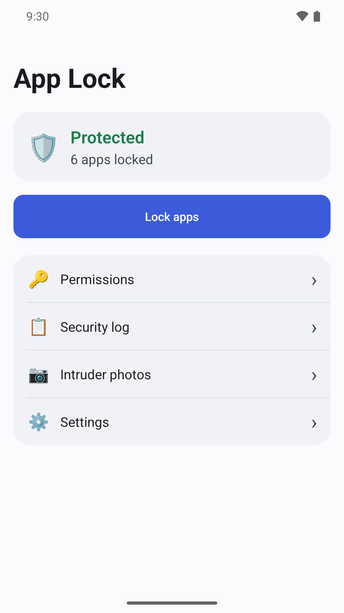

## Ne işe yarar

AppLock, seçtiğin uygulamaların önüne bir kilit ekranı koyar. Biri kilitli bir uygulamayı açtığında, uygulamayı görmeden önce PIN'ini, desenini veya parolanı girmesi ya da parmak izini kullanması gerekir. Uygulamanın içinde adı "App Lock" olarak yazılır.

- Hesap gerekmez. PIN'in, kilitli uygulama listen, güvenlik kaydı ve davetsiz misafir fotoğrafları telefonunda kalır, hiçbir yere yüklenmez.
- Yanlış kodu art arda giren birinin fotoğrafını çekebilir.
- PIN'ini unutursan kurtarma kodu seni içeri alır.
- Reklamlarla ücretsizdir. Uygulama kilitlemek her zaman ücretsizdir. Tek seferlik Premium satın alma reklamları kaldırır ve ek özellikler sunar.

## Başlarken

1. AppLock'u aç ve **Get started** düğmesine dokun.
2. **How do you want to unlock?** bölümünde **PIN**, **Pattern** veya **Password** seçeneklerinden birini seç.
3. Girişini yap, sonra onaylamak için tekrar gir. PIN 6 haneli olur. Desen en az 4 noktayı birleştirir. Parola en az 4 karakterden oluşur. Desen veya parolada her girişten sonra **Continue** düğmesine dokun.
4. **Save your recovery code** ekranında 8 haneli kodu not al ve güvenli bir yerde sakla. Kodu yalnızca bir kez görürsün. PIN'ini, desenini veya parolanı unutursan içeri girmenin tek yolu budur.
5. **I’ve saved this code somewhere safe** kutusunu işaretle ve **Continue** düğmesine dokun.

Şimdi ana ekrandasın. İzinleri verip ilk uygulamanı kilitleyene kadar ekranda **Protection off** yazar.

## İzinleri ver

AppLock bir uygulamayı ancak Android, uygulamanın açıldığını fark etmesine ve kilit ekranını üstüne çizmesine izin verirse kilitleyebilir. Bunun için iki izin gerekir: **Accessibility** ve **Display over other apps**. Diğer izinler isteğe bağlıdır.

1. Ana ekranda **Finish setup** veya **Permissions** düğmesine dokun.
2. **Accessibility** satırına dokun. AppLock önce **What Accessibility access does** adlı bir sayfa gösterir. Sayfayı oku.
3. **I understand — open settings** düğmesine dokun. Kabul etmiyorsan **Not now** düğmesine dokun: hiçbir şey değişmez ve ayarlar açılmaz.
4. Açılan Android ayarları ekranında AppLock hizmetini aç, sonra AppLock'a geri dön.
5. **Display over other apps** satırına dokun ve Android ayarları ekranında izin ver.
6. İzin vermek istediğin diğer satırlara da dokun. İş bitince satırda **Granted** yazar.

**AppLock neden Accessibility ister?** AppLock, Android'in Accessibility hizmetini yalnızca tek bir amaçla kullanır: hangi uygulamanın öne geldiğini fark etmek, böylece korumak istediğin uygulamaların üstünde kilit ekranını gösterebilmek.

- Ne yapar: Yalnızca az önce açılan uygulamanın adını izler, başka hiçbir şeyi izlemez. Kilitli bir uygulamanın kilidi açıldığında veya yanlış kod girildiğinde, uygulamanın adı telefonundaki **Security log** kaydına eklenir. Böylece sonra inceleyebilirsin.
- Ne yapmaz: Ne AppLock'ta ne de başka bir uygulamada ekran içeriğini, tuş vuruşlarını, parolaları, mesajları veya ekrandaki başka verileri asla okumaz. Cihazından hiçbir şey gönderilmez.
- Android Ayarları'ndan istediğin zaman kapatabilirsin. Bu durumda AppLock kilit ekranını gösteremez.

**Diğer izinler ne için?**

- **Display over other apps**: Kilit ekranının kilitli uygulamanın üstünde görünmesini sağlar.
- **Usage access**: Korumanın güvenilir çalıştığını doğrulamaya yardımcı olur.
- **Notifications**: Kilit istemleri ve izinsiz giriş denemeleri hakkında seni uyarır.
- **Camera** (isteğe bağlı): Kilidi açamayan kişinin fotoğrafını çeker.
- **Notification access**: Kilitli uygulamaların bildirim içeriğini gizler.
- **Ignore battery optimization**: Korumanın arka planda çalışmaya devam etmesini sağlar.

Tüm izinler yalnızca telefonunda kullanılır.

## Kilitlenecek uygulamaları seç

1. Ana ekranda **Lock apps** düğmesine dokun.
2. Uygulamayı bul. Adını **Search apps** alanına yaz veya **User**, **System** ve **Recent** sekmeleri arasında geçiş yap. **Recent** en yeni yüklenenleri başta gösterir.
3. Kilitlemek istediğin her uygulamanın yanındaki anahtarı aç.
4. Geri dön. Ana ekranda **Protected** ve kilitli uygulama sayısı görünür.

Bir uygulamanın kilidini kalıcı olarak kaldırmak için **Lock apps** ekranını tekrar aç ve anahtarını kapat.

## Kilitli bir uygulamayı aç

1. Kilitlediğin bir uygulamayı aç. Kilit ekranı hemen üstünü kaplar.
2. PIN'ini, desenini veya parolanı gir. **Unlock with biometrics** seçeneğini açtıysan parmak izini de kullanabilirsin.
3. Yanlış girişten sonra tekrar deneyebilirsin. Çok fazla yanlış girişten sonra biraz beklemen gerekir.

AppLock'un kendisi de aynı şekilde kilitlidir. Böylece başkası ayarlarını değiştiremez.

## Kilitlemenin işleyişini değiştir

1. Ana ekranda **Settings** düğmesine dokun.
2. **Appearance** altında **System**, **Light** veya **Dark** seçeneğini seç.
3. **Re-lock** altında, kilidini açtığın bir uygulamanın ne zaman yeniden kilitleneceğini seç: uygulamadan çıkınca hemen (**Immediately**), ekran kapanınca (**On screen off**) veya 5 dakika sonra (**After 5 min**).
4. **Security** altında **Unlock with biometrics** seçeneğini aç. Önce PIN'ini, desenini veya parolanı onaylarsın. Bunun için telefonunda parmak izi veya yüz tanıma önceden kurulu olmalıdır.
5. **Protection** altında **Scramble the PIN pad** seçeneğini aç. Sayı tuşlarının yeri karışır, böylece dokunduğun yerlerden PIN'ini kimse tahmin edemez.
6. Kilitli uygulamaların mesajlarını gizli tutmak için **Hide notification content for locked apps** seçeneğini aç. Bunun için **Permissions** ekranında **Notification access** izni gerekir.
7. **Disguise** altında **Hide from Recents** seçeneğini aç. AppLock son kullanılan uygulamalar listesinde görünmez.

## Kimin girmeye çalıştığını gör

1. **Settings** ekranını aç ve **Intruder photo after failed attempts** seçeneğini aç.
2. **Permissions** ekranını aç ve **Camera** iznini ver.
3. Bundan sonra kilit ekranında art arda üç yanlış girişten sonra ön kamera bir fotoğraf çeker.
4. Ana ekranda **Intruder photos** düğmesine dokun. Fotoğrafları, açılan uygulamanın adıyla birlikte görürsün.
5. Kilit açmaları, başarısız denemeleri ve ayar değişikliklerini görmek için **Security log** düğmesine dokun.

## PIN'ini unuttuysan içeri gir

1. AppLock'u aç. Kilit ekranında **Can’t get in?** düğmesine dokun.
2. Kaydettiğin 8 haneli kurtarma kodunu gir ve **Continue** düğmesine dokun.
3. Yeni bir PIN, desen veya parola belirle. Ardından yeni bir kurtarma kodu alırsın. Eski kod artık çalışmaz.

PIN'ini hâlâ biliyorsan ve yeni bir kurtarma kodu almak istiyorsan **Settings** ekranını aç ve **Replace recovery code** düğmesine dokun.

## Premium

Premium tek seferlik bir ödemedir, abonelik değildir. **Settings** ekranını aç ve **Unlock Premium** düğmesine dokun. Premium olmadan da uygulama kilitleme ücretsiz kalır. Premium şunları sağlar:

- Reklam yok.
- **Fake crash screen (long-press to unlock)**: Kilitli bir uygulama, kilit ekranı yerine çökmüş gibi görünür.
- Gizleme simgeleri: AppLock'un ana ekrandaki simgesini ve adını **Calculator**, **Notes** veya **Weather** olarak değiştirebilirsin. **Calculator** ile **Open a real calculator instead** seçeneğini açabilir ve bir **Secret code** belirleyebilirsin: kodu yazıp = tuşuna bastığında AppLock açılır. PIN'in de her zaman çalışır.
- Davetsiz misafir fotoğraflarının tam geçmişi. Ücretsiz sürüm en yeni 5 fotoğrafı gösterir.
- **Export backup**: Ayarlarının ve kilit listenin, seçtiğin bir parolayla korunan şifreli bir kopyası. **Restore backup** ücretsizdir.

Daha önce Premium aldıysan **Settings** ekranında **Restore purchases** düğmesine dokun.

## Sorular

**AppLock neden Accessibility iznine ihtiyaç duyar?**
Yalnızca az önce hangi uygulamanın açıldığını fark etmek ve kilitlediğin uygulamaların üstünde kilit ekranını göstermek için. Ekranında ne olduğunu veya ne yazdığını asla okumaz. Yukarıdaki "İzinleri ver" bölümüne bak.

**Ana ekranda "Protection off" yazıyor. Sorun ne?**
Ya **Accessibility** ya da **Display over other apps** izni verilmemiştir ya da henüz hiçbir uygulama kilitlenmemiştir. İzin listesini açmak için **Finish setup** düğmesine dokun, sonra **Lock apps** ekranını kontrol et.

**AppLock'u tamamen gizleyebilir miyim?**
Hayır. Android, yüklü her uygulama için bir simge tutar. Premium ile simgeyi ve adı bir gizleme simgesiyle değiştirebilirsin.

**PIN'imi unuttum ve kurtarma kodunu da kaybettim. Sıfırlayabilir misiniz?**
Hayır. AppLock hesapsız ve çevrimdışı çalışır, bu yüzden e-postayla sıfırlama yoktur. İçeri girmenin tek yolu kurtarma kodudur. Onu güvenli bir yerde sakla.

**Yedek PIN'imi veya davetsiz misafir fotoğraflarını içerir mi?**
Hayır. Bir yedeği geri yükledikten sonra uygulama önce senden yeni bir PIN, desen veya parola belirlemeni ister.

## Gizlilik

PIN'in, kilitli uygulamaların, güvenlik kaydı ve davetsiz misafir fotoğrafları cihazında kalır, hiçbir yere yüklenmez. Ücretsiz sürüm Google AdMob reklamları gösterir. Tüm [gizlilik politikasını](https://varian1.github.io/privacy.html) oku.
