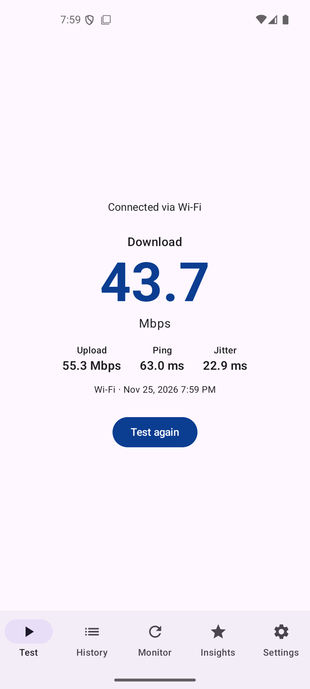
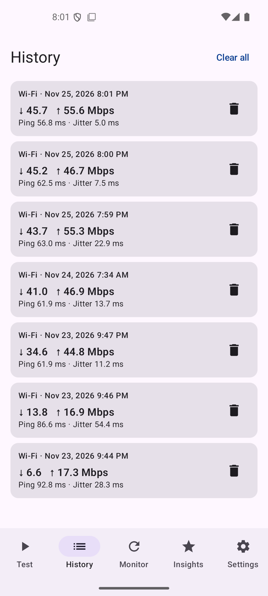
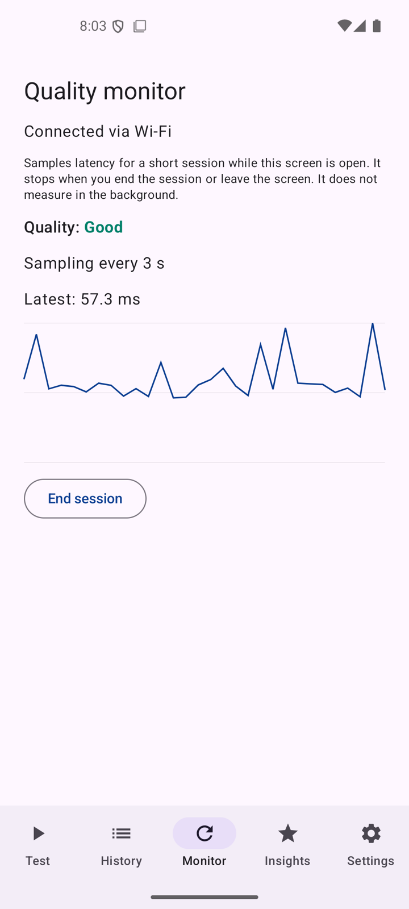

## What it does

Internet Speed Test measures the connection you are using right now, on Wi-Fi or mobile data. It shows your download and upload speed, ping and jitter. It also saves your results so you can see how your connection changes over time.

- One-tap test with a live speed readout
- Download and upload in Mbps, ping and jitter in ms
- Wi-Fi or cellular shown with every result
- A short Quality Monitor session that checks your latency while the screen is open

## Get started

1. Open the app. You do not need an account.
2. Check the connection type. The app shows Wi-Fi or cellular when your phone makes it available.
3. Run your first test (see below).

## Run a speed test

1. Connect to the network you want to test.
2. Tap **Start Test**.
3. Watch the live speed readout while the test runs.
4. Read your results: download, upload, ping, jitter, connection type, and the date and time.
5. Run another test from the result screen if you want to test again.

## Check your history

1. Open the history screen. Your tests are listed with the newest first.
2. Look at the date, connection type, download, upload, ping and jitter for each test.
3. Delete one test, or clear the whole history.

## Watch your connection quality

1. Open the Quality Monitor.
2. Start a session. The app checks your latency at regular intervals.
3. Watch the quality indicator while you work or play.
4. End the session, or leave the monitor, to stop it.

## Premium

Premium is a one-time purchase, not a subscription. It adds:

- No ads
- Full test history
- Charts for download, upload, ping and jitter
- Average, minimum and maximum, with 7-day and 30-day filters
- Wi-Fi vs cellular comparison

Running a speed test is always free.

## Questions

**Do I need Premium to test my speed?**
No. Running a speed test is always free.

**Does a test use my mobile data?**
Yes. The test downloads and uploads data over your current connection. On mobile data, this can count against your data plan.

**Does the app check my connection in the background?**
No. The Quality Monitor only measures while its screen is open and the session is running.

**Why do my results change from test to test?**
Results depend on the test server and your network at that moment.

**How many tests are saved?**
The free version keeps your most recent tests. Premium keeps your full history.

## Privacy

Your results and settings stay on your device. The test uses a public test server that can see your IP address. The free version shows ads from Google AdMob, which may use device identifiers, approximate location and app interactions. Where available, you can change your ad choices in Settings.
