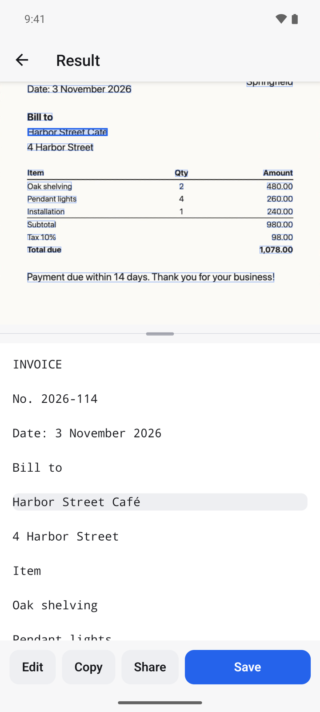
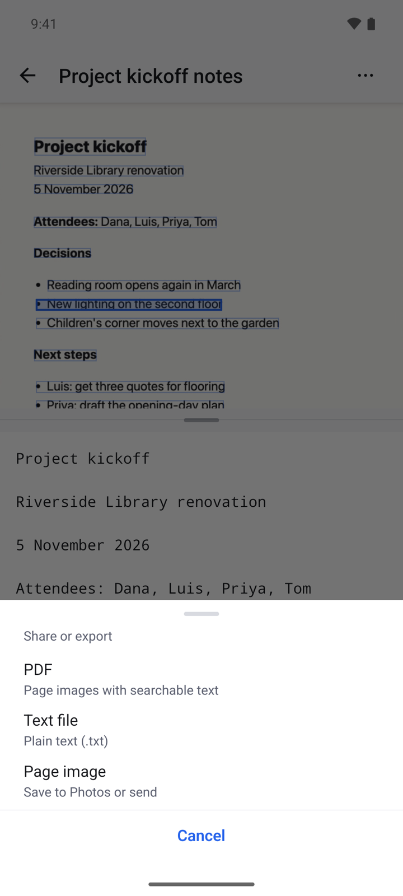

## ماذا يفعل التطبيق

يصوّر OCRScanner الصفحة الورقية، ويعدّل زواياها، ثم يقرأ النص الذي فيها على هاتفك. يمكنك تعديل النص ونسخه، والبحث في كل ما مسحته، ومشاركة المسح الضوئي بصيغة PDF قابل للبحث أو ملف نصي أو صورة.

- التعرّف على النص يتم على جهازك ويعمل دون إنترنت.
- لا حاجة إلى حساب. تبقى مستنداتك على هاتفك ولا تُرفع إلى أي مكان.
- استورد ملف PDF، أو شارك الصور من تطبيقات أخرى على أندرويد.
- مجاني مع إعلانات. شراء Premium مرة واحدة يزيل الإعلانات ويضيف لغات أكثر.

## البدء

1. افتح OCRScanner. تكون قائمة **Scans** فارغة في أول مرة.
2. اضغط **Scan** لاستخدام الكاميرا، أو **Import** لاختيار صور موجودة لديك.
3. اسمح بالوصول إلى الكاميرا عندما يطلب أندرويد ذلك. الاستيراد لا يحتاج إلى الوصول إلى مكتبة الصور كلها.

## امسح صفحة ضوئيًا

1. اضغط **Scan** ووجّه الكاميرا إلى الصفحة. اضغط زر الالتقاط لتصوير الصفحة.
2. في شاشة **Review** يحدّد التطبيق حواف الصفحة تلقائيًا. اسحب الزاوية الزرقاء إذا كانت إحدى الحواف في غير مكانها، أو اضغط **Full page** للاحتفاظ بالصورة كاملة.
3. اختر مرشّحًا لتنظيف الصفحة: **Original** أو **Magic** أو **Gray** أو **B&W**.
4. اضغط **Rotate 90°** إذا كانت الصفحة مقلوبة جانبيًا، أو **Retake** لتصويرها من جديد.
5. اضغط **Recognize text**.

لمسح عدة صفحات ضوئيًا في مستند واحد، افتح المسح لاحقًا، واضغط **⋯** ثم اختر **Add pages**.

## استيراد ملف PDF

يقرأ OCRScanner حتى 20 صفحة من ملف PDF واحد، أو 50 صفحة مع Premium. تُقرأ كل صفحة كصورة، لذلك لا يُستخدم النص الموجود أصلًا داخل ملف PDF.

1. اختر ملف PDF واحدًا من منتقي الملفات في هاتفك. لا حاجة إلى إذن التخزين.
2. في **Review** تحقّق من الصفحات. إذا كان الملف أطول من الحد المسموح، تُخبرك شاشة Review بعدد الصفحات التي تم تجاهلها.
3. اضغط **Recognize text**.

## شارك الصور من تطبيقات أخرى

هذه الميزة تعمل على أندرويد.

1. في المعرض أو في تطبيق آخر، حدّد حتى 20 صورة ثم اضغط مشاركة.
2. اختر OCRScanner.
3. افتح قفل التطبيق إذا كان **App lock** مفعّلًا. تُفتح الصور في **Review** كمسح جديد.

إذا كانت لديك صفحات مفتوحة غير محفوظة، يسألك التطبيق قبل استبدالها.

## اقرأ النص وعدّله وانسخه

1. بعد التعرّف على النص، تعرض **Result** الصفحة في الأعلى ونصها في الأسفل.
2. اضغط سطرًا من النص لترى موضعه في الصفحة. اضغط كلمة في الصفحة لتنتقل إلى سطرها.
3. تُظهر الأسطر التي لا يطمئن إليها التطبيق بتمييز خاص، فتعرف ما يجب مراجعته.
4. اضغط **Edit** لتصحيح النص، أو **Copy** لنسخه، أو **Share** لإرساله.
5. اضغط **Save** لحفظ المسح في قائمتك.

## ابحث عن مسح ضوئي من خلال نصه

1. في **Scans**، اضغط **Search text in your scans**.
2. اكتب كلمة. تظهر كل عمليات المسح التي تحتوي عليها، مع إبراز الكلمة المطابقة بخط عريض.
3. اضغط نتيجة لفتح المسح عند موضع التطابق.

لعرض عمليات المسح التي تحمل وسمًا واحدًا فقط، اضغط ذلك الوسم تحت حقل البحث. عندها يبحث التطبيق داخل هذه العمليات فقط. اضغط الوسم مرة أخرى لعرض الكل.

## شارك أو صدّر

1. افتح مسحًا ضوئيًا واضغط زر المشاركة.
2. اختر الصيغة:
   - **PDF**: صور الصفحات ومعها نص قابل للبحث خلفها.
   - **Text file**: نص عادي (.txt).
   - **Page image**: احفظها في الصور أو أرسلها.
3. اختر التطبيق الذي تريد الإرسال إليه.

## غيّر الاسم وأضف وسومًا واحذف

1. افتح مسحًا ضوئيًا واضغط **⋯**.
2. اختر **Rename** لتغيير العنوان، أو **Edit tags** لإضافة وسوم تفصل بينها بفواصل.
3. اختر **Recognize text again** لقراءة الصفحات من جديد بلغة نص أخرى. يُستبدل أي نص عدّلته.
4. اختر **Delete scan** لحذفه من هاتفك.

## انسخ مستنداتك احتياطيًا واستعدها

1. في **Scans**، اضغط أيقونة الإعدادات في أعلى الشاشة إلى اليمين.
2. تحت **Storage**، اضغط **Back up scans**. تُجمع كل مستنداتك في ملف واحد.
3. اختر مكان حفظ الملف أو طريقة إرساله. الملف غير مشفّر، فاحتفظ به في مكان آمن.
4. على هاتف جديد، اضغط **Restore from backup** واختر الملف. يسألك التطبيق قبل أن يستبدل كل المسوح الموجودة على الهاتف بالمسوح الموجودة في النسخة الاحتياطية.

## اقفل التطبيق وغيّر الإعدادات

1. في **Scans**، اضغط أيقونة الإعدادات في أعلى الشاشة إلى اليمين.
2. فعّل **App lock** لتطلب بصمة الإصبع أو الوجه أو قفل الشاشة قبل فتح مستنداتك.
3. تحت **Text language (OCR)**، اختر نظام الكتابة في مستنداتك. يشمل **Latin** الإنجليزية والإسبانية والفرنسية والألمانية والإندونيسية وغيرها. يقترح التطبيق النظام الذي تستخدمه لغة هاتفك.
4. اضغط **App language** لاستخدام التطبيق بلغة مختلفة عن لغة هاتفك.
5. اختر **Image quality** (Balanced أو Full) و**Theme** (System أو Light أو Dark).

## Premium

Premium دفعة واحدة وليس اشتراكًا. افتح **Settings** واضغط **See Premium**. وهو يمنحك:

- بلا إعلانات.
- النص الصيني والياباني والكوري، وكذلك الهندي وغيره من نصوص الديفاناغاري على أندرويد.
- دمج عدة مسوح ضوئية في ملف PDF أو ملف نصي واحد.
- استيراد ملفات PDF أطول: حتى 50 صفحة بدلًا من 20.

إذا اشتريت Premium من قبل، اضغط **Restore purchase** في شاشة Premium.

## أسئلة

**هل يعمل دون إنترنت؟**
نعم. المسح والتعرّف على النص والبحث والتصدير كلها تعمل على هاتفك.

**أين تُحفظ مستنداتي؟**
على جهازك فقط. إذا حذفت التطبيق، تُحذف المستندات معه، فاضغط **Back up scans** في Settings أولًا للاحتفاظ بها.

**في النص أخطاء. ماذا أفعل؟**
أعد التصوير في إضاءة جيدة والصفحة مسطّحة، وجرّب المرشّح **Magic** أو **B&W**، وتأكد أن **Text language (OCR)** يناسب المستند. ويمكنك أيضًا تصحيح الكلمات المفردة عبر **Edit**.

**هل يقرأ الخط اليدوي؟**
التطبيق مصمم للنص المطبوع. وغالبًا ما يُقرأ الخط اليدوي خطأً.

## الخصوصية

لا تُرفع مستنداتك أبدًا. تعرض النسخة المجانية إعلانات من Google AdMob. اقرأ [سياسة الخصوصية](https://varian1.github.io/ocrscanner/privacy.html) كاملة.
