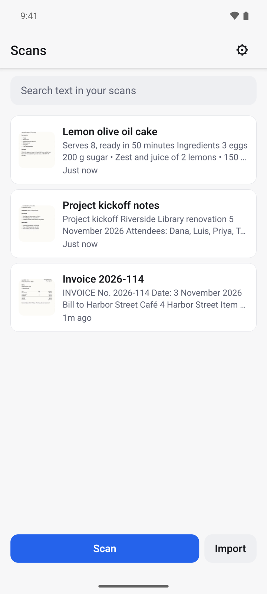
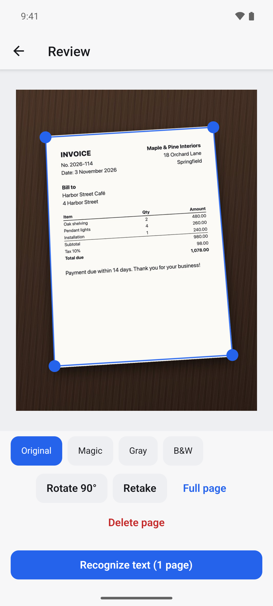
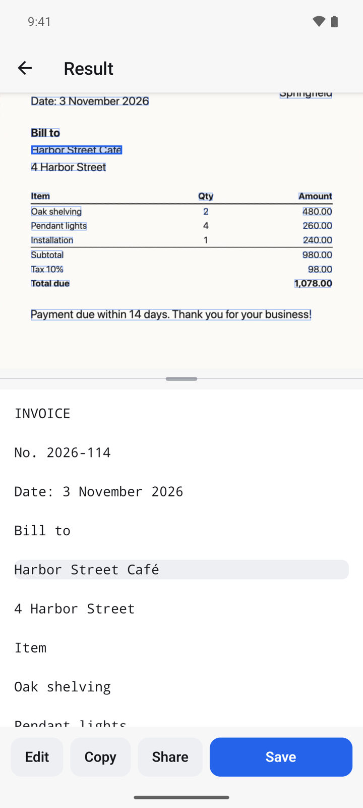
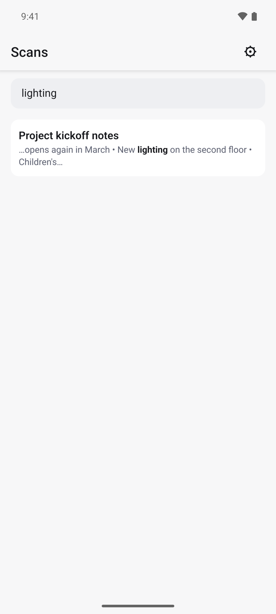
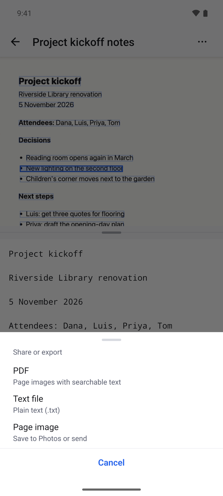
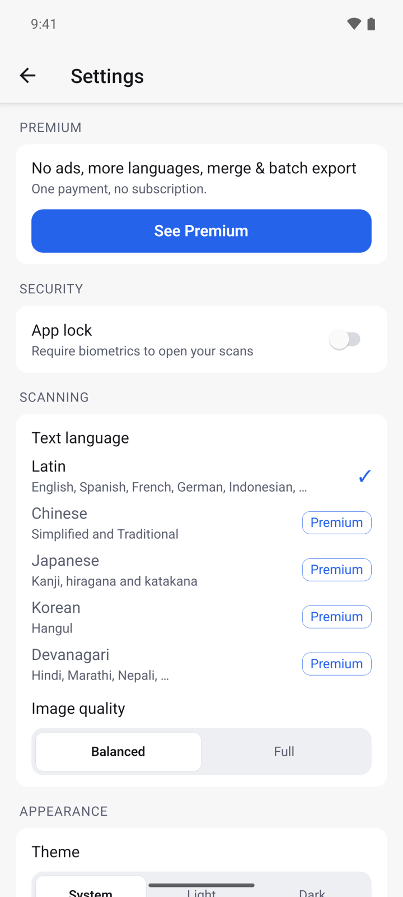

## What it does

OCRScanner photographs a paper page, straightens it and reads the text on your phone. You can edit and copy the text, search every scan you have made, and share a scan as a searchable PDF, a text file or an image.

- Text recognition runs on your device and works without internet.
- No account. Your scans stay on your phone and are never uploaded.
- Free with ads. A one-time Premium purchase removes ads and adds more languages.

## Get started

1. Open OCRScanner. The **Scans** list is empty the first time.
2. Tap **Scan** to use the camera, or **Import** to pick photos you already have.
3. Allow the camera when Android asks. Import does not need access to your whole photo library.

## Scan a page

1. Tap **Scan** and point the camera at the page. Tap the shutter button to take the photo.
2. On **Review**, the page edges are found for you. Drag a blue corner if an edge is off, or tap **Full page** to keep the whole photo.
3. Pick a filter to clean the page: **Original**, **Magic**, **Gray** or **B&W**.
4. Tap **Rotate 90°** if the page is sideways, or **Retake** to photograph it again.
5. Tap **Recognize text**.

To scan several pages into one document, open the scan later, tap **⋯** and choose **Add pages**.

## Read, edit and copy the text

1. After recognition, **Result** shows the page on top and its text below.
2. Tap a line of text to see where it is on the page. Tap a word on the page to jump to its line.
3. Lines the app is unsure about are highlighted, so you know what to check.
4. Tap **Edit** to correct the text, **Copy** to copy it, or **Share** to send it.
5. Tap **Save** to keep the scan in your list.

## Find a scan by its text

1. On **Scans**, tap **Search text in your scans**.
2. Type a word. Every scan that contains it is listed, with the match in bold.
3. Tap a result to open the scan at that match.

## Share or export

1. Open a scan and tap the share button.
2. Choose a format:
   - **PDF**: the page images with searchable text behind them.
   - **Text file**: plain text (.txt).
   - **Page image**: save to Photos or send.
3. Pick the app to send it to.

## Rename, tag and delete

1. Open a scan and tap **⋯**.
2. Choose **Rename** to change the title, or **Edit tags** to add tags separated by commas.
3. Choose **Delete scan** to remove it from your phone.

## Lock the app and change settings

1. On **Scans**, tap the settings icon in the top right.
2. Turn on **App lock** to require your fingerprint, face or screen lock before your scans open.
3. Under **Text language**, pick the script of your documents. **Latin** covers English, Spanish, French, German, Indonesian and more.
4. Choose **Image quality** (Balanced or Full) and the **Theme** (System, Light or Dark).

## Premium

Premium is one payment, not a subscription. Open **Settings** and tap **See Premium**. It gives you:

- No ads.
- Chinese, Japanese and Korean text, plus Hindi and other Devanagari text on Android.
- Merging several scans into one PDF or text file.

If you bought Premium before, tap **Restore purchase** on the Premium screen.

## Questions

**Does it work offline?**
Yes. Scanning, text recognition, search and export all run on your phone.

**Where are my scans kept?**
Only on your device. If you uninstall the app, the scans are removed with it, so export the ones you want to keep.

**The text has mistakes. What can I do?**
Retake the photo in good light with the page flat, try the **Magic** or **B&W** filter, and check that **Text language** matches the document. You can also fix single words with **Edit**.

**Can it read handwriting?**
It is made for printed text. Handwriting is often read wrongly.

## Privacy

Your documents are never uploaded. The free version shows ads from Google AdMob. Read the full [privacy policy](https://varian1.github.io/ocrscanner/privacy.html).
