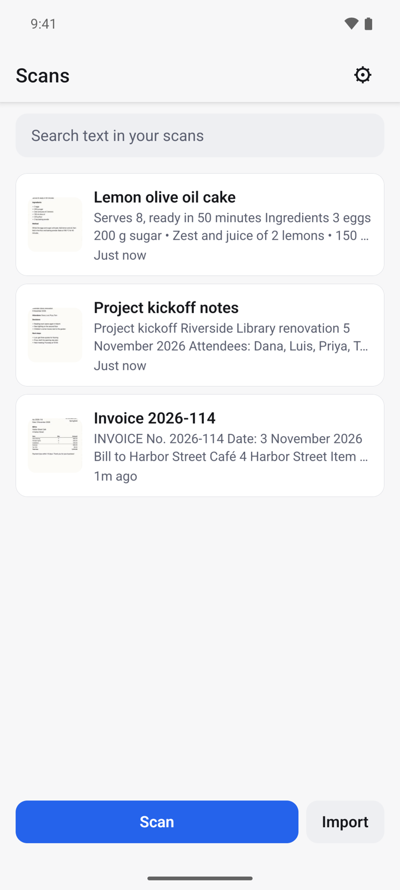

## Wat de app doet

OCRScanner maakt een foto van een papieren pagina, rechtet die en leest de tekst op je telefoon. Je kunt de tekst bewerken en kopiëren, al je scans doorzoeken en een scan delen als doorzoekbare PDF, als tekstbestand of als afbeelding.

- Tekstherkenning gebeurt op je toestel en werkt zonder internet.
- Geen account. Je scans blijven op je telefoon en worden nooit geüpload.
- Importeer een PDF, of deel afbeeldingen vanuit andere apps op Android.
- Gratis met advertenties. Met een eenmalige Premium-aankoop verdwijnen de advertenties en krijg je meer talen.

## Aan de slag

1. Open OCRScanner. De lijst **Scans** is de eerste keer leeg.
2. Tik op **Scan** om de camera te gebruiken, of op **Import** om foto's te kiezen die je al hebt.
3. Geef toegang tot de camera als Android erom vraagt. Voor importeren heb je geen toegang tot je hele fotobibliotheek nodig.

## Een pagina scannen

1. Tik op **Scan** en richt de camera op de pagina. Tik op de sluiterknop om de foto te maken.
2. Op **Review** worden de randen van de pagina automatisch gevonden. Sleep een blauwe hoek als een rand niet klopt, of tik op **Full page** om de hele foto te houden.
3. Kies een filter om de pagina op te schonen: **Original**, **Magic**, **Gray** of **B&W**.
4. Tik op **Rotate 90°** als de pagina op zijn kant staat, of op **Retake** om opnieuw te fotograferen.
5. Tik op **Recognize text**.

Wil je meerdere pagina's in één document scannen? Open de scan later, tik op **⋯** en kies **Add pages**.

## Een PDF importeren

OCRScanner leest tot 20 pagina's van één PDF, of 50 met Premium. Elke pagina wordt als afbeelding gelezen, dus tekst die al in de PDF staat wordt niet gebruikt.

1. Kies één PDF in de bestandskiezer van je telefoon. Je hebt geen opslagtoestemming nodig.
2. Controleer de pagina's op **Review**. Is de PDF langer dan de limiet, dan laat Review weten hoeveel pagina's zijn weggelaten.
3. Tik op **Recognize text**.

## Afbeeldingen delen vanuit andere apps

Dit werkt op Android.

1. Selecteer in je galerij of een andere app maximaal 20 afbeeldingen en tik op delen.
2. Kies OCRScanner.
3. Ontgrendel de app als **App lock** aanstaat. De afbeeldingen openen op **Review** als nieuwe scan.

Heb je niet-opgeslagen pagina's open, dan vraagt de app eerst of ze vervangen mogen worden.

## De tekst lezen, bewerken en kopiëren

1. Na de herkenning toont **Result** bovenaan de pagina en eronder de tekst.
2. Tik op een regel tekst om te zien waar die op de pagina staat. Tik op een woord op de pagina om naar de bijbehorende regel te springen.
3. Regels waar de app niet zeker van is, zijn gemarkeerd. Zo weet je wat je moet controleren.
4. Tik op **Edit** om de tekst te verbeteren, op **Copy** om te kopiëren of op **Share** om te versturen.
5. Tik op **Save** om de scan in je lijst te bewaren.

## Een scan zoeken op tekst

1. Tik op **Scans** op **Search text in your scans**.
2. Typ een woord. Alle scans waarin het voorkomt, worden getoond, met de treffer vet gedrukt.
3. Tik op een resultaat om de scan bij die treffer te openen.

Wil je alleen de scans met één bepaald label zien? Tik dan onder het zoekveld op dat label. Zoeken gebeurt dan alleen in die scans. Tik nogmaals op het label om weer alle scans te zien.

## Delen of exporteren

1. Open een scan en tik op de deelknop.
2. Kies een indeling:
   - **PDF**: de pagina-afbeeldingen met doorzoekbare tekst erachter.
   - **Text file**: gewone tekst (.txt).
   - **Page image**: bewaar in Foto's of verstuur.
3. Kies de app waarmee je het bestand wilt versturen.

## Hernoemen, labelen en verwijderen

1. Open een scan en tik op **⋯**.
2. Kies **Rename** om de titel te wijzigen, of **Edit tags** om labels toe te voegen, gescheiden door komma's.
3. Kies **Recognize text again** om de pagina's opnieuw te lezen in een andere tekstentaal. Tekst die je hebt bewerkt, wordt vervangen.
4. Kies **Delete scan** om de scan van je telefoon te verwijderen.

## Een back-up maken en je scans terugzetten

1. Tik op **Scans** op het instellingenpictogram rechtsboven.
2. Tik onder **Storage** op **Back up scans**. Al je scans worden in één bestand verpakt.
3. Kies waar je het bestand opslaat of naartoe stuurt. Het bestand is niet versleuteld, dus bewaar het op een veilige plek.
4. Tik op een nieuwe telefoon op **Restore from backup** en kies het bestand. De app vraagt eerst of alle scans op de telefoon vervangen mogen worden door die uit de back-up.

## De app vergrendelen en instellingen wijzigen

1. Tik op **Scans** op het instellingenpictogram rechtsboven.
2. Zet **App lock** aan om je vingerafdruk, gezicht of schermvergrendeling te vragen voordat je scans openen.
3. Kies onder **Text language (OCR)** het schrift van je documenten. **Latin** omvat onder meer Nederlands, Engels, Spaans, Frans, Duits en Indonesisch. De app stelt het schrift voor dat bij de taal van je telefoon hoort.
4. Tik op **App language** om de app in een andere taal te gebruiken dan je telefoon.
5. Kies de **Image quality** (Balanced of Full) en het **Theme** (System, Light of Dark).

## Premium

Premium is een eenmalige betaling, geen abonnement. Open **Settings** en tik op **See Premium**. Je krijgt:

- Geen advertenties.
- Chinese, Japanse en Koreaanse tekst, plus Hindi en andere Devanagari-tekst op Android.
- Meerdere scans samenvoegen tot één PDF of tekstbestand.
- Langere PDF's importeren: tot 50 pagina's in plaats van 20.

Heb je Premium eerder gekocht, tik dan op het Premium-scherm op **Restore purchase**.

## Vragen

**Werkt de app offline?**
Ja. Scannen, tekstherkenning, zoeken en exporteren gebeuren allemaal op je telefoon.

**Waar worden mijn scans bewaard?**
Alleen op je toestel. Verwijder je de app, dan verdwijnen de scans ook. Tik daarom eerst in Settings op **Back up scans** als je ze wilt houden.

**De tekst bevat fouten. Wat kan ik doen?**
Maak de foto opnieuw bij goed licht met de pagina plat, probeer het filter **Magic** of **B&W** en controleer of **Text language (OCR)** past bij het document. Losse woorden kun je verbeteren met **Edit**.

**Kan de app handschrift lezen?**
De app is gemaakt voor gedrukte tekst. Handschrift wordt vaak verkeerd gelezen.

## Privacy

Je documenten worden nooit geüpload. De gratis versie toont advertenties van Google AdMob. Lees het volledige [privacybeleid](https://varian1.github.io/ocrscanner/privacy.html).
