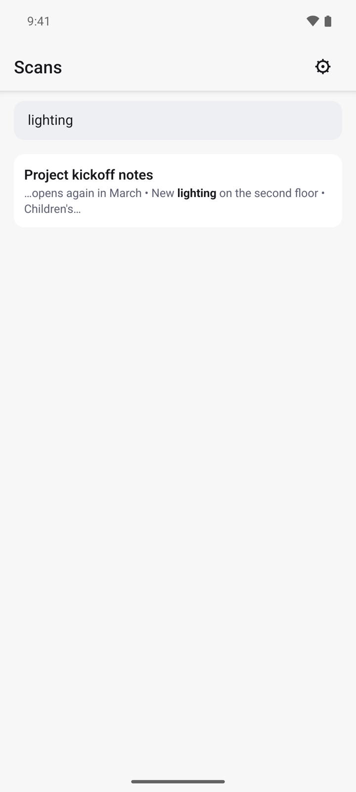

## แอปนี้ทำอะไรได้

OCRScanner ถ่ายภาพหน้ากระดาษ ปรับให้ตรง และอ่านข้อความบนโทรศัพท์ของคุณ คุณแก้ไขและคัดลอกข้อความได้ ค้นหาในทุกสแกนที่เคยทำ และแชร์สแกนเป็น PDF ที่ค้นหาข้อความได้ ไฟล์ข้อความ หรือรูปภาพ

- การอ่านข้อความทำงานบนเครื่องของคุณ และใช้ได้โดยไม่ต้องมีอินเทอร์เน็ต
- ไม่ต้องสมัครบัญชี สแกนของคุณอยู่บนโทรศัพท์และไม่ถูกอัปโหลดเลย
- นำเข้า PDF หรือแชร์รูปภาพจากแอปอื่นบน Android ได้
- ใช้ฟรีโดยมีโฆษณา ซื้อ Premium ครั้งเดียวเพื่อเอาโฆษณาออกและเพิ่มภาษา

## เริ่มต้นใช้งาน

1. เปิด OCRScanner รายการ **Scans** จะว่างเปล่าเมื่อเปิดครั้งแรก
2. แตะ **Scan** เพื่อใช้กล้อง หรือ **Import** เพื่อเลือกรูปที่มีอยู่แล้ว
3. อนุญาตให้ใช้กล้องเมื่อ Android ถาม การนำเข้าไม่ต้องเข้าถึงคลังรูปภาพทั้งหมดของคุณ

## สแกนหน้ากระดาษ

1. แตะ **Scan** แล้วเล็งกล้องไปที่หน้ากระดาษ แตะปุ่มชัตเตอร์เพื่อถ่ายภาพ
2. ในหน้า **Review** แอปจะหาขอบกระดาษให้เอง หากขอบไม่ตรง ให้ลากมุมสีน้ำเงิน หรือแตะ **Full page** เพื่อใช้ทั้งภาพ
3. เลือกฟิลเตอร์เพื่อทำให้หน้ากระดาษสะอาดขึ้น: **Original**, **Magic**, **Gray** หรือ **B&W**
4. แตะ **Rotate 90°** หากหน้ากระดาษตะแคง หรือแตะ **Retake** เพื่อถ่ายใหม่
5. แตะ **Recognize text**

หากต้องการสแกนหลายหน้าเป็นเอกสารเดียว ให้เปิดสแกนนั้นภายหลัง แตะ **⋯** แล้วเลือก **Add pages**

## นำเข้า PDF

OCRScanner อ่าน PDF ไฟล์เดียวได้สูงสุด 20 หน้า หรือ 50 หน้าเมื่อใช้ Premium ทุกหน้าจะถูกอ่านเป็นรูปภาพ ดังนั้นข้อความที่มีอยู่ใน PDF แล้วจะไม่ถูกนำมาใช้

1. เลือก PDF หนึ่งไฟล์ในตัวเลือกไฟล์ของโทรศัพท์ ไม่ต้องขออนุญาตเข้าถึงพื้นที่จัดเก็บ
2. ในหน้า **Review** ตรวจสอบแต่ละหน้า หาก PDF ยาวเกินขีดจำกัด หน้า Review จะบอกว่ามีกี่หน้าที่ถูกตัดออก
3. แตะ **Recognize text**

## แชร์รูปภาพจากแอปอื่น

ใช้ได้บน Android

1. ในแกลเลอรีหรือแอปอื่น เลือกรูปได้สูงสุด 20 รูป แล้วแตะแชร์
2. เลือก OCRScanner
3. ปลดล็อกแอปหากเปิด **App lock** ไว้ รูปภาพจะเปิดในหน้า **Review** เป็นสแกนใหม่

หากคุณมีหน้าที่ยังไม่ได้บันทึกเปิดอยู่ แอปจะถามก่อนแทนที่

## อ่าน แก้ไข และคัดลอกข้อความ

1. หลังจากอ่านข้อความเสร็จ หน้า **Result** จะแสดงหน้ากระดาษด้านบนและข้อความด้านล่าง
2. แตะบรรทัดข้อความเพื่อดูว่าอยู่ตรงไหนของหน้า แตะคำบนหน้ากระดาษเพื่อข้ามไปยังบรรทัดของคำนั้น
3. บรรทัดที่แอปไม่มั่นใจจะถูกไฮไลต์ไว้ คุณจึงรู้ว่าควรตรวจตรงไหน
4. แตะ **Edit** เพื่อแก้ข้อความ **Copy** เพื่อคัดลอก หรือ **Share** เพื่อส่งต่อ
5. แตะ **Save** เพื่อเก็บสแกนไว้ในรายการของคุณ

## ค้นหาสแกนจากข้อความ

1. ในหน้า **Scans** แตะ **Search text in your scans**
2. พิมพ์คำที่ต้องการ ทุกสแกนที่มีคำนั้นจะแสดงในรายการ โดยคำที่ตรงกันเป็นตัวหนา
3. แตะผลลัพธ์เพื่อเปิดสแกนตรงตำแหน่งที่พบ

หากต้องการดูเฉพาะสแกนที่มีแท็กหนึ่ง ให้แตะแท็กนั้นใต้ช่องค้นหา การค้นหาจะมองเฉพาะในสแกนเหล่านั้น แตะแท็กอีกครั้งเพื่อดูสแกนทั้งหมด

## แชร์หรือส่งออก

1. เปิดสแกนแล้วแตะปุ่มแชร์
2. เลือกรูปแบบ:
   - **PDF**: รูปภาพของหน้ากระดาษพร้อมข้อความที่ค้นหาได้อยู่เบื้องหลัง
   - **Text file**: ข้อความธรรมดา (.txt)
   - **Page image**: บันทึกลงในแกลเลอรีหรือส่งต่อ
3. เลือกแอปที่ต้องการส่งไป

## เปลี่ยนชื่อ ติดแท็ก และลบ

1. เปิดสแกนแล้วแตะ **⋯**
2. เลือก **Rename** เพื่อเปลี่ยนชื่อ หรือ **Edit tags** เพื่อเพิ่มแท็ก โดยคั่นด้วยเครื่องหมายจุลภาค
3. เลือก **Recognize text again** เพื่ออ่านหน้าเหล่านั้นใหม่ด้วยภาษาข้อความอื่น ข้อความที่คุณแก้ไขไว้จะถูกแทนที่
4. เลือก **Delete scan** เพื่อลบออกจากโทรศัพท์

## สำรองและกู้คืนสแกน

1. ในหน้า **Scans** แตะไอคอนการตั้งค่าที่มุมขวาบน
2. ใต้ **Storage** แตะ **Back up scans** สแกนทั้งหมดของคุณจะถูกรวมเป็นไฟล์เดียว
3. เลือกที่บันทึกหรือส่งไฟล์ ไฟล์นี้ไม่ได้เข้ารหัส ดังนั้นเก็บไว้ในที่ปลอดภัย
4. บนโทรศัพท์เครื่องใหม่ แตะ **Restore from backup** แล้วเลือกไฟล์ แอปจะถามก่อนแทนที่สแกนทั้งหมดบนโทรศัพท์ด้วยสแกนในไฟล์สำรอง

## ล็อกแอปและเปลี่ยนการตั้งค่า

1. ในหน้า **Scans** แตะไอคอนการตั้งค่าที่มุมขวาบน
2. เปิด **App lock** เพื่อให้ต้องใช้ลายนิ้วมือ ใบหน้า หรือการล็อกหน้าจอก่อนเปิดสแกนของคุณ
3. ใต้ **Text language (OCR)** เลือกตัวอักษรที่ใช้ในเอกสารของคุณ **Latin** ครอบคลุมอังกฤษ สเปน ฝรั่งเศส เยอรมัน อินโดนีเซีย และอื่น ๆ แอปจะแนะนำตัวเลือกที่ตรงกับภาษาของโทรศัพท์
4. แตะ **App language** เพื่อใช้แอปเป็นภาษาอื่นที่ไม่ตรงกับภาษาของโทรศัพท์
5. เลือก **Image quality** (Balanced หรือ Full) และ **Theme** (System, Light หรือ Dark)

## Premium

Premium เป็นการจ่ายครั้งเดียว ไม่ใช่การสมัครสมาชิกรายเดือน เปิด **Settings** แล้วแตะ **See Premium** สิ่งที่คุณจะได้:

- ไม่มีโฆษณา
- ข้อความภาษาจีน ญี่ปุ่น และเกาหลี รวมถึงภาษาฮินดีและข้อความอักษรเทวนาครีอื่น ๆ บน Android
- รวมหลายสแกนเป็น PDF หรือไฟล์ข้อความไฟล์เดียว
- นำเข้า PDF ที่ยาวขึ้น: สูงสุด 50 หน้าแทน 20 หน้า

หากเคยซื้อ Premium แล้ว ให้แตะ **Restore purchase** ในหน้า Premium

## คำถามที่พบบ่อย

**ใช้งานแบบออฟไลน์ได้ไหม**
ได้ การสแกน การอ่านข้อความ การค้นหา และการส่งออกทั้งหมดทำงานบนโทรศัพท์ของคุณ

**สแกนของฉันเก็บไว้ที่ไหน**
เก็บบนอุปกรณ์ของคุณเท่านั้น หากถอนการติดตั้งแอป สแกนจะถูกลบไปด้วย ดังนั้นให้แตะ **Back up scans** ใน Settings ก่อนเพื่อเก็บไว้

**ข้อความมีคำผิด ต้องทำอย่างไร**
ถ่ายภาพใหม่ในที่ที่มีแสงดี วางกระดาษให้เรียบ ลองใช้ฟิลเตอร์ **Magic** หรือ **B&W** และตรวจว่า **Text language (OCR)** ตรงกับเอกสาร คุณยังแก้ทีละคำได้ด้วย **Edit**

**อ่านลายมือได้ไหม**
แอปนี้ทำมาสำหรับข้อความที่พิมพ์ ลายมืออาจถูกอ่านผิดบ่อย

## ความเป็นส่วนตัว

เอกสารของคุณไม่ถูกอัปโหลดเลย เวอร์ชันฟรีแสดงโฆษณาจาก Google AdMob อ่าน[นโยบายความเป็นส่วนตัว](https://varian1.github.io/ocrscanner/privacy.html)ฉบับเต็มได้ที่ลิงก์นี้
