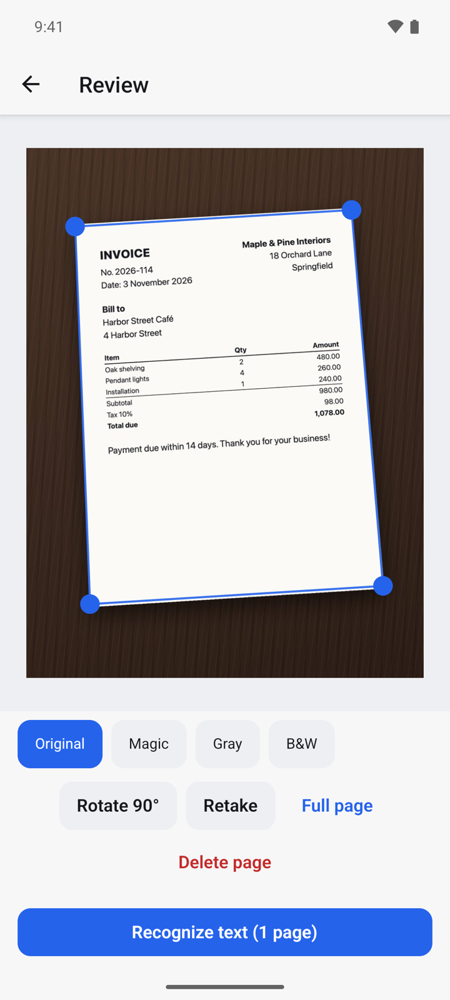

## Ne işe yarar

OCRScanner kâğıt bir sayfanın fotoğrafını çeker, düzeltir ve üzerindeki metni telefonunda okur. Metni düzenleyip kopyalayabilir, yaptığın tüm taramalarda arama yapabilir, taramayı aranabilir PDF, metin dosyası veya resim olarak paylaşabilirsin.

- Metin tanıma cihazında çalışır, internet gerekmez.
- Hesap yok. Taramaların telefonunda kalır, hiçbir yere yüklenmez.
- PDF içe aktarabilir veya Android'de diğer uygulamalardan resim paylaşabilirsin.
- Reklamlı ve ücretsiz. Tek seferlik Premium satın alma reklamları kaldırır ve daha fazla dil ekler.

## Başlarken

1. OCRScanner'ı aç. **Scans** listesi ilk açılışta boştur.
2. Kamerayı kullanmak için **Scan**'e, hazır fotoğrafları seçmek için **Import**'a dokun.
3. Android sorduğunda kamera iznini ver. İçe aktarma için tüm fotoğraf kitaplığına erişim gerekmez.

## Sayfa tara

1. **Scan**'e dokun ve kamerayı sayfaya doğrult. Fotoğrafı çekmek için deklanşör düğmesine dokun.
2. **Review** ekranında sayfa kenarları senin için bulunur. Bir kenar yanlışsa mavi köşeyi sürükle veya fotoğrafın tamamını tutmak için **Full page**'e dokun.
3. Sayfayı temizlemek için bir filtre seç: **Original**, **Magic**, **Gray** veya **B&W**.
4. Sayfa yan duruyorsa **Rotate 90°**'ye, yeniden çekmek için **Retake**'e dokun.
5. **Recognize text**'e dokun.

Birden fazla sayfayı tek belgede taramak için taramayı sonra aç, **⋯**'e dokun ve **Add pages**'i seç.

## PDF içe aktar

OCRScanner tek bir PDF'nin en fazla 20 sayfasını, Premium ile 50 sayfasını okur. Her sayfa resim olarak okunur, bu yüzden PDF'in içindeki hazır metin kullanılmaz.

1. Telefonunun dosya seçicisinde bir PDF seç. Depolama izni gerekmez.
2. **Review** ekranında sayfaları kontrol et. PDF sınırdan uzunsa Review kaç sayfanın dışarıda kaldığını söyler.
3. **Recognize text**'e dokun.

## Diğer uygulamalardan resim paylaş

Bu özellik Android'de çalışır.

1. Galerinde veya başka bir uygulamada en fazla 20 resim seç ve paylaş'a dokun.
2. OCRScanner'ı seç.
3. **App lock** açıksa uygulamanın kilidini aç. Resimler yeni bir tarama olarak **Review** ekranında açılır.

Kaydedilmemiş sayfalar açıksa uygulama, onların yerine geçmeden önce sana sorar.

## Metni oku, düzenle ve kopyala

1. Tanımadan sonra **Result** ekranı üstte sayfayı, altta metnini gösterir.
2. Sayfada yerini görmek için bir metin satırına dokun. Satırına gitmek için sayfadaki bir kelimeye dokun.
3. Uygulamanın emin olmadığı satırlar vurgulanır, böylece nelere bakman gerektiğini bilirsin.
4. Metni düzeltmek için **Edit**'e, kopyalamak için **Copy**'ye, göndermek için **Share**'e dokun.
5. Taramayı listende tutmak için **Save**'e dokun.

## Taramayı metniyle bul

1. **Scans** ekranında **Search text in your scans**'e dokun.
2. Bir kelime yaz. Onu içeren her tarama, eşleşme kalın yazılmış hâlde listelenir.
3. Taramayı o eşleşmede açmak için bir sonuca dokun.

Yalnızca bir etiketi olan taramaları görmek için arama alanının altındaki etikete dokun. Arama o zaman sadece bu taramaların içine bakar. Tüm taramaları görmek için etikete yeniden dokun.

## Paylaş veya dışa aktar

1. Bir tarama aç ve paylaş düğmesine dokun.
2. Bir biçim seç:
   - **PDF**: arkasında aranabilir metin bulunan sayfa resimleri.
   - **Text file**: düz metin (.txt).
   - **Page image**: Fotoğraflar'a kaydet veya gönder.
3. Göndereceğin uygulamayı seç.

## Yeniden adlandır, etiketle ve sil

1. Bir tarama aç ve **⋯**'e dokun.
2. Başlığı değiştirmek için **Rename**'i, virgülle ayırarak etiket eklemek için **Edit tags**'i seç.
3. Sayfaları başka bir metin dilinde yeniden okumak için **Recognize text again**'i seç. Düzenlediğin metin değiştirilir.
4. Taramayı telefonundan kaldırmak için **Delete scan**'i seç.

## Taramalarını yedekle ve geri yükle

1. **Scans** ekranında sağ üstteki ayarlar simgesine dokun.
2. **Storage** altında **Back up scans**'e dokun. Tüm taramaların tek dosyada toplanır.
3. Dosyanın kaydedileceği veya gönderileceği yeri seç. Dosya şifrelenmez, bu yüzden güvenli bir yerde tut.
4. Yeni bir telefonda **Restore from backup**'a dokun ve dosyayı seç. Uygulama, telefondaki tüm taramaları yedekteki taramalarla değiştirmeden önce sana sorar.

## Uygulamayı kilitle ve ayarları değiştir

1. **Scans** ekranında sağ üstteki ayarlar simgesine dokun.
2. Taramalar açılmadan önce parmak izi, yüz veya ekran kilidi istemek için **App lock**'u aç.
3. **Text language (OCR)** altında belgelerinin yazı sistemini seç. **Latin**; İngilizce, İspanyolca, Fransızca, Almanca, Endonezce ve daha fazlasını kapsar. Uygulama, telefonunun dilinin kullandığı yazı sistemini önerir.
4. Uygulamayı telefonundan farklı bir dilde kullanmak için **App language**'e dokun.
5. **Image quality** (Balanced veya Full) ile **Theme** (System, Light veya Dark) seçeneklerini belirle.

## Premium

Premium tek seferlik bir ödemedir, abonelik değildir. **Settings**'i aç ve **See Premium**'a dokun. Şunları sağlar:

- Reklam yok.
- Çince, Japonca ve Korece metin; ayrıca Android'de Hintçe ve diğer Devanagari metinler.
- Birkaç taramayı tek PDF'te veya metin dosyasında birleştirme.
- Daha uzun PDF'leri içe aktarma: 20 yerine en fazla 50 sayfa.

Daha önce Premium aldıysan Premium ekranında **Restore purchase**'a dokun.

## Questions

**İnternetsiz çalışır mı?**
Evet. Tarama, metin tanıma, arama ve dışa aktarma telefonunda çalışır.

**Taramalarım nerede tutuluyor?**
Yalnızca cihazında. Uygulamayı silersen taramalar da silinir. Onları saklamak için önce Settings'te **Back up scans**'e dokun.

**Metinde hatalar var. Ne yapabilirim?**
Fotoğrafı iyi ışıkta, sayfa düzken yeniden çek, **Magic** veya **B&W** filtresini dene ve **Text language (OCR)** ayarının belgeyle eşleştiğini kontrol et. Tek tek kelimeleri **Edit** ile de düzeltebilirsin.

**El yazısını okuyabilir mi?**
Basılı metin için yapılmıştır. El yazısı çoğu zaman yanlış okunur.

## Gizlilik

Belgelerin hiçbir zaman yüklenmez. Ücretsiz sürüm Google AdMob reklamları gösterir. Tam [gizlilik politikasını](https://varian1.github.io/ocrscanner/privacy.html) oku.
