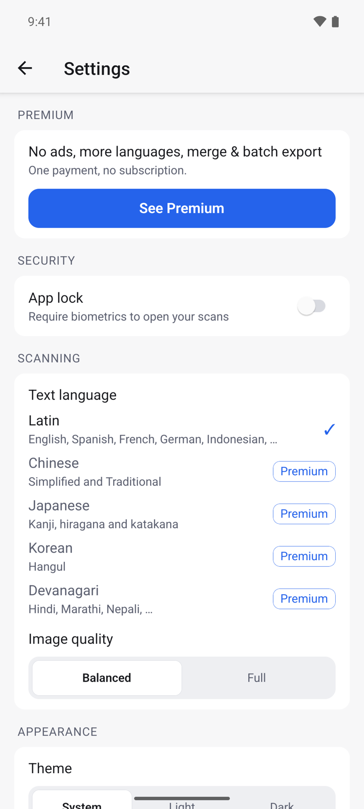

## 功能简介

OCRScanner 可以拍摄纸质文档,自动校正页面,并在手机上识别文字。你可以编辑和复制文字,搜索所有已扫描的内容,还可以把扫描件分享为可搜索的 PDF、文本文件或图片。

- 文字识别在手机本地完成,无需联网。
- 无需账号。扫描件只保存在你的手机上,绝不会上传。
- 可导入 PDF,在 Android 上还能从其他应用分享图片过来。
- 免费使用,含广告。一次性购买 Premium 即可去除广告,并增加更多识别语言。

## 开始使用

1. 打开 OCRScanner。第一次使用时,**Scans** 列表是空的。
2. 点按 **Scan** 使用相机拍摄,或点按 **Import** 选择已有的照片。
3. Android 询问时,请允许使用相机。导入照片不需要访问你的整个相册。

## 扫描一页文档

1. 点按 **Scan**,把相机对准文档,再点按快门按钮拍照。
2. 在 **Review** 页面,应用会自动找到文档边缘。如果某条边不准,拖动蓝色的角点即可;也可以点按 **Full page** 保留整张照片。
3. 选择一种滤镜来清理页面:**Original**、**Magic**、**Gray** 或 **B&W**。
4. 如果页面是横着的,点按 **Rotate 90°**;想重新拍,点按 **Retake**。
5. 点按 **Recognize text**。

如果想把多页扫描成一份文档,稍后打开这份扫描件,点按 **⋯**,然后选择 **Add pages**。

## 导入 PDF

OCRScanner 最多可读取一个 PDF 的 20 页,开通 Premium 后最多 50 页。每一页都会当作图片来识别,所以 PDF 里原有的文字不会被使用。

1. 在手机的文件选择器中选择一个 PDF。无需存储权限。
2. 在 **Review** 页面检查各页。如果 PDF 超过页数上限,Review 会告诉你有多少页没有导入。
3. 点按 **Recognize text**。

## 从其他应用分享图片

此功能适用于 Android。

1. 在相册或其他应用中,选择最多 20 张图片,然后点按分享。
2. 选择 OCRScanner。
3. 如果开启了 **App lock**,请先解锁应用。图片会作为新的扫描件在 **Review** 页面打开。

如果你有尚未保存的页面,应用会先询问,再替换它们。

## 查看、编辑和复制文字

1. 识别完成后,**Result** 页面上方显示原页面,下方显示识别出的文字。
2. 点按一行文字,可以看到它在页面上的位置。点按页面上的某个词,可以跳到对应的那一行。
3. 应用没有把握的行会高亮显示,方便你重点检查。
4. 点按 **Edit** 修改文字,点按 **Copy** 复制,点按 **Share** 发送。
5. 点按 **Save**,把扫描件保存到列表中。

## 按文字内容查找扫描件

1. 在 **Scans** 页面,点按 **Search text in your scans**。
2. 输入一个词。所有包含该词的扫描件都会列出来,匹配的词以粗体显示。
3. 点按某个结果,即可在匹配位置打开该扫描件。

如果只想看带某个标签的扫描件,点按搜索框下方的该标签。此时搜索只会在这些扫描件中进行。再次点按该标签,即可显示全部扫描件。

## 分享或导出

1. 打开一份扫描件,点按分享按钮。
2. 选择格式:
   - **PDF**:页面图片,背后带有可搜索的文字。
   - **Text file**:纯文本(.txt)。
   - **Page image**:保存到相册或直接发送。
3. 选择要发送到的应用。

## 重命名、添加标签和删除

1. 打开一份扫描件,点按 **⋯**。
2. 选择 **Rename** 可修改标题,选择 **Edit tags** 可添加标签,多个标签之间用逗号分隔。
3. 选择 **Recognize text again**,可以用另一种文字语言重新识别各页。你编辑过的文字会被替换。
4. 选择 **Delete scan**,即可从手机中删除该扫描件。

## 备份和恢复扫描件

1. 在 **Scans** 页面,点按右上角的设置图标。
2. 在 **Storage** 下,点按 **Back up scans**。你所有的扫描件会被打包成一个文件。
3. 选择保存或发送该文件的位置。文件没有加密,请妥善保管。
4. 换新手机后,点按 **Restore from backup** 并选择该文件。应用会先询问,再用备份中的扫描件替换手机上的全部扫描件。

## 应用锁与设置

1. 在 **Scans** 页面,点按右上角的设置图标。
2. 开启 **App lock** 后,打开扫描件前需要验证指纹、面部或锁屏密码。
3. 在 **Text language (OCR)** 下,选择文档所用的文字类型。**Latin** 涵盖英语、西班牙语、法语、德语、印尼语等。应用会推荐与你手机语言对应的选项。
4. 点按 **App language**,可以让应用使用与手机不同的语言。
5. 选择 **Image quality**(Balanced 或 Full)和 **Theme**(System、Light 或 Dark)。

## Premium

Premium 是一次性付费,不是订阅。打开 **Settings**,点按 **See Premium**。它包含:

- 无广告。
- 中文、日文和韩文识别,以及 Android 上的印地语和其他天城文识别。
- 把多份扫描件合并为一个 PDF 或文本文件。
- 导入更长的 PDF:最多 50 页,而不是 20 页。

如果你以前购买过 Premium,请在 Premium 页面点按 **Restore purchase**。

## 常见问题

**可以离线使用吗?**
可以。扫描、文字识别、搜索和导出都在你的手机上完成。

**我的扫描件保存在哪里?**
只保存在你的设备上。卸载应用时,扫描件也会一并删除,所以请先在 Settings 中点按 **Back up scans** 进行备份。

**识别出的文字有错误,怎么办?**
在光线充足的地方把页面放平后重新拍摄,试试 **Magic** 或 **B&W** 滤镜,并确认 **Text language (OCR)** 与文档相符。个别错字也可以用 **Edit** 修改。

**能识别手写字吗?**
它是为印刷文字设计的,手写字经常会识别错误。

## 隐私

你的文档绝不会被上传。免费版会显示来自 Google AdMob 的广告。完整内容请阅读[隐私政策](https://varian1.github.io/ocrscanner/privacy.html)。
