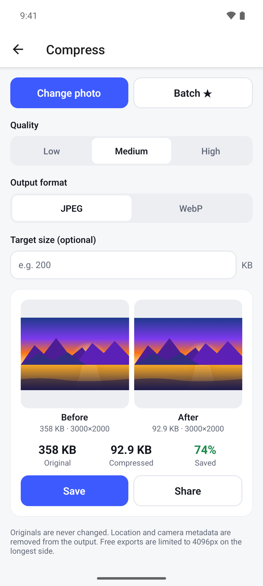

## ماذا يفعل التطبيق

يجمع Photo & Image Toolkit خمس أدوات يومية للصور في تطبيق واحد: الضغط، وتغيير الحجم والاقتصاص، والتحويل، والكولاج، وإزالة الخلفية. كل أداة تعمل على هاتفك وتحفظ نسخة جديدة، فلا تتغير صورتك الأصلية أبدًا. التطبيق متوفر بـ 14 لغة ويتبع لغة هاتفك.

- بلا حساب. تُعالَج الصور على جهازك ولا تُرفع إلى أي مكان.
- لا يرى التطبيق إلا الصور التي تختارها.
- تُحذف بيانات الموقع وتفاصيل الكاميرا من النسخ التي يحفظها.
- مجاني مع إعلانات. شراء Premium مرة واحدة يزيل الإعلانات ويضيف المعالجة الجماعية.

## ابدأ الاستخدام

1. افتح Photo & Image Toolkit. تعرض الشاشة الرئيسية الأدوات الخمس.
2. اضغط على أداة، مثل **Compress**.
3. اضغط **Select photo** واختر صورة. لا يطلب التطبيق الوصول إلى مكتبة صورك كاملة.
4. عندما تصبح النتيجة جاهزة، اضغط **Save** لحفظها كصورة جديدة، أو **Share** لإرسالها إلى تطبيق آخر.

## ضغط صورة

1. في الشاشة الرئيسية، اضغط **Compress** ثم **Select photo**.
2. تحت **Quality**، اختر **Low** أو **Medium** أو **High**. الخيار Low يعطي أصغر ملف.
3. تحت **Output format**، اختر **JPEG** أو **WebP**.
4. إذا كان يجب أن يبقى الملف أقل من حجم معين، اكتبه في **Target size (optional)** بالكيلوبايت.
5. اضغط **Compress**. سترى الصورة قبل الضغط وبعده، مع الحجم الأصلي والحجم الجديد ومقدار ما وفّرته.
6. اضغط **Save** أو **Share**.

إذا تعذّر الوصول إلى الحجم المطلوب دون خسارة كبيرة في الجودة، يخبرك التطبيق ويعطيك أصغر نتيجة ممكنة.

## تغيير الحجم والاقتصاص والتدوير والقلب

1. اضغط **Resize & Crop** ثم **Select photo**.
2. تحت **Crop ratio**، أبقِ **Free** أو اختر شكلًا ثابتًا مثل **1:1** أو **4:5** أو **16:9**.
3. اسحب داخل مربع الاقتصاص لتحريكه. اسحب النقطة الزرقاء في زاويته لتكبيره أو تصغيره.
4. اضغط **⟲ Left** أو **⟳ Right** لتدوير الصورة. اضغط زر **Flip** لعكسها كما في المرآة.
5. تحت **Resize**، اختر **Original** للإبقاء على الحجم، أو **Pixels** لكتابة العرض، أو **%** للتحجيم بالنسبة المئوية، أو **Presets** لأحجام جاهزة لوسائل التواصل والمستندات.
6. تحت **Format**، اختر **JPEG** أو **PNG** أو **WebP**.
7. تحقق من سطر **Output** لمعرفة الحجم النهائي، ثم اضغط **Apply**.
8. اضغط **Save** أو **Share**.

## التحويل إلى JPEG أو PNG أو WebP

1. اضغط **Convert** ثم **Select photo**. يمكن فتح صور HEIC وPNG وWebP وJPEG.
2. تحت **Convert to**، اختر **JPEG** أو **PNG** أو **WebP**. تحت الأزرار ملاحظة قصيرة توضح مزايا كل صيغة.
3. مع JPEG وWebP، اختر **Quality**: **Low** أو **Medium** أو **High**.
4. اضغط زر **Convert to** في أسفل البطاقة، مثل **Convert to JPEG**.
5. قارن الحجم قبل التحويل وبعده، ثم اضغط **Save** أو **Share**.

إذا كانت في الصورة مناطق شفافة واخترت JPEG، ينبّهك التطبيق إلى أنها ستصبح بيضاء.

## إنشاء كولاج

1. اضغط **Collage** ثم **Select photos**. اختر من 2 إلى 9 صور.
2. لتغيير الترتيب، اضغط صورة في المعاينة، ثم اضغط الصورة التي تريد التبديل معها.
3. تحت **Layout**، اختر طريقة ترتيب الصور. التخطيطات التي عليها ★ ضمن Premium.
4. تحت **Shape**، اختر **1:1** أو **4:5** أو **9:16** أو **16:9**.
5. اضبط **Spacing** بين الصور، و**Corners** (**Square** أو **Soft** أو **Round**)، ولون **Background**.
6. تحت **Format**، اختر **JPEG** أو **PNG**.
7. اضغط **Create collage** ثم **Save** أو **Share**.

## إزالة الخلفية

1. اضغط **Remove Background** ثم **Select photo**. يقص التطبيق العنصر الرئيسي فورًا. يعمل بأفضل شكل مع عنصر واحد واضح: شخص أو حيوان أليف أو منتج.
2. اضغط **Before** و**After** لمقارنة الصورة المقصوصة بالأصل.
3. تحت **Background**، اختر ما يظهر خلف العنصر:
   - **Transparent**: تُحفظ كصورة PNG شفافة.
   - **Colour**: اختر أحد الألوان المعروضة.
   - **Photo**: اضغط **Choose background photo** واختر صورة أخرى.
4. اضغط **Save** أو **Share**.

مع Premium، يمكنك أيضًا وضع العنصر على خلفية متدرجة.

يتم القص على جهازك. في أول استخدام لهذه الأداة، قد يحتاج هاتفك إلى الاتصال بالإنترنت للحظات لتنزيل نموذج القص عبر خدمات Google Play.

## افتح الإعدادات

1. في الشاشة الرئيسية، اضغط **Settings** في الأعلى.
2. تحت **Premium**، تعرف إن كنت على **Free** أم **Premium**، أو اضغط **Upgrade to Premium**، أو اضغط **Restore purchases**.
3. تحت **Privacy**، افتح **Privacy Policy** أو **Terms of Use**. في بعض الدول سترى أيضًا **Ad privacy choices** لتغيير موافقتك على الإعلانات.

## Premium

Premium دفعة واحدة وليس اشتراكًا. اضغط **★ Go Premium** في الشاشة الرئيسية، أو **Upgrade to Premium** في **Settings**. وهو يمنحك:

- بلا إعلانات.
- المعالجة الجماعية بزر **Batch**: اضغط أو حوّل حتى 20 صورة دفعة واحدة، أو اقصّ حتى 10 صور. ويمكنك أيضًا تغيير حجم عدة صور معًا.
- تصدير بدقة عالية: حتى 8192 بكسل للضلع الأطول بدل 4096، وحتى 4096 بكسل بدل 2048 للصور المقصوصة، وكولاج أكبر.
- **Smooth edges** لحواف أنعم في **Remove Background**، وقوالب خلفيات متدرجة.
- تخطيطات كولاج إضافية.

إذا اشتريت Premium من قبل، اضغط **Restore purchases** في **Settings** أو في شاشة Premium.

## الأسئلة الشائعة

**هل يغيّر صورتي الأصلية؟**
لا. كل أداة تحفظ نسخة جديدة. في أندرويد تذهب النسخ إلى ألبوم **Photo Toolkit** في معرض الصور.

**هل تُرفع صوري إلى الإنترنت؟**
لا. الأدوات الخمس كلها تعمل على هاتفك، بما فيها إزالة الخلفية.

**لماذا صورتي المحفوظة أصغر بالبكسل من الأصلية؟**
تحفظ النسخة المجانية الصور حتى 4096 بكسل للضلع الأطول، والصور المقصوصة حتى 2048 بكسل. تُصغَّر الصور الأكبر. ويرفع Premium هذه الحدود.

**هل يمكنني الحفظ بصيغة HEIC؟**
ليس في أندرويد. يمكنك فتح صور HEIC وتحويلها إلى JPEG أو PNG أو WebP.

**تظهر رسالة خطأ في إزالة الخلفية. ماذا أفعل؟**
تحتاج هذه الأداة إلى خدمات Google Play. تأكد من اتصالك بالإنترنت ومن إعداد Google Play على هاتفك، ثم حاول مرة أخرى.

## الخصوصية

تُعالَج صورك على جهازك ولا تُرفع إلى أي مكان. تعرض النسخة المجانية إعلانات من Google AdMob. اقرأ [سياسة الخصوصية](https://varian1.github.io/photoimagetoolkit/privacy.html) كاملة.
