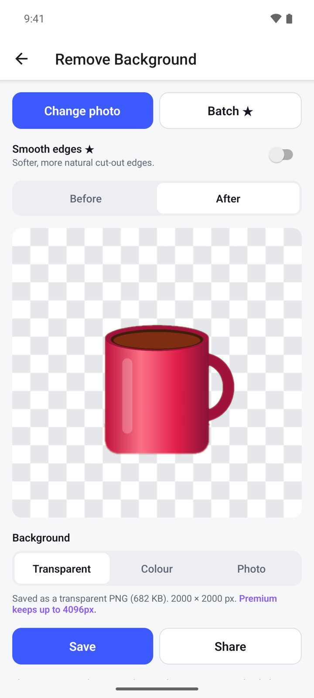

## Ce que fait l'appli

Photo & Image Toolkit réunit cinq outils photo du quotidien dans une seule appli : compresser, redimensionner et recadrer, convertir, faire un collage et supprimer l'arrière-plan. Chaque outil fonctionne sur votre téléphone et enregistre une nouvelle copie : votre photo d'origine n'est jamais modifiée. L'appli existe en 14 langues et suit la langue de votre téléphone.

- Pas de compte. Les photos sont traitées sur votre appareil et ne sont jamais envoyées en ligne.
- L'appli ne voit que les photos que vous choisissez.
- La position et les informations de l'appareil photo sont retirées des copies enregistrées.
- Gratuite avec publicités. Un achat Premium unique supprime les publicités et ajoute le traitement par lot.

## Premiers pas

1. Ouvrez Photo & Image Toolkit. L'écran d'accueil affiche les cinq outils.
2. Touchez un outil, par exemple **Compress**.
3. Touchez **Select photo** et choisissez une photo. L'appli ne demande pas l'accès à toute votre photothèque.
4. Quand le résultat est prêt, touchez **Save** pour le garder comme nouvelle photo, ou **Share** pour l'envoyer vers une autre appli.

## Compresser une photo

1. Sur l'écran d'accueil, touchez **Compress**, puis **Select photo**.
2. Sous **Quality**, choisissez **Low**, **Medium** ou **High**. **Low** donne le fichier le plus léger.
3. Sous **Output format**, choisissez **JPEG** ou **WebP**.
4. Si le fichier doit rester sous une certaine taille, saisissez-la en Ko dans **Target size (optional)**.
5. Touchez **Compress**. Vous voyez la photo avant et après, avec la taille d'origine, la nouvelle taille et la place gagnée.
6. Touchez **Save** ou **Share**.

Si la taille cible ne peut pas être atteinte sans une forte perte de qualité, l'appli vous le dit et vous donne le résultat le plus léger possible.

## Redimensionner, recadrer, pivoter ou retourner

1. Touchez **Resize & Crop**, puis **Select photo**.
2. Sous **Crop ratio**, gardez **Free** ou choisissez une forme fixe comme **1:1**, **4:5** ou **16:9**.
3. Faites glisser le cadre de recadrage pour le déplacer. Faites glisser le point bleu d'un coin pour l'agrandir ou le réduire.
4. Touchez **⟲ Left** ou **⟳ Right** pour faire pivoter la photo. Touchez un bouton **Flip** pour la retourner comme dans un miroir.
5. Sous **Resize**, choisissez **Original** pour garder la taille, **Pixels** pour saisir une largeur, **%** pour réduire ou agrandir en pourcentage, ou **Presets** pour des tailles toutes prêtes pour les réseaux sociaux et les documents.
6. Sous **Format**, choisissez **JPEG**, **PNG** ou **WebP**.
7. Vérifiez la taille finale sur la ligne **Output**, puis touchez **Apply**.
8. Touchez **Save** ou **Share**.

## Convertir en JPEG, PNG ou WebP

1. Touchez **Convert**, puis **Select photo**. Vous pouvez ouvrir des photos HEIC, PNG, WebP et JPEG.
2. Sous **Convert to**, choisissez **JPEG**, **PNG** ou **WebP**. Une courte note sous les boutons indique à quoi sert chaque format.
3. Pour JPEG et WebP, choisissez une **Quality** : **Low**, **Medium** ou **High**.
4. Touchez le bouton **Convert to** en bas de la carte, par exemple **Convert to JPEG**.
5. Comparez la taille avant et après, puis touchez **Save** ou **Share**.

Si la photo contient des zones transparentes et que vous choisissez JPEG, l'appli vous prévient qu'elles deviendront blanches.

## Faire un collage

1. Touchez **Collage**, puis **Select photos**. Choisissez de 2 à 9 photos.
2. Pour changer l'ordre, touchez une photo dans l'aperçu, puis la photo avec laquelle l'échanger.
3. Sous **Layout**, choisissez la disposition des photos. Les dispositions marquées d'une ★ font partie de Premium.
4. Sous **Shape**, choisissez **1:1**, **4:5**, **9:16** ou **16:9**.
5. Réglez l'**Spacing** entre les photos, les **Corners** (**Square**, **Soft** ou **Round**) et la couleur de **Background**.
6. Sous **Format**, choisissez **JPEG** ou **PNG**.
7. Touchez **Create collage**, puis **Save** ou **Share**.

## Supprimer un arrière-plan

1. Touchez **Remove Background**, puis **Select photo**. L'appli détoure le sujet aussitôt. Elle fonctionne mieux avec un seul sujet bien net : une personne, un animal ou un produit.
2. Touchez **Before** et **After** pour comparer le détourage avec l'original.
3. Sous **Background**, choisissez ce qui se trouve derrière le sujet :
   - **Transparent** : enregistré en PNG transparent.
   - **Colour** : choisissez l'une des couleurs proposées.
   - **Photo** : touchez **Choose background photo** et choisissez une autre photo.
4. Touchez **Save** ou **Share**.

Avec Premium, vous pouvez aussi placer le sujet sur un dégradé.

Le détourage se fait sur votre appareil. La première fois que vous utilisez cet outil, votre téléphone peut avoir besoin d'être en ligne un instant pour récupérer le modèle de détourage via les services Google Play.

## Ouvrir les réglages

1. Sur l'écran d'accueil, touchez **Settings** en haut à droite.
2. Sous **Premium**, voyez si vous êtes en **Free** ou **Premium**, touchez **Upgrade to Premium**, ou touchez **Restore purchases**.
3. Sous **Privacy**, ouvrez la **Privacy Policy** ou les **Terms of Use**. Dans certains pays, vous voyez aussi **Ad privacy choices**, où vous pouvez modifier votre consentement aux publicités.

## Premium

Premium est un paiement unique, pas un abonnement. Touchez **★ Go Premium** sur l'écran d'accueil, ou **Upgrade to Premium** dans **Settings**. Il vous apporte :

- Aucune publicité.
- Le traitement par lot avec le bouton **Batch** : compresser ou convertir jusqu'à 20 photos à la fois, ou en détourer jusqu'à 10. Vous pouvez aussi redimensionner plusieurs photos à la fois.
- L'export en haute résolution : jusqu'à 8192 px sur le plus grand côté au lieu de 4096 px, jusqu'à 4096 px au lieu de 2048 px pour les détourages, et des collages plus grands.
- **Smooth edges** pour des bords de détourage plus doux dans **Remove Background**, et des modèles d'arrière-plan en dégradé.
- Des dispositions de collage supplémentaires.

Si vous avez déjà acheté Premium, touchez **Restore purchases** dans **Settings** ou sur l'écran Premium.

## Questions

**Mon original est-il modifié ?**
Non. Chaque outil enregistre une nouvelle copie. Sur Android, les copies vont dans l'album **Photo Toolkit** de votre galerie.

**Mes photos sont-elles envoyées en ligne ?**
Non. Les cinq outils fonctionnent sur votre téléphone, y compris la suppression d'arrière-plan.

**Pourquoi ma photo enregistrée a-t-elle moins de pixels que l'original ?**
La version gratuite enregistre les photos jusqu'à 4096 px sur le plus grand côté, et les détourages jusqu'à 2048 px. Les photos plus grandes sont réduites. Premium relève ces limites.

**Puis-je enregistrer en HEIC ?**
Pas sur Android. Vous pouvez ouvrir des photos HEIC et les convertir en JPEG, PNG ou WebP.

**La suppression d'arrière-plan affiche une erreur. Que faire ?**
Cet outil a besoin des services Google Play. Vérifiez que vous êtes en ligne et que Google Play est configuré sur votre téléphone, puis réessayez.

## Confidentialité

Vos photos sont traitées sur votre appareil et ne sont jamais envoyées en ligne. La version gratuite affiche des publicités de Google AdMob. Lisez la [politique de confidentialité](https://varian1.github.io/photoimagetoolkit/privacy.html) complète.
