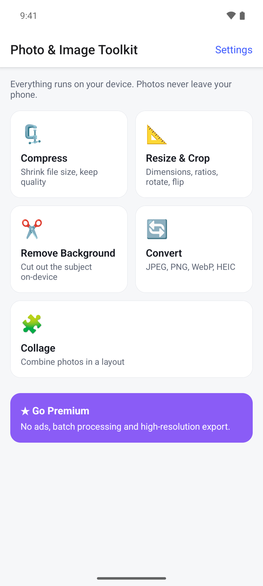
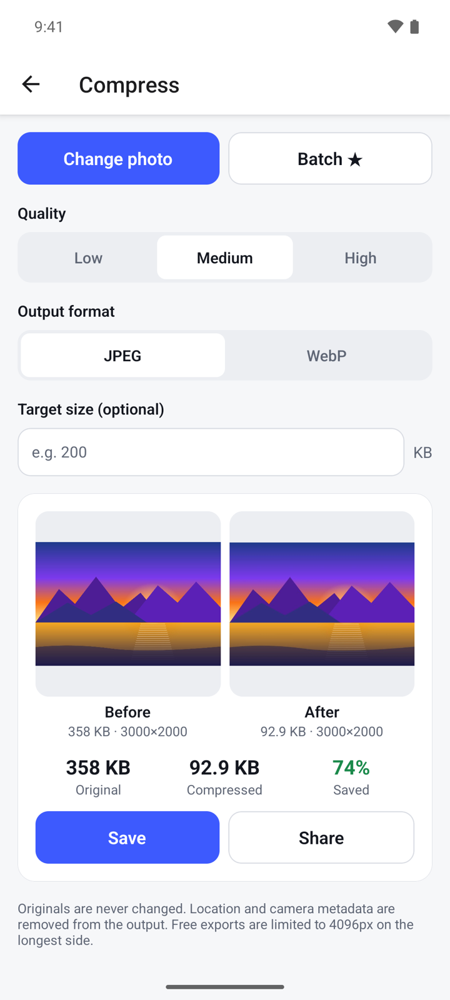
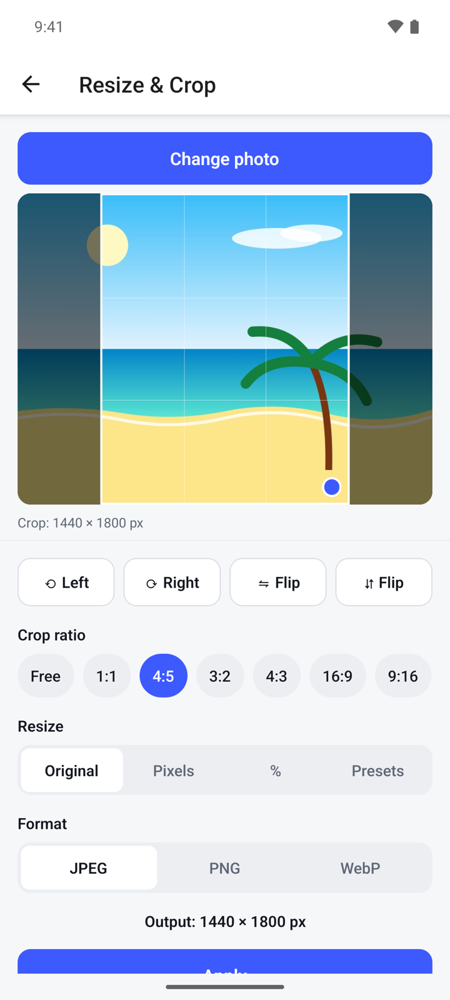
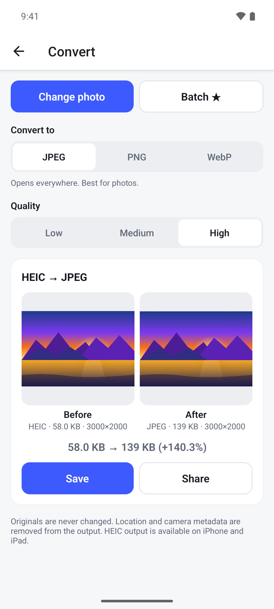
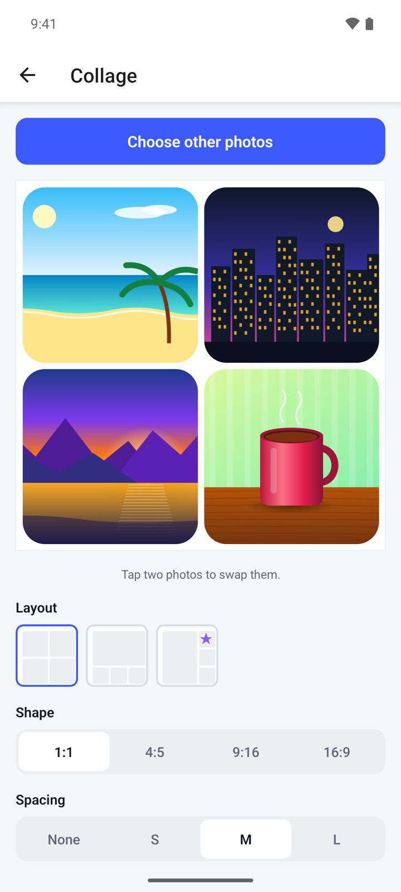
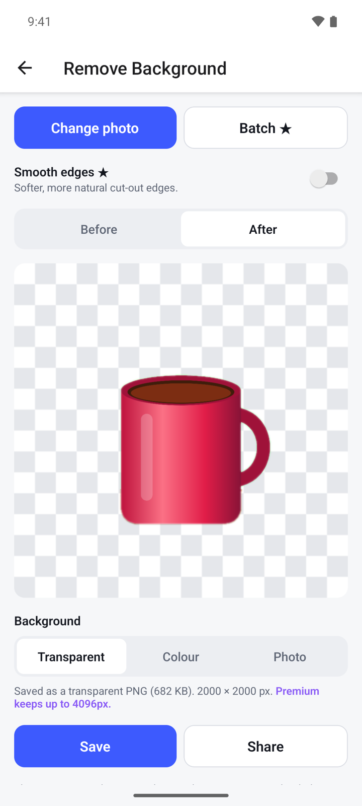

## What it does

Photo & Image Toolkit puts five everyday photo tools in one app: compress, resize and crop, convert, collage and background removal. Every tool works on your phone and saves a new copy, so your original photo is never changed.

- No account. Photos are processed on your device and never uploaded.
- The app only sees the photos you pick.
- Location and camera details are removed from the copies it saves.
- Free with ads. A one-time Premium purchase removes ads and adds batch processing.

## Get started

1. Open Photo & Image Toolkit. The home screen shows the five tools.
2. Tap a tool, for example **Compress**.
3. Tap **Select photo** and pick a photo. The app does not ask for access to your whole photo library.
4. When the result is ready, tap **Save** to keep it as a new photo, or **Share** to send it to another app.

## Compress a photo

1. On the home screen, tap **Compress**, then **Select photo**.
2. Under **Quality**, choose **Low**, **Medium** or **High**. Low gives the smallest file.
3. Under **Output format**, choose **JPEG** or **WebP**.
4. If the file must stay under a certain size, type it in **Target size (optional)**, in KB.
5. Tap **Compress**. You see the photo before and after, with the original size, the new size and how much you saved.
6. Tap **Save** or **Share**.

If the target size cannot be reached without heavy quality loss, the app tells you and gives you the smallest result.

## Resize, crop, rotate or flip

1. Tap **Resize & Crop**, then **Select photo**.
2. Under **Crop ratio**, keep **Free** or pick a fixed shape such as **1:1**, **4:5** or **16:9**.
3. Drag inside the crop box to move it. Drag the blue dot in its corner to make it larger or smaller.
4. Tap **⟲ Left** or **⟳ Right** to rotate the photo. Tap a **Flip** button to mirror it.
5. Under **Resize**, choose **Original** to keep the size, **Pixels** to type a width, **%** to scale by percent, or **Presets** for ready-made sizes for social media and documents.
6. Under **Format**, choose **JPEG**, **PNG** or **WebP**.
7. Check the **Output** line for the final size, then tap **Apply**.
8. Tap **Save** or **Share**.

## Convert to JPEG, PNG or WebP

1. Tap **Convert**, then **Select photo**. HEIC, PNG, WebP and JPEG photos can be opened.
2. Under **Convert to**, choose **JPEG**, **PNG** or **WebP**. A short note under the buttons says what each format is good for.
3. For JPEG and WebP, choose a **Quality**: **Low**, **Medium** or **High**.
4. Tap the **Convert to** button at the bottom of the card, for example **Convert to JPEG**.
5. Compare the size before and after, then tap **Save** or **Share**.

If the photo has transparent areas and you pick JPEG, the app warns you that they will become white.

## Make a collage

1. Tap **Collage**, then **Select photos**. Pick 2 to 9 photos.
2. To change the order, tap one photo in the preview, then tap the photo to swap it with.
3. Under **Layout**, pick how the photos are arranged. Layouts marked with ★ are part of Premium.
4. Under **Shape**, choose **1:1**, **4:5**, **9:16** or **16:9**.
5. Set the **Spacing** between photos, the **Corners** (**Square**, **Soft** or **Round**) and the **Background** colour.
6. Under **Format**, choose **JPEG** or **PNG**.
7. Tap **Create collage**, then **Save** or **Share**.

## Remove a background

1. Tap **Remove Background**, then **Select photo**. The app cuts out the subject right away. It works best with one clear subject: a person, pet or product.
2. Tap **Before** and **After** to compare the cut-out with the original.
3. Under **Background**, choose what goes behind the subject:
   - **Transparent**: saved as a transparent PNG.
   - **Colour**: pick one of the colours shown.
   - **Photo**: tap **Choose background photo** and pick another photo.
4. Tap **Save** or **Share**.

The cut-out is made on your device. The first time you use this tool, your phone may need to be online for a moment to fetch the cut-out model through Google Play services.

## Open Settings

1. On the home screen, tap **Settings** in the top right.
2. Under **Premium**, see whether you are on **Free** or **Premium**, tap **Upgrade to Premium**, or tap **Restore purchases**.
3. Under **Privacy**, open the **Privacy Policy** or the **Terms of Use**. In some countries you also see **Ad privacy choices**, where you can change your ad consent.

## Premium

Premium is one payment, not a subscription. Tap **★ Go Premium** on the home screen, or **Upgrade to Premium** in **Settings**. It gives you:

- No ads.
- Batch processing with the **Batch** button: compress or convert up to 20 photos at once, or cut out up to 10.
- High-resolution export: up to 8192 px on the longest side instead of 4096 px, up to 4096 px instead of 2048 px for cut-outs, and larger collages.
- **Smooth edges** for softer cut-out edges in **Remove Background**.
- Extra collage layouts.

If you bought Premium before, tap **Restore purchases** in **Settings** or on the Premium screen.

## Questions

**Does it change my original photo?**
No. Every tool saves a new copy. On Android the copies go to the **Photo Toolkit** album in your gallery.

**Are my photos uploaded?**
No. All five tools run on your phone, also background removal.

**Why is my saved photo smaller in pixels than the original?**
The free version saves photos up to 4096 px on the longest side, and cut-outs up to 2048 px. Larger photos are scaled down. Premium raises these limits.

**Can I save as HEIC?**
Not on Android. You can open HEIC photos and convert them to JPEG, PNG or WebP.

**Background removal shows an error. What can I do?**
This tool needs Google Play services. Check that you are online and that Google Play is set up on your phone, then try again.

## Privacy

Your photos are processed on your device and never uploaded. The free version shows ads from Google AdMob. Read the full [privacy policy](https://varian1.github.io/photoimagetoolkit/privacy.html).
