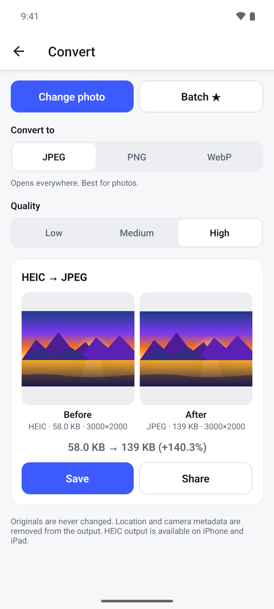

## Apa yang boleh dilakukan

Photo & Image Toolkit menghimpunkan lima alat foto harian dalam satu aplikasi: mampat, ubah saiz dan pangkas, tukar format, kolaj, dan buang latar belakang. Setiap alat berfungsi dalam telefon anda dan menyimpan salinan baharu, jadi foto asal anda tidak pernah diubah. Aplikasi ini tersedia dalam 14 bahasa dan mengikut bahasa telefon anda.

- Tiada akaun. Foto diproses pada peranti anda dan tidak pernah dimuat naik.
- Aplikasi hanya melihat foto yang anda pilih.
- Maklumat lokasi dan kamera dibuang daripada salinan yang disimpan.
- Percuma dengan iklan. Pembelian Premium sekali sahaja membuang iklan dan menambah pemprosesan kelompok.

## Mulakan

1. Buka Photo & Image Toolkit. Skrin utama memaparkan lima alat.
2. Ketik satu alat, contohnya **Compress**.
3. Ketik **Select photo** dan pilih sekeping foto. Aplikasi tidak meminta akses kepada seluruh galeri foto anda.
4. Apabila hasilnya siap, ketik **Save** untuk menyimpannya sebagai foto baharu, atau **Share** untuk menghantarnya ke aplikasi lain.

## Mampatkan foto

1. Pada skrin utama, ketik **Compress**, kemudian **Select photo**.
2. Di bawah **Quality**, pilih **Low**, **Medium** atau **High**. Low menghasilkan fail paling kecil.
3. Di bawah **Output format**, pilih **JPEG** atau **WebP**.
4. Jika fail mesti kekal di bawah saiz tertentu, taip saiz itu dalam **Target size (optional)**, dalam KB.
5. Ketik **Compress**. Anda akan melihat foto sebelum dan selepas, dengan saiz asal, saiz baharu dan jumlah yang dijimatkan.
6. Ketik **Save** atau **Share**.

Jika saiz sasaran tidak dapat dicapai tanpa kehilangan kualiti yang ketara, aplikasi akan memberitahu anda dan memberikan hasil yang paling kecil.

## Ubah saiz, pangkas, putar atau balikkan

1. Ketik **Resize & Crop**, kemudian **Select photo**.
2. Di bawah **Crop ratio**, kekalkan **Free** atau pilih bentuk tetap seperti **1:1**, **4:5** atau **16:9**.
3. Seret di dalam kotak pangkas untuk menggerakkannya. Seret titik biru di sudutnya untuk membesarkan atau mengecilkannya.
4. Ketik **⟲ Left** atau **⟳ Right** untuk memutar foto. Ketik butang **Flip** untuk membalikkannya seperti cermin.
5. Di bawah **Resize**, pilih **Original** untuk mengekalkan saiz, **Pixels** untuk menaip lebar, **%** untuk mengubah skala mengikut peratus, atau **Presets** untuk saiz siap pakai bagi media sosial dan dokumen.
6. Di bawah **Format**, pilih **JPEG**, **PNG** atau **WebP**.
7. Semak baris **Output** untuk saiz akhir, kemudian ketik **Apply**.
8. Ketik **Save** atau **Share**.

## Tukar kepada JPEG, PNG atau WebP

1. Ketik **Convert**, kemudian **Select photo**. Foto HEIC, PNG, WebP dan JPEG boleh dibuka.
2. Di bawah **Convert to**, pilih **JPEG**, **PNG** atau **WebP**. Nota ringkas di bawah butang menerangkan kegunaan setiap format.
3. Untuk JPEG dan WebP, pilih **Quality**: **Low**, **Medium** atau **High**.
4. Ketik butang **Convert to** di bahagian bawah kad, contohnya **Convert to JPEG**.
5. Bandingkan saiz sebelum dan selepas, kemudian ketik **Save** atau **Share**.

Jika foto mempunyai kawasan lut sinar dan anda memilih JPEG, aplikasi akan memberi amaran bahawa kawasan itu akan menjadi putih.

## Buat kolaj

1. Ketik **Collage**, kemudian **Select photos**. Pilih 2 hingga 9 foto.
2. Untuk menukar susunan, ketik satu foto dalam pratonton, kemudian ketik foto yang hendak ditukar tempatnya.
3. Di bawah **Layout**, pilih cara foto disusun. Susun atur yang bertanda ★ adalah sebahagian daripada Premium.
4. Di bawah **Shape**, pilih **1:1**, **4:5**, **9:16** atau **16:9**.
5. Tetapkan **Spacing** antara foto, **Corners** (**Square**, **Soft** atau **Round**) dan warna **Background**.
6. Di bawah **Format**, pilih **JPEG** atau **PNG**.
7. Ketik **Create collage**, kemudian **Save** atau **Share**.

## Buang latar belakang

1. Ketik **Remove Background**, kemudian **Select photo**. Aplikasi terus memotong subjek. Ia paling sesuai untuk satu subjek yang jelas: orang, haiwan peliharaan atau produk.
2. Ketik **Before** dan **After** untuk membandingkan hasil potongan dengan gambar asal.
3. Di bawah **Background**, pilih apa yang diletakkan di belakang subjek:
   - **Transparent**: disimpan sebagai PNG lut sinar.
   - **Colour**: pilih salah satu warna yang dipaparkan.
   - **Photo**: ketik **Choose background photo** dan pilih foto lain.
4. Ketik **Save** atau **Share**.

Dengan Premium, anda juga boleh meletakkan subjek pada latar gradien.

Potongan dibuat pada peranti anda. Kali pertama anda menggunakan alat ini, telefon anda mungkin perlu dalam talian seketika untuk mengambil model potongan melalui perkhidmatan Google Play.

## Buka Settings

1. Pada skrin utama, ketik **Settings** di penjuru kanan atas.
2. Di bawah **Premium**, lihat sama ada anda menggunakan **Free** atau **Premium**, ketik **Upgrade to Premium**, atau ketik **Restore purchases**.
3. Di bawah **Privacy**, buka **Privacy Policy** atau **Terms of Use**. Di sesetengah negara anda juga akan melihat **Ad privacy choices**, tempat anda boleh menukar persetujuan iklan anda.

## Premium

Premium ialah satu bayaran sahaja, bukan langganan. Ketik **★ Go Premium** pada skrin utama, atau **Upgrade to Premium** dalam **Settings**. Ia memberikan anda:

- Tiada iklan.
- Pemprosesan kelompok dengan butang **Batch**: mampat atau tukar sehingga 20 foto sekali gus, atau potong sehingga 10 foto. Anda juga boleh mengubah saiz banyak foto sekali gus.
- Eksport resolusi tinggi: sehingga 8192 px pada sisi terpanjang berbanding 4096 px, sehingga 4096 px berbanding 2048 px untuk potongan, dan kolaj yang lebih besar.
- **Smooth edges** untuk tepi potongan yang lebih lembut dalam **Remove Background**, serta templat latar belakang gradien.
- Susun atur kolaj tambahan.

Jika anda pernah membeli Premium, ketik **Restore purchases** dalam **Settings** atau pada skrin Premium.

## Soalan lazim

**Adakah foto asal saya berubah?**
Tidak. Setiap alat menyimpan salinan baharu. Pada Android, salinan disimpan dalam album **Photo Toolkit** dalam galeri anda.

**Adakah foto saya dimuat naik?**
Tidak. Kelima-lima alat berjalan dalam telefon anda, termasuk pembuangan latar belakang.

**Mengapakah foto yang disimpan lebih kecil dalam piksel berbanding foto asal?**
Versi percuma menyimpan foto sehingga 4096 px pada sisi terpanjang, dan potongan sehingga 2048 px. Foto yang lebih besar dikecilkan. Premium menaikkan had ini.

**Bolehkah saya menyimpan sebagai HEIC?**
Tidak pada Android. Anda boleh membuka foto HEIC dan menukarnya kepada JPEG, PNG atau WebP.

**Pembuangan latar belakang menunjukkan ralat. Apa yang boleh saya lakukan?**
Alat ini memerlukan perkhidmatan Google Play. Pastikan anda dalam talian dan Google Play telah disediakan pada telefon anda, kemudian cuba lagi.

## Privasi

Foto anda diproses pada peranti anda dan tidak pernah dimuat naik. Versi percuma memaparkan iklan daripada Google AdMob. Baca [dasar privasi](https://varian1.github.io/photoimagetoolkit/privacy.html) yang penuh.
