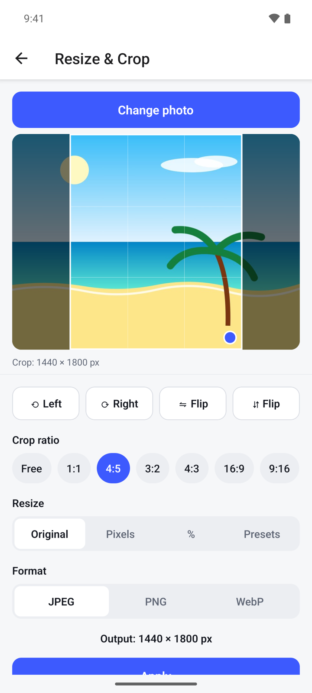

## Wat de app doet

Photo & Image Toolkit brengt vijf handige fototools samen in één app: comprimeren, verkleinen en bijsnijden, converteren, collages maken en achtergronden verwijderen. Elke tool werkt op je telefoon en bewaart een nieuwe kopie, dus je originele foto blijft altijd ongewijzigd. De app is beschikbaar in 14 talen en volgt de taal van je telefoon.

- Geen account nodig. Foto's worden op je toestel verwerkt en nooit geüpload.
- De app ziet alleen de foto's die jij kiest.
- Locatie- en cameragegevens worden verwijderd uit de kopieën die de app bewaart.
- Gratis met advertenties. Een eenmalige Premium-aankoop verwijdert de advertenties en voegt bulkverwerking toe.

## Aan de slag

1. Open Photo & Image Toolkit. Het startscherm toont de vijf tools.
2. Tik op een tool, bijvoorbeeld **Compress**.
3. Tik op **Select photo** en kies een foto. De app vraagt geen toegang tot je hele fotobibliotheek.
4. Als het resultaat klaar is, tik je op **Save** om het als nieuwe foto te bewaren, of op **Share** om het naar een andere app te sturen.

## Een foto comprimeren

1. Tik op het startscherm op **Compress** en daarna op **Select photo**.
2. Kies onder **Quality** voor **Low**, **Medium** of **High**. Low geeft het kleinste bestand.
3. Kies onder **Output format** voor **JPEG** of **WebP**.
4. Moet het bestand onder een bepaalde grootte blijven? Vul die dan in bij **Target size (optional)**, in KB.
5. Tik op **Compress**. Je ziet de foto voor en na, met de originele grootte, de nieuwe grootte en hoeveel je bespaard hebt.
6. Tik op **Save** of **Share**.

Als de gewenste grootte niet haalbaar is zonder sterk kwaliteitsverlies, meldt de app dat en geeft je het kleinst mogelijke resultaat.

## Formaat wijzigen, bijsnijden, draaien of spiegelen

1. Tik op **Resize & Crop** en daarna op **Select photo**.
2. Houd onder **Crop ratio** **Free** aan of kies een vaste vorm, zoals **1:1**, **4:5** of **16:9**.
3. Sleep binnen het uitsnedekader om het te verplaatsen. Sleep de blauwe stip in de hoek om het groter of kleiner te maken.
4. Tik op **⟲ Left** of **⟳ Right** om de foto te draaien. Tik op een **Flip**-knop om de foto te spiegelen.
5. Kies onder **Resize** voor **Original** om het formaat te houden, **Pixels** om een breedte in te typen, **%** om in procenten te schalen of **Presets** voor kant-en-klare formaten voor sociale media en documenten.
6. Kies onder **Format** voor **JPEG**, **PNG** of **WebP**.
7. Controleer op de regel **Output** het eindformaat en tik dan op **Apply**.
8. Tik op **Save** of **Share**.

## Converteren naar JPEG, PNG of WebP

1. Tik op **Convert** en daarna op **Select photo**. Je kunt foto's in HEIC, PNG, WebP en JPEG openen.
2. Kies onder **Convert to** voor **JPEG**, **PNG** of **WebP**. Een korte toelichting onder de knoppen vertelt waar elk formaat goed voor is.
3. Kies bij JPEG en WebP een **Quality**: **Low**, **Medium** of **High**.
4. Tik onderaan de kaart op de knop **Convert to**, bijvoorbeeld **Convert to JPEG**.
5. Vergelijk de grootte voor en na en tik dan op **Save** of **Share**.

Heeft de foto transparante delen en kies je JPEG, dan waarschuwt de app dat die wit worden.

## Een collage maken

1. Tik op **Collage** en daarna op **Select photos**. Kies 2 tot 9 foto's.
2. Wil je de volgorde wijzigen? Tik in het voorbeeld op één foto en daarna op de foto waarmee je die wilt omwisselen.
3. Kies onder **Layout** hoe de foto's worden ingedeeld. Indelingen met een ★ horen bij Premium.
4. Kies onder **Shape** voor **1:1**, **4:5**, **9:16** of **16:9**.
5. Stel de **Spacing** tussen de foto's in, de **Corners** (**Square**, **Soft** of **Round**) en de kleur van de **Background**.
6. Kies onder **Format** voor **JPEG** of **PNG**.
7. Tik op **Create collage** en daarna op **Save** of **Share**.

## Een achtergrond verwijderen

1. Tik op **Remove Background** en daarna op **Select photo**. De app knipt het onderwerp meteen uit. Het werkt het best met één duidelijk onderwerp: een persoon, huisdier of product.
2. Tik op **Before** en **After** om de uitsnede met het origineel te vergelijken.
3. Kies onder **Background** wat er achter het onderwerp komt:
   - **Transparent**: bewaard als transparante PNG.
   - **Colour**: kies een van de getoonde kleuren.
   - **Photo**: tik op **Choose background photo** en kies een andere foto.
4. Tik op **Save** of **Share**.

Met Premium kun je het onderwerp ook op een kleurverloop zetten.

Het uitknippen gebeurt op je toestel. De eerste keer dat je deze tool gebruikt, moet je telefoon misschien even online zijn om het uitknipmodel op te halen via Google Play-services.

## Instellingen openen

1. Tik op het startscherm rechtsboven op **Settings**.
2. Zie onder **Premium** of je **Free** of **Premium** hebt, tik op **Upgrade to Premium** of tik op **Restore purchases**.
3. Open onder **Privacy** het **Privacy Policy** of de **Terms of Use**. In sommige landen zie je ook **Ad privacy choices**, waar je je toestemming voor advertenties kunt wijzigen.

## Premium

Premium is een eenmalige betaling, geen abonnement. Tik op het startscherm op **★ Go Premium** of in **Settings** op **Upgrade to Premium**. Je krijgt:

- Geen advertenties.
- Bulkverwerking met de knop **Batch**: comprimeer of converteer tot 20 foto's tegelijk, of knip er tot 10 uit. Je kunt ook het formaat van veel foto's tegelijk wijzigen.
- Export in hoge resolutie: tot 8192 px aan de lange zijde in plaats van 4096 px, tot 4096 px in plaats van 2048 px bij uitgeknipte foto's, en grotere collages.
- **Smooth edges** voor zachtere randen bij het uitknippen in **Remove Background**, en achtergrondsjablonen met kleurverloop.
- Extra collage-indelingen.

Heb je Premium eerder gekocht? Tik dan op **Restore purchases** in **Settings** of op het Premium-scherm.

## Vragen

**Verandert de app mijn originele foto?**
Nee. Elke tool bewaart een nieuwe kopie. Op Android komen de kopieën in het album **Photo Toolkit** in je galerij.

**Worden mijn foto's geüpload?**
Nee. Alle vijf de tools werken op je telefoon, ook het verwijderen van achtergronden.

**Waarom is mijn bewaarde foto kleiner in pixels dan het origineel?**
De gratis versie bewaart foto's tot 4096 px aan de lange zijde en uitgeknipte foto's tot 2048 px. Grotere foto's worden verkleind. Premium verhoogt deze limieten.

**Kan ik opslaan als HEIC?**
Niet op Android. Je kunt wel HEIC-foto's openen en converteren naar JPEG, PNG of WebP.

**Het verwijderen van de achtergrond geeft een foutmelding. Wat kan ik doen?**
Deze tool heeft Google Play-services nodig. Controleer of je online bent en of Google Play op je telefoon is ingesteld. Probeer het daarna opnieuw.

## Privacy

Je foto's worden op je toestel verwerkt en nooit geüpload. De gratis versie toont advertenties van Google AdMob. Lees het volledige [privacybeleid](https://varian1.github.io/photoimagetoolkit/privacy.html).
