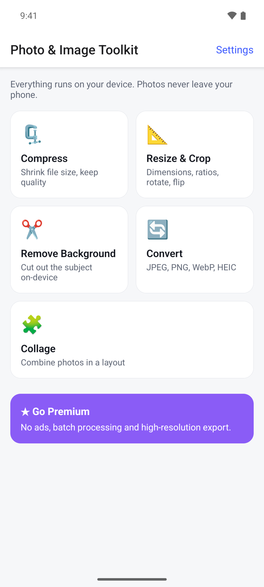

## Что умеет приложение

Photo & Image Toolkit объединяет пять нужных инструментов для фото: сжатие, изменение размера и обрезку, конвертацию, коллажи и удаление фона. Все инструменты работают на вашем телефоне и сохраняют новую копию, так что исходное фото не меняется. Приложение доступно на 14 языках и использует язык вашего телефона.

- Без аккаунта. Фото обрабатываются на устройстве и никуда не загружаются.
- Приложение видит только те фото, которые вы выбрали.
- Из сохранённых копий удаляются данные о местоположении и камере.
- Бесплатно, с рекламой. Разовая покупка Premium убирает рекламу и добавляет пакетную обработку.

## Начало работы

1. Откройте Photo & Image Toolkit. На главном экране вы увидите пять инструментов.
2. Нажмите на инструмент, например **Compress**.
3. Нажмите **Select photo** и выберите фото. Приложение не запрашивает доступ ко всей вашей фотогалерее.
4. Когда результат готов, нажмите **Save**, чтобы сохранить его как новое фото, или **Share**, чтобы отправить в другое приложение.

## Сжать фото

1. На главном экране нажмите **Compress**, затем **Select photo**.
2. В разделе **Quality** выберите **Low**, **Medium** или **High**. При значении Low файл получится самым маленьким.
3. В разделе **Output format** выберите **JPEG** или **WebP**.
4. Если файл должен весить не больше определённого размера, введите его в поле **Target size (optional)** в КБ.
5. Нажмите **Compress**. Вы увидите фото до и после, а также исходный размер, новый размер и сколько места удалось сэкономить.
6. Нажмите **Save** или **Share**.

Если заданный размер невозможно получить без сильной потери качества, приложение сообщит об этом и предложит самый маленький результат.

## Изменить размер, обрезать, повернуть или отразить

1. Нажмите **Resize & Crop**, затем **Select photo**.
2. В разделе **Crop ratio** оставьте **Free** или выберите готовую пропорцию, например **1:1**, **4:5** или **16:9**.
3. Чтобы переместить рамку обрезки, перетащите её внутри. Чтобы увеличить или уменьшить рамку, потяните синюю точку в её углу.
4. Нажмите **⟲ Left** или **⟳ Right**, чтобы повернуть фото. Нажмите кнопку **Flip**, чтобы отразить его зеркально.
5. В разделе **Resize** выберите **Original**, чтобы сохранить размер, **Pixels**, чтобы ввести ширину, **%**, чтобы изменить масштаб в процентах, или **Presets** — готовые размеры для соцсетей и документов.
6. В разделе **Format** выберите **JPEG**, **PNG** или **WebP**.
7. Проверьте итоговый размер в строке **Output** и нажмите **Apply**.
8. Нажмите **Save** или **Share**.

## Конвертировать в JPEG, PNG или WebP

1. Нажмите **Convert**, затем **Select photo**. Можно открывать фото в форматах HEIC, PNG, WebP и JPEG.
2. В разделе **Convert to** выберите **JPEG**, **PNG** или **WebP**. Короткая подсказка под кнопками объясняет, для чего подходит каждый формат.
3. Для JPEG и WebP выберите **Quality**: **Low**, **Medium** или **High**.
4. Нажмите кнопку **Convert to** внизу карточки, например **Convert to JPEG**.
5. Сравните размер до и после, затем нажмите **Save** или **Share**.

Если на фото есть прозрачные области и вы выбираете JPEG, приложение предупредит, что они станут белыми.

## Сделать коллаж

1. Нажмите **Collage**, затем **Select photos**. Выберите от 2 до 9 фото.
2. Чтобы изменить порядок, нажмите на одно фото в предпросмотре, затем на то фото, с которым его нужно поменять местами.
3. В разделе **Layout** выберите, как расположить фото. Макеты со значком ★ входят в Premium.
4. В разделе **Shape** выберите **1:1**, **4:5**, **9:16** или **16:9**.
5. Задайте **Spacing** — расстояние между фото, **Corners** (**Square**, **Soft** или **Round**) и цвет **Background**.
6. В разделе **Format** выберите **JPEG** или **PNG**.
7. Нажмите **Create collage**, затем **Save** или **Share**.

## Удалить фон

1. Нажмите **Remove Background**, затем **Select photo**. Приложение сразу вырезает объект. Лучше всего оно работает, когда на фото один чёткий объект: человек, питомец или товар.
2. Нажимайте **Before** и **After**, чтобы сравнить вырезанный объект с оригиналом.
3. В разделе **Background** выберите, что будет за объектом:
   - **Transparent**: сохраняется как PNG с прозрачным фоном.
   - **Colour**: выберите один из показанных цветов.
   - **Photo**: нажмите **Choose background photo** и выберите другое фото.
4. Нажмите **Save** или **Share**.

С Premium можно также поместить объект на градиентный фон.

Объект вырезается на вашем устройстве. При первом использовании этого инструмента телефону может понадобиться ненадолго подключиться к интернету, чтобы загрузить модель для вырезания через сервисы Google Play.

## Открыть настройки

1. На главном экране нажмите **Settings** в правом верхнем углу.
2. В разделе **Premium** вы увидите, какой у вас тариф — **Free** или **Premium**. Здесь же можно нажать **Upgrade to Premium** или **Restore purchases**.
3. В разделе **Privacy** откройте **Privacy Policy** или **Terms of Use**. В некоторых странах также доступен пункт **Ad privacy choices**, где можно изменить согласие на рекламу.

## Premium

Premium — это разовый платёж, а не подписка. Нажмите **★ Go Premium** на главном экране или **Upgrade to Premium** в **Settings**. Premium даёт:

- Отсутствие рекламы.
- Пакетную обработку кнопкой **Batch**: можно сжать или конвертировать до 20 фото за раз либо вырезать фон у 10 фото. Также можно изменять размер сразу у многих фото.
- Экспорт в высоком разрешении: до 8192 px по длинной стороне вместо 4096 px, до 4096 px вместо 2048 px для вырезанных объектов и более крупные коллажи.
- **Smooth edges** для более мягких краёв вырезанного объекта в **Remove Background**, а также шаблоны с градиентным фоном.
- Дополнительные макеты для коллажей.

Если вы уже покупали Premium, нажмите **Restore purchases** в **Settings** или на экране Premium.

## Questions

**Меняется ли мое исходное фото?**
Нет. Каждый инструмент сохраняет новую копию. На Android копии попадают в альбом **Photo Toolkit** в вашей галерее.

**Загружаются ли мои фото в интернет?**
Нет. Все пять инструментов работают на вашем телефоне, в том числе удаление фона.

**Почему сохранённое фото меньше оригинала в пикселях?**
Бесплатная версия сохраняет фото размером до 4096 px по длинной стороне, а вырезанные объекты — до 2048 px. Более крупные фото уменьшаются. В Premium эти ограничения выше.

**Можно ли сохранить фото в HEIC?**
На Android нельзя. Фото HEIC можно открыть и преобразовать в JPEG, PNG или WebP.

**При удалении фона появляется ошибка. Что делать?**
Для этого инструмента нужны сервисы Google Play. Убедитесь, что телефон подключён к интернету и Google Play на нём настроен, затем попробуйте снова.

## Конфиденциальность

Ваши фото обрабатываются на устройстве и никуда не загружаются. В бесплатной версии показывается реклама от Google AdMob. Полный текст читайте в [политике конфиденциальности](https://varian1.github.io/photoimagetoolkit/privacy.html).
