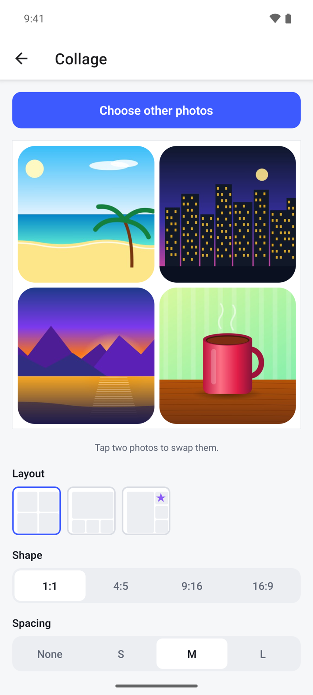

## What it does

Photo & Image Toolkit gom năm công cụ ảnh thông dụng vào một ứng dụng: nén ảnh, đổi cỡ và cắt, chuyển đổi định dạng, ghép ảnh và xóa nền. Mọi công cụ đều chạy ngay trên điện thoại và lưu thành một bản sao mới, nên ảnh gốc của bạn không bao giờ bị thay đổi. Ứng dụng có 14 ngôn ngữ và tự theo ngôn ngữ của điện thoại.

- Không cần tài khoản. Ảnh được xử lý ngay trên thiết bị và không bao giờ bị tải lên.
- Ứng dụng chỉ thấy những ảnh bạn chọn.
- Vị trí và thông tin máy ảnh được xóa khỏi các bản sao mà ứng dụng lưu.
- Miễn phí, có quảng cáo. Mua Premium một lần để tắt quảng cáo và dùng xử lý hàng loạt.

## Get started

1. Mở Photo & Image Toolkit. Màn hình chính hiển thị năm công cụ.
2. Chạm vào một công cụ, ví dụ **Compress**.
3. Chạm **Select photo** và chọn một ảnh. Ứng dụng không yêu cầu quyền truy cập toàn bộ thư viện ảnh của bạn.
4. Khi có kết quả, chạm **Save** để lưu thành ảnh mới, hoặc **Share** để gửi sang ứng dụng khác.

## Compress a photo

1. Ở màn hình chính, chạm **Compress**, rồi chạm **Select photo**.
2. Trong mục **Quality**, chọn **Low**, **Medium** hoặc **High**. Low cho tệp nhỏ nhất.
3. Trong mục **Output format**, chọn **JPEG** hoặc **WebP**.
4. Nếu tệp phải nhỏ hơn một dung lượng nhất định, nhập số KB vào **Target size (optional)**.
5. Chạm **Compress**. Bạn sẽ thấy ảnh trước và sau khi nén, cùng dung lượng gốc, dung lượng mới và mức tiết kiệm được.
6. Chạm **Save** hoặc **Share**.

Nếu không thể đạt dung lượng mục tiêu mà không làm giảm chất lượng nhiều, ứng dụng sẽ báo cho bạn và đưa ra kết quả nhỏ nhất có thể.

## Resize, crop, rotate or flip

1. Chạm **Resize & Crop**, rồi chạm **Select photo**.
2. Trong mục **Crop ratio**, giữ **Free** hoặc chọn một tỷ lệ cố định như **1:1**, **4:5** hay **16:9**.
3. Kéo bên trong khung cắt để di chuyển khung. Kéo chấm xanh ở góc khung để phóng to hoặc thu nhỏ.
4. Chạm **⟲ Left** hoặc **⟳ Right** để xoay ảnh. Chạm một nút **Flip** để lật ảnh như soi gương.
5. Trong mục **Resize**, chọn **Original** để giữ nguyên kích thước, **Pixels** để nhập chiều rộng, **%** để thu phóng theo phần trăm, hoặc **Presets** để dùng các cỡ có sẵn cho mạng xã hội và tài liệu.
6. Trong mục **Format**, chọn **JPEG**, **PNG** hoặc **WebP**.
7. Xem dòng **Output** để biết kích thước cuối cùng, rồi chạm **Apply**.
8. Chạm **Save** hoặc **Share**.

## Convert to JPEG, PNG or WebP

1. Chạm **Convert**, rồi chạm **Select photo**. Bạn có thể mở ảnh HEIC, PNG, WebP và JPEG.
2. Trong mục **Convert to**, chọn **JPEG**, **PNG** hoặc **WebP**. Một ghi chú ngắn dưới các nút cho biết mỗi định dạng phù hợp với việc gì.
3. Với JPEG và WebP, chọn **Quality**: **Low**, **Medium** hoặc **High**.
4. Chạm nút **Convert to** ở cuối thẻ, ví dụ **Convert to JPEG**.
5. So sánh dung lượng trước và sau, rồi chạm **Save** hoặc **Share**.

Nếu ảnh có vùng trong suốt mà bạn chọn JPEG, ứng dụng sẽ cảnh báo rằng các vùng đó sẽ chuyển thành màu trắng.

## Make a collage

1. Chạm **Collage**, rồi chạm **Select photos**. Chọn từ 2 đến 9 ảnh.
2. Để đổi thứ tự, chạm một ảnh trong phần xem trước, rồi chạm ảnh muốn hoán đổi vị trí.
3. Trong mục **Layout**, chọn cách sắp xếp ảnh. Các bố cục có dấu ★ thuộc Premium.
4. Trong mục **Shape**, chọn **1:1**, **4:5**, **9:16** hoặc **16:9**.
5. Chỉnh **Spacing** giữa các ảnh, **Corners** (**Square**, **Soft** hoặc **Round**) và màu **Background**.
6. Trong mục **Format**, chọn **JPEG** hoặc **PNG**.
7. Chạm **Create collage**, rồi chạm **Save** hoặc **Share**.

## Remove a background

1. Chạm **Remove Background**, rồi chạm **Select photo**. Ứng dụng tách chủ thể ngay lập tức. Công cụ hoạt động tốt nhất khi ảnh có một chủ thể rõ ràng: người, thú cưng hoặc sản phẩm.
2. Chạm **Before** và **After** để so sánh ảnh đã tách nền với ảnh gốc.
3. Trong mục **Background**, chọn thứ sẽ nằm phía sau chủ thể:
   - **Transparent**: lưu thành ảnh PNG trong suốt.
   - **Colour**: chọn một trong các màu hiển thị.
   - **Photo**: chạm **Choose background photo** và chọn một ảnh khác.
4. Chạm **Save** hoặc **Share**.

Với Premium, bạn còn có thể đặt chủ thể lên nền chuyển màu.

Việc tách nền được thực hiện ngay trên thiết bị. Lần đầu dùng công cụ này, điện thoại có thể cần kết nối mạng trong giây lát để tải mô hình tách nền qua Google Play services.

## Open Settings

1. Ở màn hình chính, chạm **Settings** ở góc trên bên phải.
2. Trong mục **Premium**, bạn có thể xem mình đang dùng bản **Free** hay **Premium**, chạm **Upgrade to Premium**, hoặc chạm **Restore purchases**.
3. Trong mục **Privacy**, mở **Privacy Policy** hoặc **Terms of Use**. Ở một số quốc gia, bạn còn thấy **Ad privacy choices**, nơi bạn có thể thay đổi lựa chọn đồng ý về quảng cáo.

## Premium

Premium chỉ cần thanh toán một lần, không phải gói đăng ký. Chạm **★ Go Premium** ở màn hình chính, hoặc **Upgrade to Premium** trong **Settings**. Premium mang đến cho bạn:

- Không có quảng cáo.
- Xử lý hàng loạt với nút **Batch**: nén hoặc chuyển đổi tối đa 20 ảnh cùng lúc, hoặc tách nền tối đa 10 ảnh. Bạn cũng có thể đổi cỡ nhiều ảnh cùng lúc.
- Xuất ảnh độ phân giải cao: tối đa 8192 px ở cạnh dài nhất thay vì 4096 px, tối đa 4096 px thay vì 2048 px với ảnh tách nền, và ảnh ghép lớn hơn.
- **Smooth edges** giúp viền ảnh tách nền mềm mại hơn trong **Remove Background**, cùng các mẫu nền chuyển màu.
- Thêm nhiều bố cục ghép ảnh.

Nếu bạn đã mua Premium trước đó, hãy chạm **Restore purchases** trong **Settings** hoặc trên màn hình Premium.

## Questions

**Ứng dụng có thay đổi ảnh gốc của tôi không?**
Không. Mọi công cụ đều lưu thành một bản sao mới. Trên Android, các bản sao nằm trong album **Photo Toolkit** của thư viện ảnh.

**Ảnh của tôi có bị tải lên không?**
Không. Cả năm công cụ đều chạy ngay trên điện thoại, kể cả xóa nền.

**Tại sao ảnh đã lưu có số điểm ảnh nhỏ hơn ảnh gốc?**
Bản miễn phí lưu ảnh tối đa 4096 px ở cạnh dài nhất, còn ảnh tách nền tối đa 2048 px. Ảnh lớn hơn sẽ bị thu nhỏ. Premium nâng các giới hạn này lên.

**Tôi có thể lưu ảnh dưới dạng HEIC không?**
Không, trên Android thì không. Bạn có thể mở ảnh HEIC và chuyển sang JPEG, PNG hoặc WebP.

**Xóa nền báo lỗi. Tôi nên làm gì?**
Công cụ này cần Google Play services. Hãy kiểm tra xem bạn đã kết nối mạng và điện thoại đã cài đặt Google Play chưa, rồi thử lại.

## Privacy

Ảnh của bạn được xử lý ngay trên thiết bị và không bao giờ bị tải lên. Bản miễn phí hiển thị quảng cáo từ Google AdMob. Xem toàn bộ [chính sách quyền riêng tư](https://varian1.github.io/photoimagetoolkit/privacy.html).
