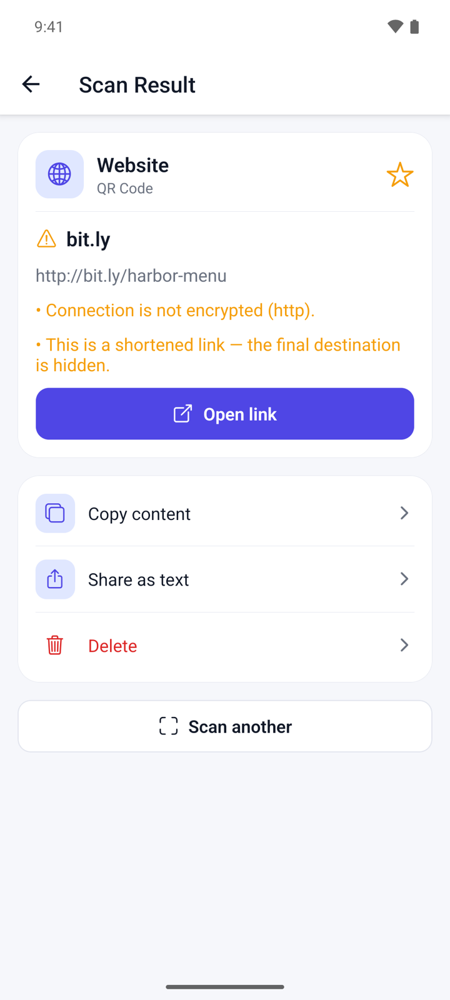

## Was die App kann

QR & Barcode Toolkit scannt QR-Codes und Barcodes mit der Kamera oder aus einem Foto und zeigt dir den Inhalt, bevor du etwas damit machst. Du kannst auch eigene QR-Codes und Barcodes erstellen, als Bild speichern oder teilen. Die App gibt es in 21 Sprachen und sie richtet sich nach der Sprache deines Handys.

- Codes werden auf deinem Gerät gelesen. Links öffnen sich nie von selbst.
- Kein Konto nötig. Dein Verlauf bleibt auf deinem Handy.
- Liest QR-Codes und 12 Barcode-Arten, zum Beispiel EAN-13, UPC-A und Code 128.
- Kostenlos mit Werbung. Ein einmaliger Kauf von Premium entfernt die Werbung und bietet mehr Gestaltungsoptionen.

## Erste Schritte

1. Öffne QR & Barcode Toolkit. **Home** zeigt vier Schnellzugriffe: **Scan QR**, **Scan Barcode**, **Create QR** und **Create Barcode**.
2. Tippe auf **Scan QR**. Beim ersten Mal tippst du auf **Allow camera** und erlaubst den Kamerazugriff, wenn Android fragt.
3. Wenn du die Kamera nicht nutzen möchtest, tippe auf **Scan from an image instead** und wähle ein Foto. Dafür brauchst du keinen Zugriff auf deine ganze Fotomediathek.

## Einen Code scannen

1. Tippe unten auf **Scan** oder auf einen Scan-Schnellzugriff auf **Home**.
2. Wähle oben **QR Code** oder **Barcode**.
3. Richte die Kamera auf den Code. Halte einen Barcode innerhalb des Rahmens.
4. Bei Dunkelheit tippst du auf die Taschenlampen-Taste. Um einen Code aus einem Foto zu lesen, tippst du auf die Bild-Taste und wählst das Foto.
5. **Scan Result** öffnet sich, sobald der Code gelesen wurde. Es zeigt die Art des Inhalts, zum Beispiel **Website**, **Wi-Fi**, **Contact** oder **Product**.
6. Tippe auf **Copy content** oder **Share as text**, oder auf **Scan another**, um zur Kamera zurückzukehren.

## Einen Link prüfen, bevor du ihn öffnest

1. Scanne einen Code, der eine Webadresse enthält. Das Ergebnis zeigt den Namen der Seite und die vollständige Adresse.
2. Lies die Warnungen, falls es welche gibt. Die App warnt vor unverschlüsselten Links (http), verkürzten Links, reinen IP-Adressen, versteckten Anmeldedaten und ähnlich aussehenden Zeichen.
3. Tippe nur auf **Open link**, wenn du der Seite vertraust, und bestätige dann mit **Open**.

Andere Arten von Codes haben eigene Tasten: **Compose email**, **Call**, **Send message**, **Open in Maps** oder **Search the web**. Jede fragt nach, bevor sie die App verlässt.

## Einen WLAN-Code lesen

1. Scanne den WLAN-QR-Code. Das Ergebnis zeigt **Network**, **Security** und **Password**.
2. Tippe auf das Augen-Symbol, um das Passwort anzuzeigen.
3. Tippe auf das Kopieren-Symbol neben dem Passwort.
4. Öffne die WLAN-Einstellungen deines Handys und verbinde dich mit dem kopierten Passwort. Die App verbindet sich nicht für dich.

## Einen QR-Code erstellen

1. Tippe auf **Create** und wähle **QR Code**.
2. Wähle unter **Content type** **Website**, **Text**, **Wi-Fi**, **Email**, **Phone**, **SMS**, **Contact** oder **Location**.
3. Fülle die Felder aus. Der QR-Code erscheint, sobald die Angaben gültig sind. Gib bei **Title (optional)** einen Namen ein, wenn du den Code im Verlauf so wiederfinden möchtest.
4. Wähle unter **Style** eine Vorlage: **Classic**, **Indigo** oder **Forest**. Du kannst auch die Farben **Foreground** und **Background** sowie die Stufe **Error correction** ändern.
5. Tippe auf **Save to history**, um ihn zu behalten, auf **Share**, um das Bild zu senden, oder auf **Save image**, um es in deiner Galerie zu speichern.

Optionen mit einem Schloss gehören zu Premium.

## Einen Barcode erstellen

1. Tippe auf **Create** und wähle **Barcode**.
2. Wähle unter **Format** **EAN-13**, **EAN-8**, **UPC-A**, **Code 128**, **Code 39** oder **ITF-14**.
3. Gib den **Value** ein. Die Zeile unter dem Feld sagt, was das Format akzeptiert. Bei Produktcodes ergänzt die App die Prüfziffer, wenn du sie weglässt.
4. Gib bei **Title (optional)** einen Namen ein, wenn du möchtest.
5. Tippe auf **Save to history**, **Share** oder **Save image**.

## Codes finden, wiederverwenden und löschen

1. Tippe auf **History**. Dort stehen die Codes, die du gescannt und erstellt hast.
2. Tippe in **Search** einen Begriff ein oder filtere mit **All**, **Scanned**, **Created**, **Favorites**, **Any type**, **QR** und **Barcode**.
3. Tippe auf den Stern in einer Zeile, um sie zu deinen Favoriten hinzuzufügen.
4. Tippe auf eine Zeile, um **Details** zu öffnen. Dort kannst du **Copy content**, **Share as text** oder **Delete** wählen. Bei QR-Codes und den Barcode-Formaten, die die App erstellen kann, siehst du außerdem den Code mit **Share image** und **Edit / reuse**.
5. Um die Liste zu leeren, tippe oben auf das Papierkorb-Symbol und dann auf **Clear**. Favoriten bleiben erhalten.

## Einstellungen ändern

1. Tippe auf **Settings**.
2. Schalte **Save scans to history** aus, wenn Scans nicht gespeichert werden sollen.
3. Schalte **Haptic feedback** ein oder aus.
4. Schalte **Keep Wi-Fi passwords in history** nur ein, wenn du die Passwörter speichern möchtest. Standardmäßig ist die Option aus.
5. Tippe auf **Language**, um die Sprache der App zu wählen. Standardmäßig folgt die App der Sprache deines Handys.
6. Tippe auf **Clear all history** und dann auf **Delete all**, um alle gescannten und erstellten Codes samt Favoriten zu entfernen.

## Premium

Premium ist eine Einmalzahlung, kein Abo. Öffne **Settings** und tippe auf **Go Premium**, oder tippe auf **Home** auf **See plans**. Du bekommst:

- Keine Werbung.
- Eigene Farben, Premium-Vorlagen und ein Logo in deinem QR-Code.
- Unbegrenzten Verlauf und unbegrenzt viele Favoriten.
- Export mit 1024 px und 2048 px.

Ohne Premium kann dir beim Tippen auf eine gesperrte Vorlage, eine gesperrte Farbe oder auf **Add logo** die Option **Watch an ad** angeboten werden. Sie schaltet diese Gestaltungsoptionen frei, bis du die App schließt. Wenn du Premium schon einmal gekauft hast, tippe in **Settings** auf **Restore purchases**.

## Fragen

**Öffnet die App Links von selbst?**
Nein. Sie zeigt zuerst die Adresse und mögliche Warnungen. Ein Link öffnet sich erst, wenn du auf **Open link** tippst und bestätigst.

**Welche Codes kann die App lesen?**
QR, EAN-13, EAN-8, UPC-A, UPC-E, Code 128, Code 39, Code 93, Codabar, ITF-14, PDF417, Data Matrix und Aztec.

**Warum fehlt das WLAN-Passwort in meinem Verlauf?**
WLAN-Passwörter werden entfernt, bevor ein Code gespeichert wird. Wenn du sie behalten möchtest, schalte in **Settings** die Option **Keep Wi-Fi passwords in history** ein, bevor du den Code scannst oder erstellst.

**Wie viele Codes werden gespeichert?**
Die kostenlose Version speichert deine letzten 100 Scans und 100 erstellten Codes sowie bis zu 10 Favoriten. **History** sagt dir, wenn die kostenlose Liste voll ist, und neue Einträge ersetzen dann die ältesten. Favoriten werden nicht entfernt, wenn die Liste voll ist. Mit Premium gibt es keine Grenze.

**Gibt es einen Dunkelmodus?**
Ja. Die App folgt dem hellen oder dunklen Design deines Handys.

## Datenschutz

Codes werden auf deinem Gerät gelesen und dein Verlauf bleibt auf deinem Handy. Die kostenlose Version zeigt Werbung von Google AdMob. Lies die vollständige [Datenschutzerklärung](https://varian1.github.io/qr-barcode-toolkit/privacy.html).
