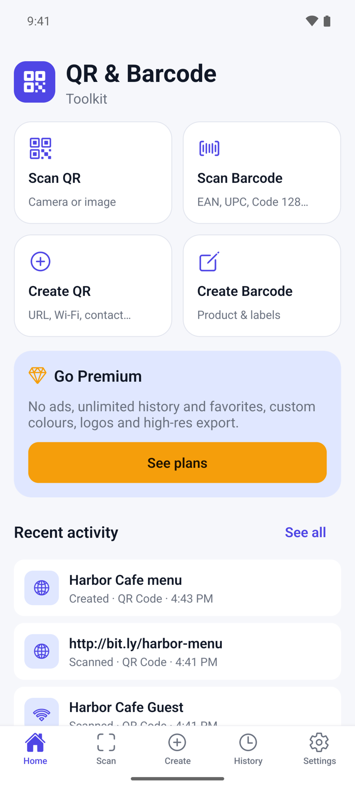
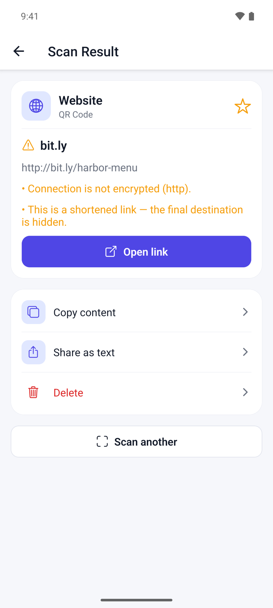
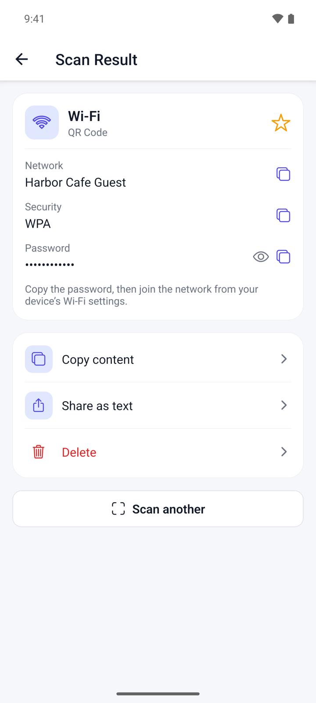
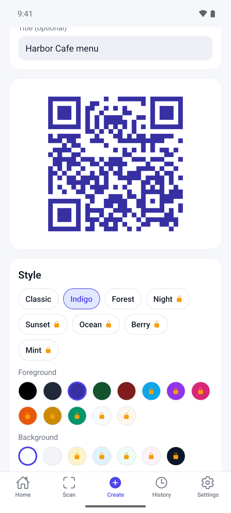
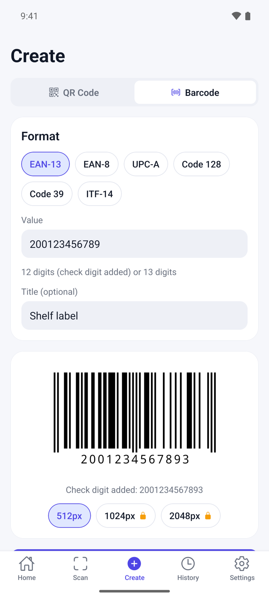

## What it does

QR & Barcode Toolkit scans QR codes and barcodes with your camera or from a photo, and shows what is inside before you act on it. You can also make your own QR codes and barcodes, then save them as images or share them.

- Codes are read on your device. Links never open by themselves.
- No account. Your history stays on your phone.
- Reads QR codes and 12 barcode types, such as EAN-13, UPC-A and Code 128.
- Free with ads. A one-time Premium purchase removes ads and adds more style options.

## Get started

1. Open QR & Barcode Toolkit. **Home** shows four shortcuts: **Scan QR**, **Scan Barcode**, **Create QR** and **Create Barcode**.
2. Tap **Scan QR**. The first time, tap **Allow camera** and allow the camera when Android asks.
3. If you prefer not to use the camera, tap **Scan from an image instead** and pick a photo. This does not need access to your whole photo library.

## Scan a code

1. Tap **Scan** at the bottom, or a scan shortcut on **Home**.
2. At the top, choose **QR Code** or **Barcode**.
3. Point the camera at the code. Keep a barcode inside the frame.
4. In the dark, tap the flashlight button. To read a code from a photo, tap the picture button and pick the photo.
5. **Scan Result** opens when the code is read. It shows the kind of content, such as **Website**, **Wi-Fi**, **Contact** or **Product**.
6. Tap **Copy content** or **Share as text**, or tap **Scan another** to go back to the camera.

## Check a link before you open it

1. Scan a code that holds a web address. The result shows the site name and the full address.
2. Read the warnings, if there are any. The app warns about unencrypted (http) links, shortened links, raw IP addresses, hidden login details and look-alike characters.
3. Tap **Open link** only if you trust the site, then tap **Open** to confirm.

Other kinds of codes get their own button: **Compose email**, **Call**, **Send message**, **Open in Maps** or **Search the web**. Each one asks before it leaves the app.

## Read a Wi-Fi code

1. Scan the Wi-Fi QR code. The result shows **Network**, **Security** and **Password**.
2. Tap the eye icon to show the password.
3. Tap the copy icon next to the password.
4. Open your phone's Wi-Fi settings and join the network with the copied password. The app does not connect for you.

## Create a QR code

1. Tap **Create** and choose **QR Code**.
2. Under **Content type**, pick **Website**, **Text**, **Wi-Fi**, **Email**, **Phone**, **SMS**, **Contact** or **Location**.
3. Fill in the fields. The QR code appears as soon as the details are valid. Fill in **Title (optional)** if you want a name for it in your history.
4. Under **Style**, pick a template: **Classic**, **Indigo** or **Forest**. You can also change the **Foreground** and **Background** colours and the **Error correction** level.
5. Tap **Save to history** to keep it, **Share** to send the image, or **Save image** to put it in your gallery.

Options with a lock are part of Premium.

## Create a barcode

1. Tap **Create** and choose **Barcode**.
2. Under **Format**, pick **EAN-13**, **EAN-8**, **UPC-A**, **Code 128**, **Code 39** or **ITF-14**.
3. Type the **Value**. The line below the field says what the format accepts. For product codes, the app adds the check digit if you leave it out.
4. Fill in **Title (optional)** if you want a name for it.
5. Tap **Save to history**, **Share** or **Save image**.

## Find, reuse and delete codes

1. Tap **History**. It lists the codes you scanned and created.
2. Type in **Search**, or filter with **All**, **Scanned**, **Created**, **Favorites**, **Any type**, **QR** and **Barcode**.
3. Tap the star on a row to add it to your favorites.
4. Tap a row to open **Details**. From there you can tap **Copy content**, **Share as text** or **Delete**. QR codes and the barcode formats the app can create also show the code with **Share image** and **Edit / reuse**.
5. To empty the list, tap the trash icon at the top and then **Clear**. Favorites are kept.

## Change settings

1. Tap **Settings**.
2. Turn off **Save scans to history** if you do not want scans kept.
3. Turn **Haptic feedback** on or off.
4. Turn on **Keep Wi-Fi passwords in history** only if you want them saved. It is off by default.
5. Tap **Clear all history** and then **Delete all** to remove every scan and created code, including favorites.

## Premium

Premium is one payment, not a subscription. Open **Settings** and tap **Go Premium**, or tap **See plans** on **Home**. It gives you:

- No ads.
- Custom colours, premium templates and a logo in your QR code.
- Unlimited history and favorites.
- Export at 1024 px and 2048 px.

Without Premium, tapping a locked template, colour or **Add logo** may offer **Watch an ad**, which unlocks these style options until you close the app. If you bought Premium before, tap **Restore purchases** in **Settings**.

## Questions

**Does the app open links by itself?**
No. It shows the address and any warnings first. A link opens only after you tap **Open link** and confirm.

**Which codes can it read?**
QR, EAN-13, EAN-8, UPC-A, UPC-E, Code 128, Code 39, Code 93, Codabar, ITF-14, PDF417, Data Matrix and Aztec.

**Why is the Wi-Fi password missing in my history?**
Wi-Fi passwords are removed before a code is saved. To keep them, turn on **Keep Wi-Fi passwords in history** in **Settings** before you scan or create the code.

**How many codes are kept?**
The free version keeps your latest 100 scans and 100 created codes, and up to 10 favorites. Favorites are not removed when the list is full. Premium has no limit.

**Is there a dark mode?**
Yes. The app follows the light or dark theme of your phone.

## Privacy

Codes are read on your device, and your history stays on your phone. The free version shows ads from Google AdMob. Read the full [privacy policy](https://varian1.github.io/qr-barcode-toolkit/privacy.html).
