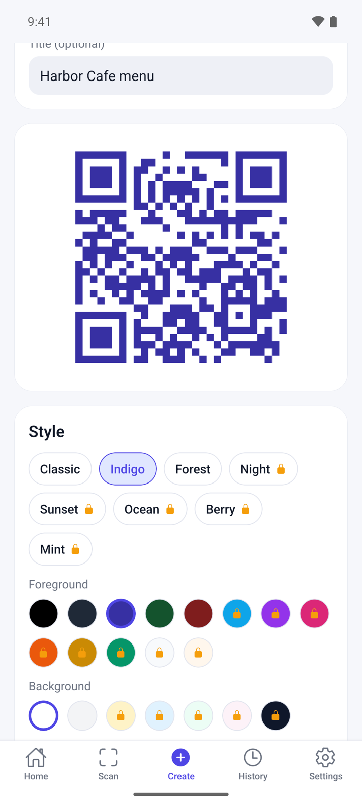

## Fungsi aplikasi

QR & Barcode Toolkit mengimbas kod QR dan kod bar menggunakan kamera atau daripada foto, dan memaparkan kandungannya sebelum anda bertindak. Anda juga boleh mencipta kod QR dan kod bar sendiri, kemudian menyimpannya sebagai imej atau berkongsinya. Aplikasi ini tersedia dalam 21 bahasa dan mengikut bahasa telefon anda.

- Kod dibaca dalam peranti anda. Pautan tidak pernah dibuka dengan sendirinya.
- Tiada akaun. Sejarah anda kekal dalam telefon anda.
- Membaca kod QR dan 12 jenis kod bar, seperti EAN-13, UPC-A dan Code 128.
- Percuma dengan iklan. Pembelian Premium sekali bayar membuang iklan dan menambah lebih banyak pilihan gaya.

## Mula menggunakan

1. Buka QR & Barcode Toolkit. **Home** memaparkan empat pintasan: **Scan QR**, **Scan Barcode**, **Create QR** dan **Create Barcode**.
2. Ketik **Scan QR**. Kali pertama, ketik **Allow camera** dan benarkan kamera apabila Android bertanya.
3. Jika anda tidak mahu menggunakan kamera, ketik **Scan from an image instead** dan pilih satu foto. Ini tidak memerlukan akses kepada seluruh pustaka foto anda.

## Imbas kod

1. Ketik **Scan** di bahagian bawah, atau pintasan imbasan pada **Home**.
2. Di bahagian atas, pilih **QR Code** atau **Barcode**.
3. Halakan kamera ke arah kod. Pastikan kod bar berada dalam bingkai.
4. Dalam gelap, ketik butang lampu suluh. Untuk membaca kod daripada foto, ketik butang gambar dan pilih foto itu.
5. **Scan Result** dibuka apabila kod berjaya dibaca. Ia menunjukkan jenis kandungan, seperti **Website**, **Wi-Fi**, **Contact** atau **Product**.
6. Ketik **Copy content** atau **Share as text**, atau ketik **Scan another** untuk kembali ke kamera.

## Semak pautan sebelum membukanya

1. Imbas kod yang mengandungi alamat web. Hasilnya menunjukkan nama laman dan alamat penuh.
2. Baca amaran, jika ada. Aplikasi memberi amaran tentang pautan tanpa penyulitan (http), pautan dipendekkan, alamat IP mentah, butiran log masuk tersembunyi dan aksara yang kelihatan serupa.
3. Ketik **Open link** hanya jika anda mempercayai laman itu, kemudian ketik **Open** untuk mengesahkan.

Jenis kod lain mempunyai butang tersendiri: **Compose email**, **Call**, **Send message**, **Open in Maps** atau **Search the web**. Setiap satu meminta kebenaran anda sebelum keluar daripada aplikasi.

## Baca kod Wi-Fi

1. Imbas kod QR Wi-Fi. Hasilnya menunjukkan **Network**, **Security** dan **Password**.
2. Ketik ikon mata untuk memaparkan kata laluan.
3. Ketik ikon salin di sebelah kata laluan.
4. Buka tetapan Wi-Fi telefon anda dan sambung ke rangkaian dengan kata laluan yang disalin. Aplikasi tidak menyambung untuk anda.

## Cipta kod QR

1. Ketik **Create** dan pilih **QR Code**.
2. Di bawah **Content type**, pilih **Website**, **Text**, **Wi-Fi**, **Email**, **Phone**, **SMS**, **Contact** atau **Location**.
3. Isi ruangan yang disediakan. Kod QR muncul sebaik sahaja butiran sah. Isi **Title (optional)** jika anda mahu memberi nama kepadanya dalam sejarah.
4. Di bawah **Style**, pilih templat: **Classic**, **Indigo** atau **Forest**. Anda juga boleh menukar warna **Foreground** dan **Background** serta tahap **Error correction**.
5. Ketik **Save to history** untuk menyimpannya, **Share** untuk menghantar imej, atau **Save image** untuk menyimpannya dalam galeri.

Pilihan yang mempunyai ikon kunci ialah sebahagian daripada Premium.

## Cipta kod bar

1. Ketik **Create** dan pilih **Barcode**.
2. Di bawah **Format**, pilih **EAN-13**, **EAN-8**, **UPC-A**, **Code 128**, **Code 39** atau **ITF-14**.
3. Taip **Value**. Baris di bawah ruangan itu menyatakan apa yang diterima oleh format tersebut. Untuk kod produk, aplikasi menambah digit semakan jika anda tidak memasukkannya.
4. Isi **Title (optional)** jika anda mahu memberi nama kepadanya.
5. Ketik **Save to history**, **Share** atau **Save image**.

## Cari, guna semula dan padam kod

1. Ketik **History**. Ia menyenaraikan kod yang anda imbas dan cipta.
2. Taip dalam **Search**, atau tapis dengan **All**, **Scanned**, **Created**, **Favorites**, **Any type**, **QR** dan **Barcode**.
3. Ketik bintang pada satu baris untuk menambahnya ke kegemaran.
4. Ketik satu baris untuk membuka **Details**. Dari situ anda boleh mengetik **Copy content**, **Share as text** atau **Delete**. Kod QR dan format kod bar yang boleh dicipta oleh aplikasi juga memaparkan kod itu bersama **Share image** dan **Edit / reuse**.
5. Untuk mengosongkan senarai, ketik ikon tong sampah di bahagian atas, kemudian **Clear**. Kegemaran dikekalkan.

## Tukar tetapan

1. Ketik **Settings**.
2. Matikan **Save scans to history** jika anda tidak mahu imbasan disimpan.
3. Hidupkan atau matikan **Haptic feedback**.
4. Hidupkan **Keep Wi-Fi passwords in history** hanya jika anda mahu kata laluan disimpan. Ia dimatikan secara lalai.
5. Ketik **Language** untuk memilih bahasa aplikasi. Secara lalai, aplikasi mengikut bahasa telefon anda.
6. Ketik **Clear all history** kemudian **Delete all** untuk membuang setiap imbasan dan kod yang dicipta, termasuk kegemaran.

## Premium

Premium ialah satu bayaran sahaja, bukan langganan. Buka **Settings** dan ketik **Go Premium**, atau ketik **See plans** pada **Home**. Ia memberi anda:

- Tiada iklan.
- Warna tersuai, templat premium dan logo dalam kod QR anda.
- Sejarah dan kegemaran tanpa had.
- Eksport pada 1024 px dan 2048 px.

Tanpa Premium, mengetik templat, warna atau **Add logo** yang berkunci mungkin menawarkan **Watch an ad**, yang membuka kunci pilihan gaya ini sehingga anda menutup aplikasi. Jika anda pernah membeli Premium, ketik **Restore purchases** dalam **Settings**.

## Soalan lazim

**Adakah aplikasi membuka pautan dengan sendirinya?**
Tidak. Ia menunjukkan alamat dan sebarang amaran dahulu. Pautan hanya dibuka selepas anda mengetik **Open link** dan mengesahkannya.

**Kod apakah yang boleh dibacanya?**
QR, EAN-13, EAN-8, UPC-A, UPC-E, Code 128, Code 39, Code 93, Codabar, ITF-14, PDF417, Data Matrix dan Aztec.

**Mengapa kata laluan Wi-Fi tiada dalam sejarah saya?**
Kata laluan Wi-Fi dibuang sebelum kod disimpan. Untuk menyimpannya, hidupkan **Keep Wi-Fi passwords in history** dalam **Settings** sebelum anda mengimbas atau mencipta kod itu.

**Berapa banyak kod yang disimpan?**
Versi percuma menyimpan 100 imbasan terkini dan 100 kod yang dicipta, serta sehingga 10 kegemaran. **History** memberitahu anda apabila senarai percuma sudah penuh, dan item baharu kemudian menggantikan yang paling lama. Kegemaran tidak dibuang apabila senarai penuh. Premium tiada had.

**Adakah ada mod gelap?**
Ada. Aplikasi mengikut tema cerah atau gelap telefon anda.

## Privasi

Kod dibaca dalam peranti anda, dan sejarah anda kekal dalam telefon anda. Versi percuma memaparkan iklan daripada Google AdMob. Baca [dasar privasi](https://varian1.github.io/qr-barcode-toolkit/privacy.html) yang lengkap.
