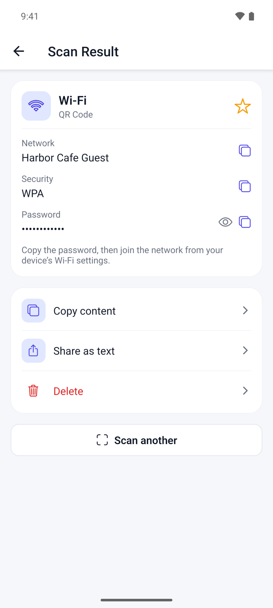

## O que o app faz

O QR & Barcode Toolkit lê QR codes e códigos de barras com a câmera ou a partir de uma foto, e mostra o que há dentro antes de você agir. Você também pode criar seus próprios QR codes e códigos de barras, salvá-los como imagem ou compartilhá-los. O app está em 21 idiomas e acompanha o idioma do seu celular.

- Os códigos são lidos no seu aparelho. Os links nunca abrem sozinhos.
- Sem conta. Seu histórico fica no seu celular.
- Lê QR codes e 12 tipos de código de barras, como EAN-13, UPC-A e Code 128.
- Grátis, com anúncios. Uma compra única do Premium remove os anúncios e libera mais opções de estilo.

## Primeiros passos

1. Abra o QR & Barcode Toolkit. A tela **Home** mostra quatro atalhos: **Scan QR**, **Scan Barcode**, **Create QR** e **Create Barcode**.
2. Toque em **Scan QR**. Na primeira vez, toque em **Allow camera** e permita o uso da câmera quando o Android perguntar.
3. Se preferir não usar a câmera, toque em **Scan from an image instead** e escolha uma foto. Não é preciso dar acesso a toda a sua galeria.

## Ler um código

1. Toque em **Scan** na parte de baixo, ou em um atalho de leitura na **Home**.
2. No alto, escolha **QR Code** ou **Barcode**.
3. Aponte a câmera para o código. Mantenha o código de barras dentro da moldura.
4. No escuro, toque no botão da lanterna. Para ler um código a partir de uma foto, toque no botão de imagem e escolha a foto.
5. **Scan Result** abre quando o código é lido. Ele mostra o tipo de conteúdo, como **Website**, **Wi-Fi**, **Contact** ou **Product**.
6. Toque em **Copy content** ou **Share as text**, ou toque em **Scan another** para voltar à câmera.

## Verificar um link antes de abrir

1. Leia um código que contenha um endereço da web. O resultado mostra o nome do site e o endereço completo.
2. Leia os avisos, se houver. O app avisa sobre links sem criptografia (http), links encurtados, endereços IP puros, dados de login ocultos e caracteres parecidos com outros.
3. Toque em **Open link** só se você confiar no site e depois toque em **Open** para confirmar.

Outros tipos de código têm o próprio botão: **Compose email**, **Call**, **Send message**, **Open in Maps** ou **Search the web**. Cada um pergunta antes de sair do app.

## Ler um código de Wi-Fi

1. Leia o QR code de Wi-Fi. O resultado mostra **Network**, **Security** e **Password**.
2. Toque no ícone de olho para mostrar a senha.
3. Toque no ícone de copiar ao lado da senha.
4. Abra os ajustes de Wi-Fi do celular e entre na rede com a senha copiada. O app não conecta por você.

## Criar um QR code

1. Toque em **Create** e escolha **QR Code**.
2. Em **Content type**, escolha **Website**, **Text**, **Wi-Fi**, **Email**, **Phone**, **SMS**, **Contact** ou **Location**.
3. Preencha os campos. O QR code aparece assim que os dados forem válidos. Preencha **Title (optional)** se quiser dar um nome a ele no histórico.
4. Em **Style**, escolha um modelo: **Classic**, **Indigo** ou **Forest**. Você também pode mudar as cores de **Foreground** e **Background** e o nível de **Error correction**.
5. Toque em **Save to history** para guardá-lo, em **Share** para enviar a imagem ou em **Save image** para colocá-la na galeria.

As opções com cadeado fazem parte do Premium.

## Criar um código de barras

1. Toque em **Create** e escolha **Barcode**.
2. Em **Format**, escolha **EAN-13**, **EAN-8**, **UPC-A**, **Code 128**, **Code 39** ou **ITF-14**.
3. Digite o **Value**. A linha abaixo do campo diz o que o formato aceita. Em códigos de produto, o app acrescenta o dígito verificador se você não o informar.
4. Preencha **Title (optional)** se quiser dar um nome a ele.
5. Toque em **Save to history**, **Share** ou **Save image**.

## Encontrar, reutilizar e apagar códigos

1. Toque em **History**. A lista mostra os códigos que você leu e criou.
2. Digite em **Search** ou filtre com **All**, **Scanned**, **Created**, **Favorites**, **Any type**, **QR** e **Barcode**.
3. Toque na estrela de uma linha para adicioná-la aos favoritos.
4. Toque em uma linha para abrir **Details**. Ali você pode tocar em **Copy content**, **Share as text** ou **Delete**. Os QR codes e os formatos de código de barras que o app consegue criar também mostram o código com **Share image** e **Edit / reuse**.
5. Para esvaziar a lista, toque no ícone da lixeira no alto e depois em **Clear**. Os favoritos são mantidos.

## Alterar as configurações

1. Toque em **Settings**.
2. Desative **Save scans to history** se não quiser guardar as leituras.
3. Ative ou desative **Haptic feedback**.
4. Ative **Keep Wi-Fi passwords in history** só se quiser salvar as senhas. Essa opção vem desativada.
5. Toque em **Language** para escolher o idioma do app. Por padrão, o app acompanha o idioma do celular.
6. Toque em **Clear all history** e depois em **Delete all** para remover todas as leituras e códigos criados, inclusive os favoritos.

## Premium

O Premium é um pagamento único, não uma assinatura. Abra **Settings** e toque em **Go Premium**, ou toque em **See plans** na **Home**. Ele oferece:

- Sem anúncios.
- Cores personalizadas, modelos premium e um logotipo no seu QR code.
- Histórico e favoritos ilimitados.
- Exportação em 1024 px e 2048 px.

Sem o Premium, ao tocar em um modelo, uma cor ou em **Add logo** bloqueado, o app pode oferecer **Watch an ad**, que libera essas opções de estilo até você fechar o app. Se você já comprou o Premium, toque em **Restore purchases** em **Settings**.

## Perguntas

**O app abre links sozinho?**
Não. Ele mostra primeiro o endereço e os avisos, se houver. O link só abre depois que você toca em **Open link** e confirma.

**Quais códigos ele consegue ler?**
QR, EAN-13, EAN-8, UPC-A, UPC-E, Code 128, Code 39, Code 93, Codabar, ITF-14, PDF417, Data Matrix e Aztec.

**Por que a senha do Wi-Fi não aparece no meu histórico?**
As senhas de Wi-Fi são removidas antes de o código ser salvo. Para guardá-las, ative **Keep Wi-Fi passwords in history** em **Settings** antes de ler ou criar o código.

**Quantos códigos são guardados?**
A versão grátis guarda as últimas 100 leituras e os últimos 100 códigos criados, e até 10 favoritos. **History** avisa quando a lista grátis está cheia, e os itens novos passam a substituir os mais antigos. Os favoritos não são removidos quando a lista está cheia. No Premium não há limite.

**Existe modo escuro?**
Sim. O app segue o tema claro ou escuro do seu celular.

## Privacidade

Os códigos são lidos no seu aparelho, e seu histórico fica no seu celular. A versão grátis mostra anúncios do Google AdMob. Leia a [política de privacidade](https://varian1.github.io/qr-barcode-toolkit/privacy.html) completa.
