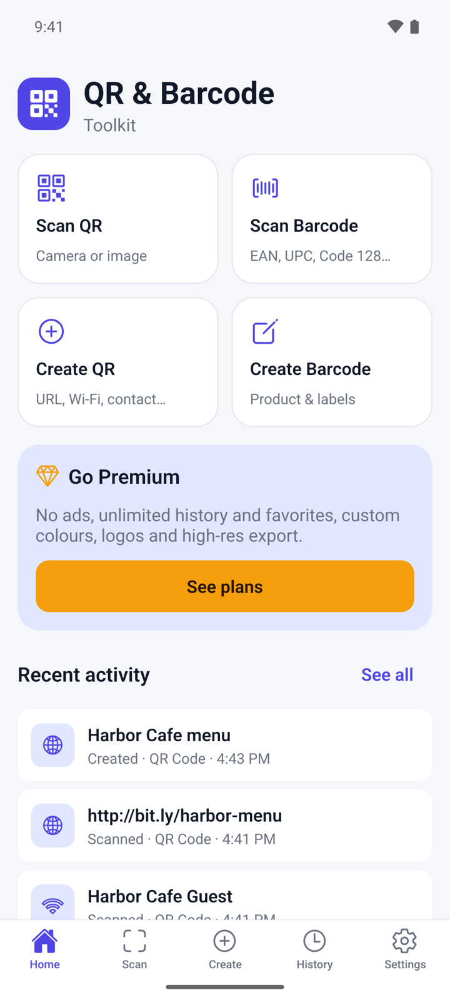
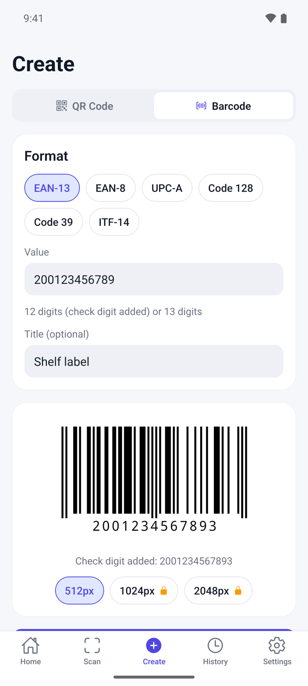

## Ứng dụng làm được gì

QR & Barcode Toolkit quét mã QR và mã vạch bằng camera hoặc từ một bức ảnh, và cho bạn xem nội dung bên trong trước khi bạn làm gì tiếp. Bạn cũng có thể tự tạo mã QR và mã vạch, rồi lưu thành ảnh hoặc chia sẻ. Ứng dụng có 21 ngôn ngữ và tự theo ngôn ngữ của điện thoại.

- Mã được đọc ngay trên máy bạn. Liên kết không bao giờ tự mở.
- Không cần tài khoản. Lịch sử chỉ nằm trên điện thoại của bạn.
- Đọc được mã QR và 12 loại mã vạch, như EAN-13, UPC-A và Code 128.
- Miễn phí có quảng cáo. Mua Premium một lần để tắt quảng cáo và có thêm nhiều kiểu tùy chỉnh.

## Bắt đầu

1. Mở QR & Barcode Toolkit. Màn hình **Home** có bốn lối tắt: **Scan QR**, **Scan Barcode**, **Create QR** và **Create Barcode**.
2. Chạm **Scan QR**. Lần đầu, chạm **Allow camera** và cho phép dùng camera khi Android hỏi.
3. Nếu không muốn dùng camera, chạm **Scan from an image instead** và chọn một bức ảnh. Ứng dụng không cần quyền truy cập toàn bộ thư viện ảnh của bạn.

## Quét mã

1. Chạm **Scan** ở cuối màn hình, hoặc chạm một lối tắt quét trên **Home**.
2. Ở phía trên, chọn **QR Code** hoặc **Barcode**.
3. Hướng camera vào mã. Với mã vạch, hãy giữ mã nằm trong khung.
4. Nơi thiếu sáng, chạm nút đèn pin. Để đọc mã từ ảnh, chạm nút hình ảnh và chọn ảnh.
5. Màn hình **Scan Result** mở ra khi mã được đọc. Màn hình cho biết loại nội dung, như **Website**, **Wi-Fi**, **Contact** hoặc **Product**.
6. Chạm **Copy content** hoặc **Share as text**, hoặc chạm **Scan another** để quay lại camera.

## Kiểm tra liên kết trước khi mở

1. Quét một mã chứa địa chỉ web. Kết quả hiện tên trang và địa chỉ đầy đủ.
2. Đọc các cảnh báo, nếu có. Ứng dụng cảnh báo về liên kết không mã hóa (http), liên kết rút gọn, địa chỉ IP trần, thông tin đăng nhập bị ẩn và ký tự giả dạng giống nhau.
3. Chỉ chạm **Open link** khi bạn tin tưởng trang đó, rồi chạm **Open** để xác nhận.

Các loại mã khác có nút riêng: **Compose email**, **Call**, **Send message**, **Open in Maps** hoặc **Search the web**. Mỗi nút đều hỏi lại trước khi rời khỏi ứng dụng.

## Đọc mã Wi-Fi

1. Quét mã QR Wi-Fi. Kết quả hiện **Network**, **Security** và **Password**.
2. Chạm biểu tượng con mắt để hiện mật khẩu.
3. Chạm biểu tượng sao chép bên cạnh mật khẩu.
4. Mở phần cài đặt Wi-Fi của điện thoại và kết nối vào mạng bằng mật khẩu vừa chép. Ứng dụng không tự kết nối giúp bạn.

## Tạo mã QR

1. Chạm **Create** và chọn **QR Code**.
2. Trong **Content type**, chọn **Website**, **Text**, **Wi-Fi**, **Email**, **Phone**, **SMS**, **Contact** hoặc **Location**.
3. Điền các ô thông tin. Mã QR hiện ra ngay khi thông tin hợp lệ. Điền **Title (optional)** nếu bạn muốn đặt tên cho mã trong lịch sử.
4. Trong **Style**, chọn một mẫu: **Classic**, **Indigo** hoặc **Forest**. Bạn cũng có thể đổi màu **Foreground**, màu **Background** và mức **Error correction**.
5. Chạm **Save to history** để lưu lại, **Share** để gửi ảnh, hoặc **Save image** để lưu vào thư viện ảnh.

Các tùy chọn có biểu tượng khóa thuộc về Premium.

## Tạo mã vạch

1. Chạm **Create** và chọn **Barcode**.
2. Trong **Format**, chọn **EAN-13**, **EAN-8**, **UPC-A**, **Code 128**, **Code 39** hoặc **ITF-14**.
3. Nhập **Value**. Dòng bên dưới ô cho biết định dạng đó chấp nhận gì. Với mã sản phẩm, ứng dụng tự thêm chữ số kiểm tra nếu bạn bỏ trống.
4. Điền **Title (optional)** nếu bạn muốn đặt tên.
5. Chạm **Save to history**, **Share** hoặc **Save image**.

## Tìm, dùng lại và xóa mã

1. Chạm **History**. Danh sách gồm các mã bạn đã quét và đã tạo.
2. Gõ vào **Search**, hoặc lọc bằng **All**, **Scanned**, **Created**, **Favorites**, **Any type**, **QR** và **Barcode**.
3. Chạm ngôi sao trên một dòng để thêm vào mục yêu thích.
4. Chạm một dòng để mở **Details**. Tại đó bạn có thể chạm **Copy content**, **Share as text** hoặc **Delete**. Với mã QR và các định dạng mã vạch mà ứng dụng tạo được, màn hình còn hiện mã cùng **Share image** và **Edit / reuse**.
5. Để xóa sạch danh sách, chạm biểu tượng thùng rác ở phía trên rồi chạm **Clear**. Các mục yêu thích vẫn được giữ lại.

## Đổi cài đặt

1. Chạm **Settings**.
2. Tắt **Save scans to history** nếu bạn không muốn lưu các lần quét.
3. Bật hoặc tắt **Haptic feedback**.
4. Chỉ bật **Keep Wi-Fi passwords in history** khi bạn muốn lưu mật khẩu Wi-Fi. Mục này mặc định đang tắt.
5. Chạm **Language** để chọn ngôn ngữ của ứng dụng. Mặc định ứng dụng theo ngôn ngữ của điện thoại.
6. Chạm **Clear all history** rồi **Delete all** để xóa mọi mã đã quét và đã tạo, kể cả mục yêu thích.

## Premium

Premium chỉ trả một lần, không phải gói đăng ký. Mở **Settings** và chạm **Go Premium**, hoặc chạm **See plans** trên **Home**. Premium mang lại:

- Không quảng cáo.
- Màu tùy chỉnh, mẫu cao cấp và logo trong mã QR của bạn.
- Lịch sử và mục yêu thích không giới hạn.
- Xuất ảnh cỡ 1024 px và 2048 px.

Khi chưa có Premium, nếu bạn chạm vào mẫu, màu hoặc **Add logo** đang bị khóa, ứng dụng có thể đưa ra **Watch an ad** để mở khóa các tùy chọn kiểu dáng này cho đến khi bạn đóng ứng dụng. Nếu bạn đã mua Premium trước đó, chạm **Restore purchases** trong **Settings**.

## Câu hỏi thường gặp

**Ứng dụng có tự mở liên kết không?**
Không. Ứng dụng hiện địa chỉ và các cảnh báo trước. Liên kết chỉ mở sau khi bạn chạm **Open link** và xác nhận.

**Ứng dụng đọc được những loại mã nào?**
QR, EAN-13, EAN-8, UPC-A, UPC-E, Code 128, Code 39, Code 93, Codabar, ITF-14, PDF417, Data Matrix và Aztec.

**Sao mật khẩu Wi-Fi không có trong lịch sử của tôi?**
Mật khẩu Wi-Fi bị xóa trước khi mã được lưu. Để giữ lại, hãy bật **Keep Wi-Fi passwords in history** trong **Settings** trước khi bạn quét hoặc tạo mã.

**Ứng dụng lưu được bao nhiêu mã?**
Bản miễn phí giữ 100 lần quét và 100 mã đã tạo gần nhất, cùng tối đa 10 mục yêu thích. **History** sẽ báo khi danh sách miễn phí đã đầy, và mục mới sẽ thay mục cũ nhất. Mục yêu thích không bị xóa khi danh sách đầy. Premium không giới hạn.

**Có chế độ tối không?**
Có. Ứng dụng theo giao diện sáng hoặc tối của điện thoại bạn.

## Quyền riêng tư

Mã được đọc ngay trên máy bạn, và lịch sử chỉ nằm trên điện thoại của bạn. Bản miễn phí hiển thị quảng cáo từ Google AdMob. Xem đầy đủ [chính sách quyền riêng tư](https://varian1.github.io/qr-barcode-toolkit/privacy.html).
