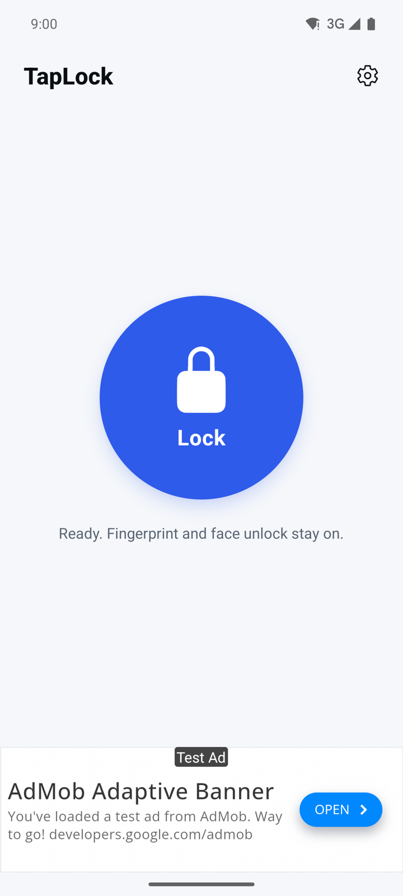

## Was die App kann

TapLock zeigt eine große **Lock**-Taste auf deinem Bildschirm. Tippst du darauf, sperrt sich dein Handy sofort, genau wie mit der Einschalttaste. Das hilft, wenn die Einschalttaste schwer zu erreichen, abgenutzt oder defekt ist.

- Mit **Accessibility lock** entsperrst du wie gewohnt per Fingerabdruck, Gesicht, PIN oder Muster.
- **Device Admin lock** ist eine zweite Art zu sperren, die ohne Bedienungshilfen funktioniert.
- Ein Bildschirm, eine Taste. Kein Konto und keine Anmeldung.
- Kostenlos mit Werbung.

## Erste Schritte

1. Öffne TapLock. Beim ersten Mal steht unter der **Lock**-Taste: "One-time setup needed (about a minute)."
2. Tippe auf **Set up TapLock**. Der Bildschirm **Lock setup** öffnet sich.
3. Wähle eine der beiden Arten zu sperren:
   - **Accessibility lock** (empfohlen, ab Android 9): sperrt wie die Einschalttaste, und Entsperren per Fingerabdruck und Gesicht funktioniert weiter.
   - **Device Admin lock**: funktioniert ohne Bedienungshilfen. Beim nächsten Entsperren fragt Android nach deiner PIN, deinem Muster oder Passwort.
4. Folge unten den Schritten für deine Wahl.

Du kannst **Lock setup** jederzeit wieder öffnen, mit dem Einstellungssymbol oben rechts auf dem Startbildschirm.

## Accessibility lock einschalten

1. Tippe auf **Lock setup** in der Karte **Accessibility lock** auf **Turn on Accessibility lock**.
2. Ein Dialog fragt: **Allow TapLock to use Accessibility?** Lies, wie TapLock die Funktion nutzt.
3. Tippe auf **Agree**, um fortzufahren. Wenn du auf **Decline** tippst, ändert sich nichts und Accessibility lock bleibt aus.
4. Die Bedienungshilfen-Einstellungen von Android öffnen sich. Suche TapLock, oft unter "Downloaded apps".
5. Schalte "Use TapLock" ein, tippe auf **Allow** und gehe zurück zu TapLock.
6. Die Karte zeigt jetzt **On**, und oben erscheint **You're all set**. Tippe auf **Back to Lock**.

**Warum TapLock die Bedienungshilfen braucht.** TapLock nutzt die Accessibility Service API nur, um den Bildschirm zu sperren, wenn du auf die **Lock**-Taste tippst, genau wie mit der Einschalttaste. Darum funktioniert das Entsperren per Fingerabdruck und Gesicht weiter. TapLock liest deinen Bildschirm nicht, sieht nicht, was du eingibst, und erhebt, speichert oder teilt über diese Berechtigung keine persönlichen Daten. Du wählst **Agree** oder **Decline**, bevor sich die Android-Einstellungen öffnen, und kannst die Berechtigung jederzeit wieder ausschalten.

Wenn die Karte länger als ein paar Sekunden **Starting** zeigt, schalte TapLock in den Bedienungshilfen aus und wieder ein. Wenn der Schalter in den Android-Einstellungen ausgegraut ist, tippe auf **Lock setup** auf **Switch greyed out?** und folge dem Hinweis dort.

## Device Admin lock verwenden

1. Tippe auf **Lock setup** in der Karte **Device Admin lock** auf **Enable Device Admin**.
2. Android bittet dich um eine Bestätigung. TapLock nutzt diese Berechtigung nur, um den Bildschirm zu sperren, wenn du auf die **Lock**-Taste tippst.
3. Die Karte zeigt jetzt **On**.

Bei dieser Art zu sperren fragt Android beim nächsten Entsperren nach PIN, Muster oder Passwort statt nach Fingerabdruck oder Gesicht. Sind beide Arten eingeschaltet, nutzt TapLock Accessibility lock.

## Bildschirm sperren

1. Öffne TapLock. Die Zeile unter der Taste beginnt mit "Ready."
2. Tippe auf **Lock**. Der Bildschirm sperrt sich sofort.
3. Entsperre dein Handy wie immer.

## Dunkelmodus nutzen

1. Schalte das dunkle Design in den Android-Einstellungen deines Handys ein.
2. Öffne TapLock. Die App folgt deinem Handy und wechselt von selbst ins Dunkle. In der App gibt es dafür keine eigene Einstellung.

## Sprache ändern

1. Tippe auf dem Startbildschirm auf das Einstellungssymbol, um **Lock setup** zu öffnen.
2. Öffne die Sprachauswahl.
3. Wähle eine der 31 Sprachen oder behalte die Systemvorgabe, dann folgt TapLock der Sprache deines Handys.

Arabisch, Urdu und Hebräisch werden von rechts nach links angezeigt. Ab Android 13 kannst du die Sprache von TapLock auch in den App-Spracheinstellungen von Android ändern.

## Sperrmethode ausschalten oder App deinstallieren

1. Tippe auf dem Startbildschirm auf das Einstellungssymbol, um **Lock setup** zu öffnen.
2. Um Accessibility lock auszuschalten, tippe auf **Manage in Accessibility settings** und schalte TapLock dort aus.
3. Um Device Admin lock auszuschalten, tippe auf **Turn off Device Admin**.
4. Schalte Device Admin aus, bevor du TapLock deinstallierst. Android erlaubt es nicht, eine App zu deinstallieren, solange sie aktiver Geräteadministrator ist.

## Fragen

**Warum braucht TapLock die Berechtigung für die Bedienungshilfen?**
Nur, um den Bildschirm zu sperren, wenn du auf **Lock** tippst, genau wie mit der Einschalttaste. Die App liest deinen Bildschirm nicht und sieht nicht, was du eingibst. Wenn du sie lieber nicht erlauben möchtest, nutze Device Admin lock.

**Mein Fingerabdruck funktioniert nicht, nachdem ich mit TapLock gesperrt habe. Warum?**
Du nutzt Device Admin lock, bei dem Android einmal nach PIN, Muster oder Passwort fragt. Schalte Accessibility lock ein, damit Entsperren per Fingerabdruck und Gesicht weiter funktioniert.

**Ich kann TapLock nicht deinstallieren. Was kann ich tun?**
Öffne **Lock setup**, tippe auf **Turn off Device Admin** und deinstalliere die App dann.

**Welche Android-Version brauche ich?**
Accessibility lock braucht Android 9 oder neuer. Auf älteren Versionen nutze Device Admin lock.

**Kann ich TapLock in meiner Sprache nutzen?**
Ja. TapLock gibt es in 31 Sprachen. Wähle deine auf **Lock setup** oder behalte die Systemvorgabe.

## Datenschutz

TapLock nutzt die Berechtigungen für Bedienungshilfen und Device Admin nur, um deinen Bildschirm zu sperren, und erhebt darüber keine persönlichen Daten. Die App zeigt Werbung von Google AdMob. Wo es vorgeschrieben ist, kannst du deine Werbeeinstellungen über **Privacy settings** auf **Lock setup** ändern. Lies die vollständige [Datenschutzerklärung](https://varian1.github.io/LockAppOnlyWeb/privacy.html).
