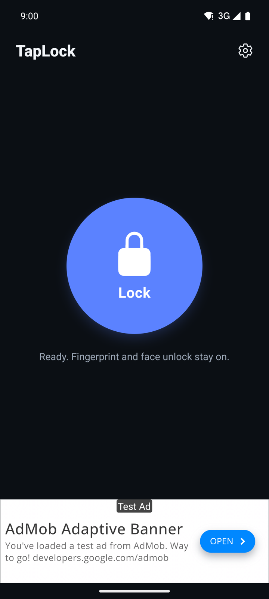

## Ce que fait l'appli

TapLock place un grand bouton **Lock** sur votre écran. Appuyez dessus et votre téléphone se verrouille aussitôt, comme avec le bouton d'alimentation. C'est pratique quand ce bouton est difficile à atteindre, usé ou cassé.

- Avec le verrouillage par Accessibilité, vous déverrouillez comme d'habitude avec votre empreinte, votre visage, votre code PIN ou votre schéma.
- Le verrouillage par Administrateur de l'appareil est une deuxième méthode, qui fonctionne sans Accessibilité.
- Un seul écran, un seul bouton. Pas de compte ni de connexion.
- Gratuit, avec publicités.

## Pour commencer

1. Ouvrez TapLock. Au premier lancement, la ligne sous le bouton **Lock** indique "One-time setup needed (about a minute)."
2. Appuyez sur **Set up TapLock**. L'écran **Lock setup** s'ouvre.
3. Choisissez l'une des deux méthodes de verrouillage :
   - **Accessibility lock** (recommandé, Android 9 ou plus récent) : verrouille comme le bouton d'alimentation, et le déverrouillage par empreinte ou par visage continue de fonctionner.
   - **Device Admin lock** : fonctionne sans Accessibilité. Android vous demande votre code PIN, votre schéma ou votre mot de passe au prochain déverrouillage.
4. Suivez ci-dessous les étapes de votre choix.

Vous pouvez rouvrir **Lock setup** à tout moment avec l'icône de réglages, en haut à droite de l'écran d'accueil.

## Activer le verrouillage par Accessibilité

1. Sur **Lock setup**, dans la carte **Accessibility lock**, appuyez sur **Turn on Accessibility lock**.
2. Une boîte de dialogue demande **Allow TapLock to use Accessibility?** Lisez comment TapLock utilise cette autorisation.
3. Appuyez sur **Agree** pour continuer. Si vous appuyez sur **Decline**, rien ne change et le verrouillage par Accessibilité reste désactivé.
4. Les réglages d'accessibilité d'Android s'ouvrent. Cherchez TapLock, souvent sous "Downloaded apps".
5. Activez "Use TapLock", appuyez sur **Allow**, puis revenez dans TapLock.
6. La carte affiche maintenant **On**, et **You're all set** apparaît en haut. Appuyez sur **Back to Lock**.

**Pourquoi TapLock demande l'Accessibilité.** TapLock utilise l'API du service d'accessibilité uniquement pour verrouiller votre écran quand vous appuyez sur le bouton **Lock**, comme avec le bouton d'alimentation. C'est pourquoi le déverrouillage par empreinte ou par visage continue de fonctionner. TapLock ne lit pas votre écran, ne voit pas ce que vous saisissez et ne collecte, ne conserve ni ne partage aucune donnée personnelle grâce à cette autorisation. Vous choisissez **Agree** ou **Decline** avant l'ouverture des réglages d'Android, et vous pouvez la désactiver à tout moment.

Si la carte affiche **Starting** pendant plus de quelques secondes, désactivez puis réactivez TapLock dans les réglages d'accessibilité. Si l'interrupteur est grisé dans les réglages d'Android, appuyez sur **Switch greyed out?** sur **Lock setup** et suivez l'indication affichée.

## Utiliser plutôt le verrouillage par Administrateur de l'appareil

1. Sur **Lock setup**, dans la carte **Device Admin lock**, appuyez sur **Enable Device Admin**.
2. Android vous demande de confirmer. TapLock utilise cette autorisation uniquement pour verrouiller l'écran quand vous appuyez sur le bouton **Lock**.
3. La carte affiche maintenant **On**.

Avec cette méthode, Android demande votre code PIN, votre schéma ou votre mot de passe au prochain déverrouillage, à la place de l'empreinte ou du visage. Si les deux méthodes sont activées, TapLock utilise le verrouillage par Accessibilité.

## Verrouiller l'écran

1. Ouvrez TapLock. La ligne sous le bouton commence par "Ready."
2. Appuyez sur **Lock**. L'écran se verrouille aussitôt.
3. Déverrouillez votre téléphone comme d'habitude.

## Utiliser le mode sombre

1. Activez le thème sombre dans les réglages Android de votre téléphone.
2. Ouvrez TapLock. L'appli suit votre téléphone et passe toute seule en mode sombre. Il n'y a pas de réglage séparé dans l'appli.

## Changer de langue

1. Sur l'écran d'accueil, appuyez sur l'icône de réglages pour ouvrir **Lock setup**.
2. Ouvrez le sélecteur de langue.
3. Choisissez l'une des 31 langues, ou gardez la langue par défaut du système pour que TapLock suive la langue de votre téléphone.

L'arabe, l'ourdou et l'hébreu s'affichent de droite à gauche. Sous Android 13 ou plus récent, vous pouvez aussi changer la langue de TapLock dans les réglages de langue des applis d'Android.

## Désactiver une méthode de verrouillage ou désinstaller

1. Sur l'écran d'accueil, appuyez sur l'icône de réglages pour ouvrir **Lock setup**.
2. Pour désactiver le verrouillage par Accessibilité, appuyez sur **Manage in Accessibility settings** et désactivez TapLock à cet endroit.
3. Pour désactiver le verrouillage par Administrateur de l'appareil, appuyez sur **Turn off Device Admin**.
4. Désactivez Device Admin avant de désinstaller TapLock. Android n'autorise pas la désinstallation d'une appli tant qu'elle est administrateur actif de l'appareil.

## Questions

**Pourquoi TapLock a-t-il besoin de l'autorisation d'Accessibilité ?**
Uniquement pour verrouiller l'écran quand vous appuyez sur **Lock**, comme avec le bouton d'alimentation. L'appli ne lit pas votre écran et ne voit pas ce que vous saisissez. Si vous préférez ne pas l'autoriser, utilisez le verrouillage par Administrateur de l'appareil.

**Mon empreinte ne fonctionne plus après un verrouillage avec TapLock. Pourquoi ?**
Vous utilisez le verrouillage par Administrateur de l'appareil, qui oblige Android à demander une fois votre code PIN, votre schéma ou votre mot de passe. Activez le verrouillage par Accessibilité pour garder le déverrouillage par empreinte et par visage.

**Je n'arrive pas à désinstaller TapLock. Que faire ?**
Ouvrez **Lock setup**, appuyez sur **Turn off Device Admin**, puis désinstallez l'appli.

**Quelle version d'Android me faut-il ?**
Le verrouillage par Accessibilité demande Android 9 ou plus récent. Sur les versions plus anciennes, utilisez le verrouillage par Administrateur de l'appareil.

**Puis-je utiliser TapLock dans ma langue ?**
Oui. TapLock existe en 31 langues. Choisissez la vôtre sur **Lock setup**, ou gardez la langue par défaut du système.

## Confidentialité

TapLock utilise les autorisations d'Accessibilité et d'Administrateur de l'appareil uniquement pour verrouiller votre écran, et ne collecte aucune donnée personnelle grâce à elles. L'appli affiche des publicités de Google AdMob ; là où la loi l'exige, vous pouvez modifier vos choix publicitaires avec **Privacy settings** sur **Lock setup**. Lisez la [politique de confidentialité](https://varian1.github.io/LockAppOnlyWeb/privacy.html) complète.
