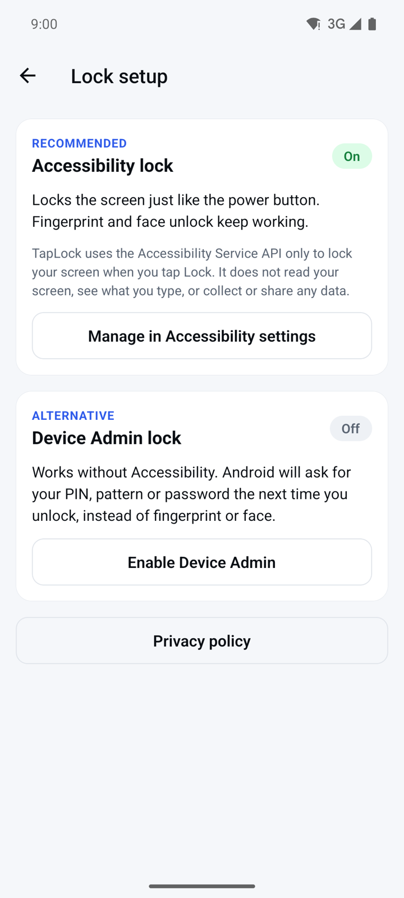
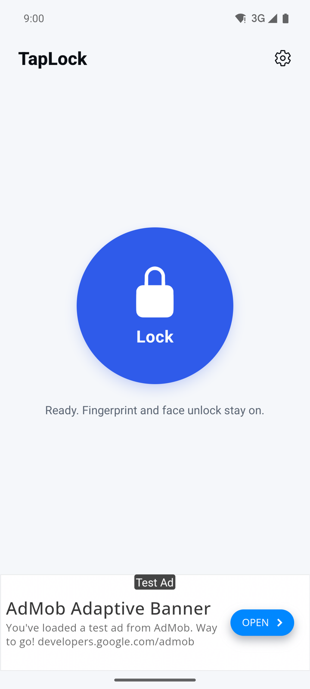
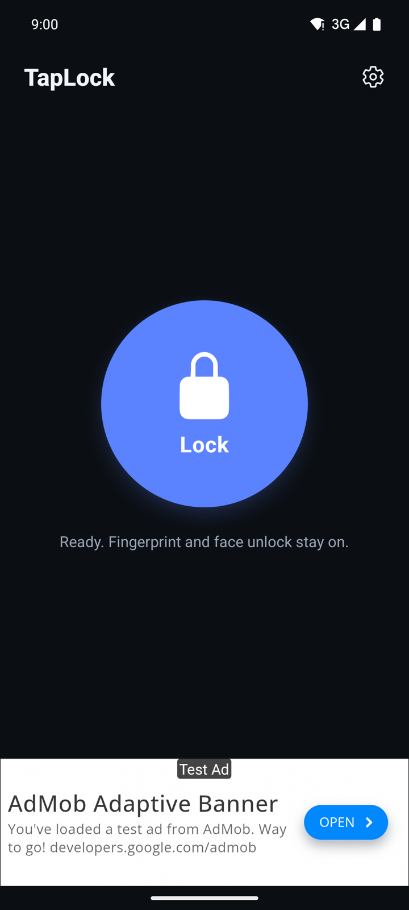

## What it does

TapLock puts one big **Lock** button on your screen. Tap it and your phone locks right away, just like pressing the power button. It is handy when the power button is hard to reach, worn out or broken.

- With Accessibility lock, you unlock as usual with your fingerprint, face, PIN or pattern.
- Device Admin lock is a second way to lock that works without Accessibility.
- One screen, one button. No account and no sign-in.
- Free with ads.

## Get started

1. Open TapLock. The first time, the line under the **Lock** button says "One-time setup needed (about a minute)."
2. Tap **Set up TapLock**. The **Lock setup** screen opens.
3. Choose one of the two ways to lock:
   - **Accessibility lock** (recommended, Android 9 or newer): locks like the power button, and fingerprint and face unlock keep working.
   - **Device Admin lock**: works without Accessibility. Android asks for your PIN, pattern or password the next time you unlock.
4. Follow the steps for your choice below.

You can open **Lock setup** again at any time with the settings icon in the top right of the home screen.

## Turn on Accessibility lock

1. On **Lock setup**, in the **Accessibility lock** card, tap **Turn on Accessibility lock**.
2. A dialog asks **Allow TapLock to use Accessibility?** Read how TapLock uses it.
3. Tap **Agree** to go on. If you tap **Decline**, nothing changes and Accessibility lock stays off.
4. Android's Accessibility settings open. Find TapLock, often under "Downloaded apps".
5. Turn on "Use TapLock", tap **Allow**, then go back to TapLock.
6. The card now shows **On**, and **You're all set** appears at the top. Tap **Back to Lock**.

**Why TapLock asks for Accessibility.** TapLock uses the Accessibility Service API only to lock your screen when you tap the **Lock** button, the same as pressing the power button. That is why fingerprint and face unlock keep working. TapLock does not read your screen, see what you type, or collect, store or share any personal data through this permission. You choose **Agree** or **Decline** before Android's settings open, and you can turn it off again at any time.

If the card shows **Starting** for more than a few seconds, turn TapLock off and on again in Accessibility settings. If the switch in Android's settings is greyed out, tap **Switch greyed out?** on **Lock setup** and follow the hint there.

## Use Device Admin lock instead

1. On **Lock setup**, in the **Device Admin lock** card, tap **Enable Device Admin**.
2. Android asks you to confirm. TapLock uses this permission only to lock the screen when you tap the **Lock** button.
3. The card now shows **On**.

With this way of locking, Android asks for your PIN, pattern or password the next time you unlock, instead of fingerprint or face. If both ways are on, TapLock uses Accessibility lock.

## Lock your screen

1. Open TapLock. The line under the button starts with "Ready."
2. Tap **Lock**. The screen locks right away.
3. Unlock your phone as you always do.

Now and then a full-screen ad opens when you tap **Lock**. Close it and the screen locks.

## Use dark mode

1. Turn on the dark theme in your phone's Android settings.
2. Open TapLock. It follows your phone and switches to dark by itself. There is no separate setting in the app.

## Turn a lock method off or uninstall

1. On the home screen, tap the settings icon to open **Lock setup**.
2. To turn off Accessibility lock, tap **Manage in Accessibility settings** and turn TapLock off there.
3. To turn off Device Admin lock, tap **Turn off Device Admin**.
4. Turn Device Admin off before you uninstall TapLock. Android does not allow uninstalling an app while it is an active device admin.

## Questions

**Why does TapLock need the Accessibility permission?**
Only to lock the screen when you tap **Lock**, the same as pressing the power button. It does not read your screen or see what you type. If you would rather not allow it, use Device Admin lock.

**My fingerprint does not work after I lock with TapLock. Why?**
You are using Device Admin lock, which makes Android ask for your PIN, pattern or password once. Turn on Accessibility lock to keep fingerprint and face unlock working.

**I cannot uninstall TapLock. What can I do?**
Open **Lock setup**, tap **Turn off Device Admin**, then uninstall.

**Which Android version do I need?**
Accessibility lock needs Android 9 or newer. On older versions, use Device Admin lock.

## Privacy

TapLock uses the Accessibility and Device Admin permissions only to lock your screen, and collects no personal data through them. The app shows ads from Google AdMob; where it is required, you can change your ad choices with **Privacy settings** on **Lock setup**. Read the full [privacy policy](https://varian1.github.io/LockAppOnlyWeb/privacy.html).
