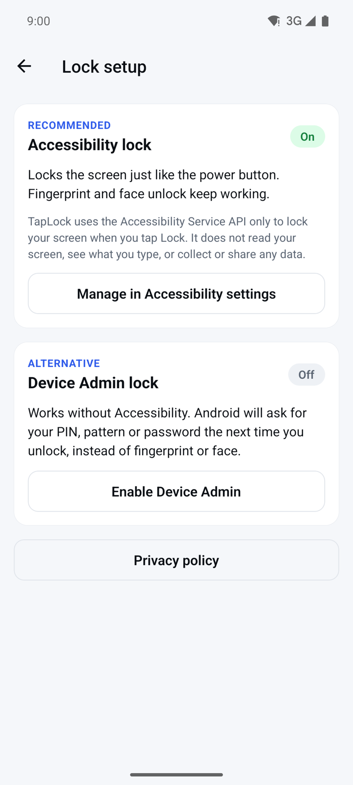

## Ano ang magagawa nito

May isang malaking **Lock** button ang TapLock sa screen mo. I-tap ito at agad na magla-lock ang phone mo, parang pagpindot sa power button. Malaking tulong ito kung mahirap abutin, sira na o sira-sira na ang power button.

- Sa Accessibility lock, mag-unlock ka gaya ng dati gamit ang fingerprint, mukha, PIN o pattern.
- Ang Device Admin lock ay pangalawang paraan ng pag-lock na gumagana kahit walang Accessibility.
- Isang screen, isang button. Walang account at walang sign-in.
- Libre, may ads.

## Pagsisimula

1. Buksan ang TapLock. Sa unang beses, sinasabi ng linya sa ilalim ng **Lock** button na "One-time setup needed (about a minute)."
2. I-tap ang **Set up TapLock**. Bubukas ang **Lock setup** screen.
3. Pumili ng isa sa dalawang paraan ng pag-lock:
   - **Accessibility lock** (inirerekomenda, Android 9 pataas): nagla-lock tulad ng power button, at gumagana pa rin ang fingerprint at face unlock.
   - **Device Admin lock**: gumagana kahit walang Accessibility. Hihingin ng Android ang PIN, pattern o password mo sa susunod na pag-unlock.
4. Sundin ang mga hakbang sa ibaba para sa napili mo.

Mabubuksan mo ulit ang **Lock setup** anumang oras gamit ang settings icon sa kanang itaas ng home screen.

## I-on ang Accessibility lock

1. Sa **Lock setup**, sa card na **Accessibility lock**, i-tap ang **Turn on Accessibility lock**.
2. May lalabas na dialog na nagtatanong ng **Allow TapLock to use Accessibility?** Basahin kung paano ito ginagamit ng TapLock.
3. I-tap ang **Agree** para magpatuloy. Kung i-tap mo ang **Decline**, walang magbabago at mananatiling naka-off ang Accessibility lock.
4. Bubukas ang Accessibility settings ng Android. Hanapin ang TapLock, madalas sa ilalim ng "Downloaded apps".
5. I-on ang "Use TapLock", i-tap ang **Allow**, at bumalik sa TapLock.
6. Makikita nang **On** ang card, at lalabas ang **You're all set** sa itaas. I-tap ang **Back to Lock**.

**Bakit humihingi ng Accessibility ang TapLock.** Ginagamit lang ng TapLock ang Accessibility Service API para i-lock ang screen mo kapag na-tap mo ang **Lock** button, gaya ng pagpindot sa power button. Kaya gumagana pa rin ang fingerprint at face unlock. Hindi binabasa ng TapLock ang screen mo, hindi nito nakikita ang tina-type mo, at hindi ito nangongolekta, nag-iimbak o nagbabahagi ng anumang personal na data sa pamamagitan ng pahintulot na ito. Ikaw ang pipili ng **Agree** o **Decline** bago bumukas ang settings ng Android, at puwede mo itong i-off muli anumang oras.

Kung mahigit ilang segundo nang **Starting** ang nakikita sa card, i-off at i-on ulit ang TapLock sa Accessibility settings. Kung naka-grey ang switch sa settings ng Android, i-tap ang **Switch greyed out?** sa **Lock setup** at sundin ang hint doon.

## Gamitin na lang ang Device Admin lock

1. Sa **Lock setup**, sa card na **Device Admin lock**, i-tap ang **Enable Device Admin**.
2. Hihingi ng kumpirmasyon ang Android. Ginagamit lang ng TapLock ang pahintulot na ito para i-lock ang screen kapag na-tap mo ang **Lock** button.
3. Makikita nang **On** ang card.

Sa paraang ito ng pag-lock, hihingin ng Android ang PIN, pattern o password mo sa susunod na pag-unlock, sa halip na fingerprint o mukha. Kung naka-on ang dalawang paraan, Accessibility lock ang gagamitin ng TapLock.

## I-lock ang screen

1. Buksan ang TapLock. Nagsisimula sa "Ready." ang linya sa ilalim ng button.
2. I-tap ang **Lock**. Agad magla-lock ang screen.
3. I-unlock ang phone mo gaya ng dati.

## Gamitin ang dark mode

1. I-on ang dark theme sa Android settings ng phone mo.
2. Buksan ang TapLock. Susunod ito sa phone mo at kusang magiging dark. Walang hiwalay na setting sa app.

## Palitan ang wika

1. Sa home screen, i-tap ang settings icon para buksan ang **Lock setup**.
2. Buksan ang language picker.
3. Pumili ng isa sa 31 wika, o iwanan ang system default para sundin ng TapLock ang wika ng phone mo.

Nakasulat nang kanan pakaliwa ang Arabic, Urdu at Hebrew. Sa Android 13 pataas, mapapalitan mo rin ang wika ng TapLock sa app language settings ng Android.

## Mag-off ng paraan ng pag-lock o mag-uninstall

1. Sa home screen, i-tap ang settings icon para buksan ang **Lock setup**.
2. Para i-off ang Accessibility lock, i-tap ang **Manage in Accessibility settings** at i-off doon ang TapLock.
3. Para i-off ang Device Admin lock, i-tap ang **Turn off Device Admin**.
4. I-off muna ang Device Admin bago i-uninstall ang TapLock. Hindi pinapayagan ng Android ang pag-uninstall ng app habang aktibo itong device admin.

## Mga tanong

**Bakit kailangan ng TapLock ang pahintulot na Accessibility?**
Para lang i-lock ang screen kapag na-tap mo ang **Lock**, gaya ng pagpindot sa power button. Hindi nito binabasa ang screen mo o nakikita ang tina-type mo. Kung ayaw mo itong payagan, gamitin ang Device Admin lock.

**Hindi gumagana ang fingerprint ko pagkatapos mag-lock gamit ang TapLock. Bakit?**
Device Admin lock ang gamit mo, kaya hihingin ng Android nang isang beses ang PIN, pattern o password mo. I-on ang Accessibility lock para gumana pa rin ang fingerprint at face unlock.

**Hindi ko ma-uninstall ang TapLock. Ano ang gagawin ko?**
Buksan ang **Lock setup**, i-tap ang **Turn off Device Admin**, saka mag-uninstall.

**Anong bersyon ng Android ang kailangan ko?**
Android 9 pataas ang kailangan ng Accessibility lock. Sa mas lumang bersyon, gamitin ang Device Admin lock.

**Magagamit ko ba ang TapLock sa sarili kong wika?**
Oo. May 31 wika ang TapLock. Piliin ang wika mo sa **Lock setup**, o iwanan ang system default.

## Privacy

Ginagamit lang ng TapLock ang mga pahintulot na Accessibility at Device Admin para i-lock ang screen mo, at hindi ito nangongolekta ng personal na data sa pamamagitan ng mga ito. Nagpapakita ang app ng ads mula sa Google AdMob; kung kinakailangan, mababago mo ang ad choices mo sa **Privacy settings** sa **Lock setup**. Basahin ang buong [privacy policy](https://varian1.github.io/LockAppOnlyWeb/privacy.html).
