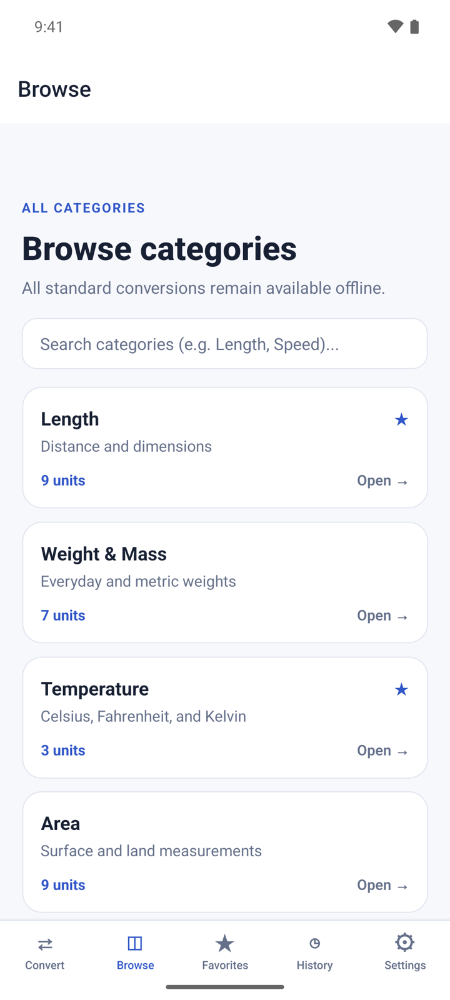

## What it does

Unit Converter は、ある単位の数値を別の単位に換算するアプリです。数値を入力して2つの単位を選ぶと、入力と同時に結果が表示されます。長さ、重さ、温度から、料理の容量、燃費、データ容量まで、15のカテゴリに対応しています。

- 換算は端末の中で行うので、インターネットがなくても使えます。
- アカウントは不要です。お気に入りと履歴は、お使いのスマートフォンの中だけに残ります。
- 一般的な食材20種類について、カップや大さじ・小さじをグラムに換算できます。結果はおおよその値です。
- 無料で使えます。広告は **Browse** と **History** の小さなバナーだけです。Premium を一度購入すると広告が消えます。

## Get started

1. Unit Converter を開きます。最初は **Convert** 画面の **Length** カテゴリが表示されます。
2. **VALUE** の下に数字を入力します。答えはすぐに **RESULT** の下に表示されます。
3. 許可が必要な項目はありません。アプリはカメラ、位置情報、ファイルを使いません。

## Convert a value

1. **Convert** で **CATEGORY** をタップし、カテゴリを選びます。たとえば **Temperature** です。
2. **FROM** をタップして、今ある単位を選びます。**TO** をタップして、換算したい単位を選びます。
3. **VALUE** の下に数字を入力します。小数点にはピリオドもカンマも使えます。桁区切りは入れないでください。1,500 ではなく 1500 と入力します。
4. 答えを **RESULT** の下で確認します。
5. **⇄** をタップすると2つの単位が入れ替わります。**Clear** をタップすると入力した値が消えます。

## Copy a result

1. **Copy result** をタップします。ボタンの表示が **Copied** に変わります。
2. 好きなアプリに貼り付けます。コピーされる文字には換算前と換算後の両方が入ります。たとえば「5 mi = 8.04672 km」です。

コピーした結果は **History** にも保存されます。

## Browse the categories

1. **Browse** をタップすると、15のカテゴリと、それぞれの単位の数が表示されます。
2. 検索ボックスに入力すると、カテゴリや単位を名前や記号で探せます。たとえば「Speed」や「mph」です。
3. カテゴリをタップすると、そのカテゴリが換算画面で開きます。

## Save your favorite categories

1. **Convert** でカテゴリを選び、**☆ Save** をタップします。ボタンの表示が **★ Saved** に変わります。
2. **Favorites** をタップすると、保存したカテゴリが表示されます。
3. カードの **Convert now →** をタップすると、そのカテゴリが換算画面で開きます。
4. お気に入りを外すには、カードの ★ をタップします。

## Reuse a past conversion

1. **History** をタップします。コピーした結果が新しい順に並びます。保存されるのは最新の100件です。
2. **Open in converter** をタップすると、同じカテゴリ、単位、値が換算画面に読み込まれます。
3. **Copy** をタップすると、その行をもう一度コピーできます。
4. 一覧を空にするには、**Clear all** をタップしてから **Clear** をタップします。

## Change the theme

1. **Settings** をタップします。
2. **Appearance** で **System**、**Light**、**Dark** のどれかを選びます。**System** を選ぶと、スマートフォンの設定に合わせて切り替わります。

## Change the language

1. **Settings** をタップします。
2. 言語の設定を開き、言語を選びます。最初の選択肢 System default は、スマートフォンの言語に合わせます。

カテゴリ名、単位名、食材名は、選んだ言語に切り替わります。**Browse** の検索では、選んだ言語の名前でも英語の名前でも見つかります。

## Premium

Premium はサブスクリプションではなく、一度きりの支払いです。すべての広告が消えます。それ以外の機能は増えません。すべてのカテゴリと単位は無料で使えます。

- **Settings** を開き、**Premium** の下にある **Remove ads** をタップします。ボタンに価格が表示されます。
- 以前に Premium を購入した場合は、**Restore purchase** をタップします。

## Questions

**オフラインでも使えますか?**
はい。換算はすべてスマートフォンの中で行います。インターネットが必要なのは、広告の表示と Premium の購入だけです。

**換算したのに History に残っていません。なぜですか?**
History に残るのは、コピーした結果だけです。**Convert** で **Copy result** をタップすると保存されます。

**「Enter a valid number」と表示されるのはなぜですか?**
入力した値に、数字として読み取れないものが含まれています。たとえば小数点が2つある場合です。数字と、多くても1つのピリオドかカンマだけを入力してください。

**月と年の換算は正確ですか?**
いいえ。**Time** では、月と年は平均的なカレンダー上の長さで計算します。これらを使うと、結果に注意書きが表示されます。

**通貨は換算できますか?**
いいえ。このアプリが換算するのは、計測の単位だけです。

## Privacy

換算は端末の中で行われ、お気に入りと履歴はスマートフォンの中だけに残ります。無料版では Google AdMob のバナー広告が表示されます。詳しくは[プライバシーポリシー](https://varian1.github.io/all-in-one-unit-converter/privacy.html)をご覧ください。
