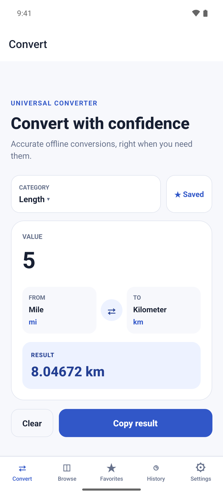
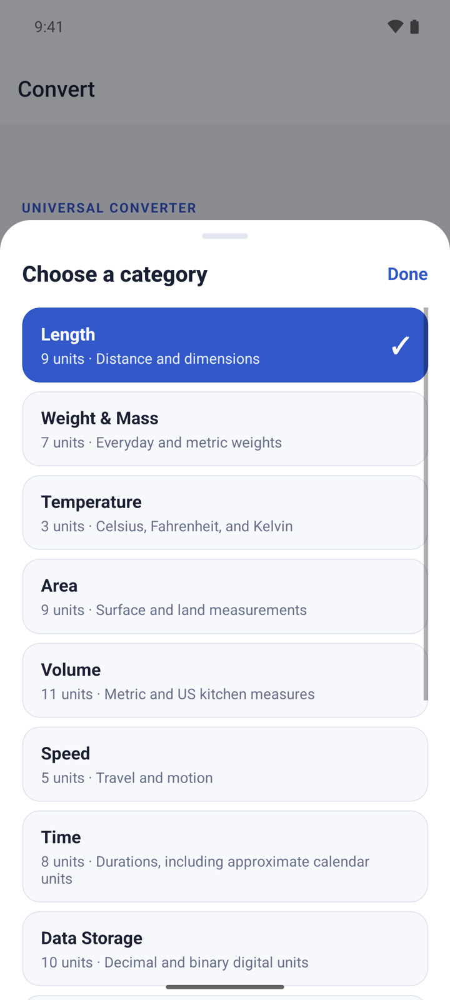
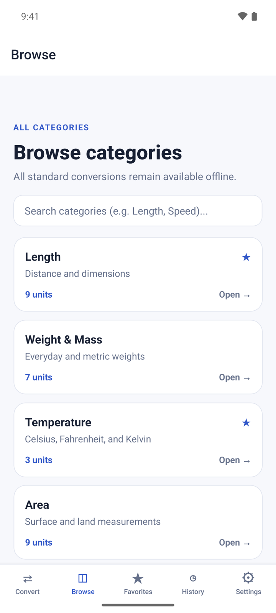
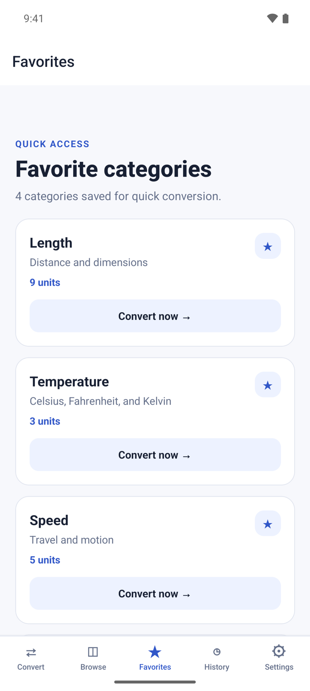
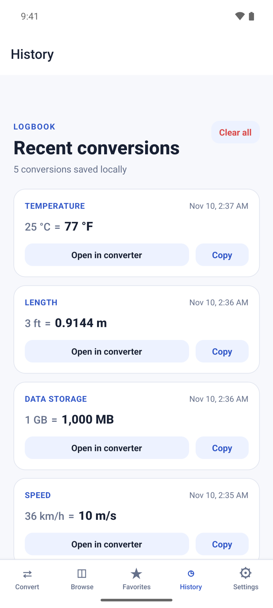
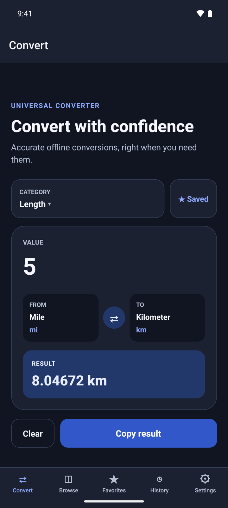

## What it does

Unit Converter changes a measurement from one unit to another. Type a value, pick two units and the result appears as you type. It covers 14 categories and 96 units, from length, weight and temperature to cooking volumes, fuel consumption and data storage.

- Conversions run on your device and work without internet.
- No account. Your favorites and history stay on your phone.
- Free with small banner ads on Browse and History only. A one-time Premium purchase removes them.

## Get started

1. Open Unit Converter. It starts on **Convert** with the **Length** category.
2. Type a number under **VALUE**. The answer shows under **RESULT** right away.
3. There is nothing to allow: the app does not use your camera, location or files.

## Convert a value

1. On **Convert**, tap **CATEGORY** and choose one, for example **Temperature**.
2. Tap **FROM** and pick the unit you have. Tap **TO** and pick the unit you want.
3. Type the number under **VALUE**. Use a point or a comma for decimals, and no thousands separators: type 1500, not 1,500.
4. Read the answer under **RESULT**.
5. Tap **⇄** to swap the two units, or **Clear** to empty the value.

## Copy a result

1. Tap **Copy result**. The button changes to **Copied**.
2. Paste it into any app. The copied text holds both sides, for example "5 mi = 8.04672 km".

Each result you copy is also saved to **History**.

## Browse the categories

1. Tap **Browse** to see all 14 categories and how many units each one has.
2. Type in **Search categories** to filter the list by category name or description, for example "Speed".
3. Tap a category to open it in the converter.

## Save your favorite categories

1. On **Convert**, choose a category and tap **☆ Save**. The button changes to **★ Saved**.
2. Tap **Favorites** to see the categories you saved.
3. Tap **Convert now →** on a card to open that category in the converter.
4. To remove a favorite, tap the ★ on its card.

## Reuse a past conversion

1. Tap **History**. It lists the results you copied, newest first. The latest 100 are kept.
2. Tap **Open in converter** to load the same category, units and value again.
3. Tap **Copy** to copy the line again.
4. To empty the list, tap **Clear all** and then **Clear**.

## Change the theme

1. Tap **Settings**.
2. Under **Appearance**, choose **System**, **Light** or **Dark**. **System** follows your phone.

## Premium

Premium is one payment, not a subscription. It removes all ads and adds nothing else: every category and unit is free.

- Open **Settings** and tap **Remove ads** under **Premium**. The button shows the price.
- If you bought Premium before, tap **Restore purchase**.

## Questions

**Does it work offline?**
Yes. All conversions run on your phone. Only ads and the Premium purchase need internet.

**Why is my conversion not in History?**
History keeps only the results you copy. Tap **Copy result** on **Convert** to save one.

**Why does the result say "Enter a valid number"?**
The value has something the app cannot read as a number, such as two decimal points. Type digits with at most one point or comma.

**Are months and years exact?**
No. In **Time**, month and year use an average calendar length, and the result shows a note when you use them.

**Can it convert currency?**
No. The app converts measurement units only.

## Privacy

Conversions run on your device, and your favorites and history stay on your phone. The free version shows banner ads from Google AdMob. Read the full [privacy policy](https://varian1.github.io/all-in-one-unit-converter/privacy.html).
