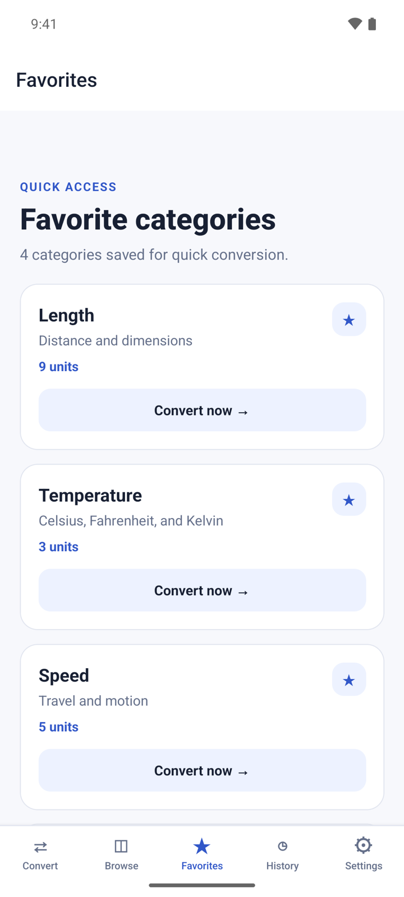

## Wat de app doet

Unit Converter rekent een meting om van de ene eenheid naar de andere. Typ een waarde, kies twee eenheden en het resultaat verschijnt terwijl je typt. De app heeft 15 categorieën, van lengte, gewicht en temperatuur tot kookmaten, brandstofverbruik en gegevensopslag.

- Alles wordt op je toestel berekend en werkt zonder internet.
- Geen account. Je favorieten en geschiedenis blijven op je telefoon.
- Rekent kopjes en lepels om naar gram voor 20 gangbare ingrediënten. Deze resultaten zijn bij benadering.
- Gratis, met kleine banneradvertenties alleen bij Browse en History. Eenmalig Premium kopen verwijdert ze.

## Aan de slag

1. Open Unit Converter. De app start op **Convert** met de categorie **Length**.
2. Typ een getal onder **VALUE**. Het antwoord staat meteen onder **RESULT**.
3. Je hoeft nergens toestemming voor te geven: de app gebruikt je camera, locatie of bestanden niet.

## Een waarde omrekenen

1. Tik op **Convert** op **CATEGORY** en kies een categorie, bijvoorbeeld **Temperature**.
2. Tik op **FROM** en kies de eenheid die je hebt. Tik op **TO** en kies de eenheid die je wilt.
3. Typ het getal onder **VALUE**. Gebruik een punt of een komma voor decimalen en geen duizendtalscheidingstekens: typ 1500, niet 1,500.
4. Lees het antwoord onder **RESULT**.
5. Tik op **⇄** om de twee eenheden om te wisselen, of op **Clear** om de waarde te wissen.

## Een resultaat kopiëren

1. Tik op **Copy result**. De knop verandert in **Copied**.
2. Plak het in een andere app. De gekopieerde tekst bevat beide kanten, bijvoorbeeld "5 mi = 8.04672 km".

Elk resultaat dat je kopieert, wordt ook bewaard in **History**.

## De categorieën bekijken

1. Tik op **Browse** om alle 15 categorieën te zien, met het aantal eenheden per categorie.
2. Typ in het zoekvak om een categorie of eenheid te vinden op naam of symbool, bijvoorbeeld "Speed" of "mph".
3. Tik op een categorie om die in de omrekenaar te openen.

## Je favoriete categorieën bewaren

1. Kies op **Convert** een categorie en tik op **☆ Save**. De knop verandert in **★ Saved**.
2. Tik op **Favorites** om de categorieën te zien die je hebt bewaard.
3. Tik op een kaart op **Convert now →** om die categorie in de omrekenaar te openen.
4. Wil je een favoriet verwijderen? Tik op de ★ op de kaart.

## Een eerdere omrekening opnieuw gebruiken

1. Tik op **History**. Daar staan de resultaten die je hebt gekopieerd, de nieuwste bovenaan. De laatste 100 blijven bewaard.
2. Tik op **Open in converter** om dezelfde categorie, eenheden en waarde opnieuw te laden.
3. Tik op **Copy** om de regel opnieuw te kopiëren.
4. Wil je de lijst leegmaken? Tik op **Clear all** en dan op **Clear**.

## Het thema wijzigen

1. Tik op **Settings**.
2. Kies onder **Appearance** voor **System**, **Light** of **Dark**. **System** volgt je telefoon.

## De taal wijzigen

1. Tik op **Settings**.
2. Open de taalinstelling en kies een taal. De eerste keuze, System default, volgt de taal van je telefoon.

De namen van categorieën, eenheden en ingrediënten veranderen mee met de taal. Zoeken in **Browse** vindt namen in jouw taal en in het Engels.

## Premium

Premium is een eenmalige betaling, geen abonnement. Het verwijdert alle advertenties en voegt verder niets toe: alle categorieën en eenheden zijn gratis.

- Open **Settings** en tik onder **Premium** op **Remove ads**. Op de knop staat de prijs.
- Heb je Premium eerder gekocht? Tik dan op **Restore purchase**.

## Vragen

**Werkt de app offline?**
Ja. Alle omrekeningen worden op je telefoon uitgevoerd. Alleen advertenties en de aankoop van Premium hebben internet nodig.

**Waarom staat mijn omrekening niet in History?**
History bewaart alleen de resultaten die je kopieert. Tik op **Convert** op **Copy result** om er een te bewaren.

**Waarom staat er "Enter a valid number" bij het resultaat?**
De waarde bevat iets wat de app niet als getal kan lezen, zoals twee decimaaltekens. Typ cijfers met hooguit één punt of komma.

**Zijn maanden en jaren exact?**
Nee. Bij **Time** gebruiken maand en jaar een gemiddelde kalenderlengte. Het resultaat toont dan een opmerking.

**Kan de app valuta omrekenen?**
Nee. De app rekent alleen meeteenheden om.

## Privacy

Omrekeningen worden op je toestel uitgevoerd en je favorieten en geschiedenis blijven op je telefoon. De gratis versie toont banneradvertenties van Google AdMob. Lees het volledige [privacybeleid](https://varian1.github.io/all-in-one-unit-converter/privacy.html).
