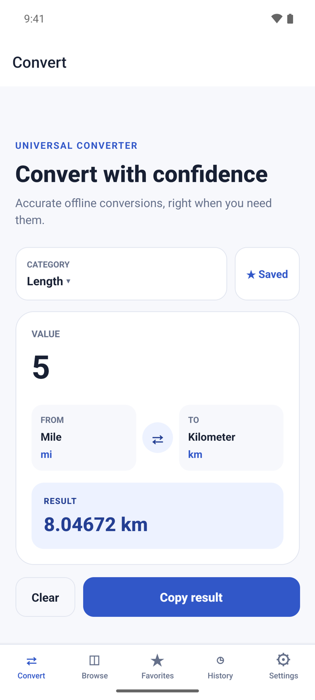
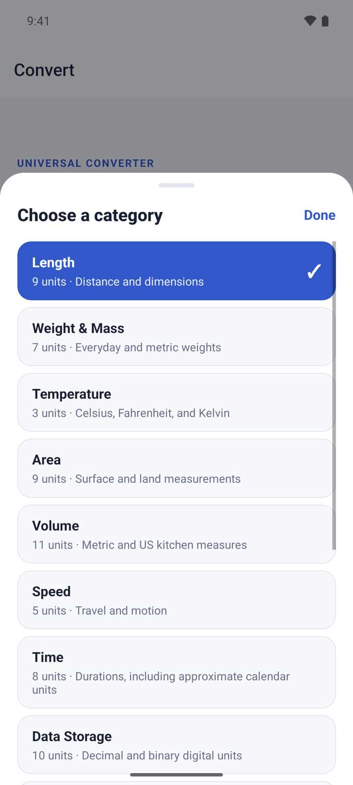

## Что умеет приложение

Unit Converter переводит величину из одной единицы измерения в другую. Введите число, выберите две единицы, и результат появится прямо во время ввода. В приложении 15 категорий: от длины, веса и температуры до кулинарных объёмов, расхода топлива и объёма данных.

- Расчёты выполняются на вашем устройстве и работают без интернета.
- Аккаунт не нужен. Избранное и история хранятся только на телефоне.
- Переводит чашки и ложки в граммы для 20 популярных продуктов. Эти результаты приблизительные.
- Бесплатно, с небольшими баннерами только на экранах Browse и History. Разовая покупка Premium убирает рекламу.

## Первый запуск

1. Откройте Unit Converter. Приложение запускается на вкладке **Convert** в категории **Length**.
2. Введите число в поле **VALUE**. Ответ сразу появится под **RESULT**.
3. Ничего разрешать не нужно: приложение не использует камеру, геолокацию и файлы.

## Перевод значения

1. На вкладке **Convert** нажмите **CATEGORY** и выберите категорию, например **Temperature**.
2. Нажмите **FROM** и выберите исходную единицу. Нажмите **TO** и выберите нужную.
3. Введите число в поле **VALUE**. Для дробей используйте точку или запятую, без разделителей тысяч: вводите 1500, а не 1,500.
4. Прочитайте ответ под **RESULT**.
5. Нажмите **⇄**, чтобы поменять единицы местами, или **Clear**, чтобы очистить значение.

## Копирование результата

1. Нажмите **Copy result**. Кнопка изменится на **Copied**.
2. Вставьте текст в любое приложение. В скопированном тексте есть обе части, например «5 mi = 8.04672 km».

Каждый скопированный результат также сохраняется в **History**.

## Обзор категорий

1. Нажмите **Browse**, чтобы увидеть все 15 категорий и число единиц в каждой.
2. Введите запрос в строку поиска, чтобы найти категорию или единицу по названию или обозначению, например «Speed» или «mph».
3. Нажмите на категорию, чтобы открыть её в конвертере.

## Сохранение любимых категорий

1. На вкладке **Convert** выберите категорию и нажмите **☆ Save**. Кнопка изменится на **★ Saved**.
2. Нажмите **Favorites**, чтобы увидеть сохранённые категории.
3. Нажмите **Convert now →** на карточке, чтобы открыть эту категорию в конвертере.
4. Чтобы убрать категорию из избранного, нажмите ★ на её карточке.

## Повтор прошлого перевода

1. Нажмите **History**. Там перечислены скопированные результаты, сначала новые. Хранятся последние 100.
2. Нажмите **Open in converter**, чтобы снова загрузить ту же категорию, единицы и значение.
3. Нажмите **Copy**, чтобы скопировать строку ещё раз.
4. Чтобы очистить список, нажмите **Clear all**, а затем **Clear**.

## Смена темы

1. Нажмите **Settings**.
2. В разделе **Appearance** выберите **System**, **Light** или **Dark**. Вариант **System** следует настройкам телефона.

## Смена языка

1. Нажмите **Settings**.
2. Откройте настройку языка и выберите язык. Первый вариант, System default, следует языку телефона.

Названия категорий, единиц и продуктов меняются вместе с языком. Поиск в **Browse** находит названия и на вашем языке, и на английском.

## Premium

Premium оплачивается один раз, это не подписка. Он убирает всю рекламу и больше ничего не добавляет: все категории и единицы бесплатны.

- Откройте **Settings** и нажмите **Remove ads** в разделе **Premium**. На кнопке указана цена.
- Если вы уже покупали Premium, нажмите **Restore purchase**.

## Вопросы

**Работает ли приложение офлайн?**
Да. Все расчёты выполняются на телефоне. Интернет нужен только для рекламы и покупки Premium.

**Почему моего перевода нет в History?**
В History попадают только скопированные результаты. Чтобы сохранить перевод, нажмите **Copy result** на вкладке **Convert**.

**Почему в результате написано "Enter a valid number"?**
В значении есть то, что приложение не может прочитать как число, например две десятичные точки. Вводите цифры не более чем с одной точкой или запятой.

**Точны ли месяцы и годы?**
Нет. В категории **Time** месяц и год считаются по средней длине в календаре, и при их использовании под результатом появляется пометка.

**Можно ли переводить валюты?**
Нет. Приложение переводит только единицы измерения.

## Конфиденциальность

Расчёты выполняются на вашем устройстве, а избранное и история хранятся на телефоне. В бесплатной версии показываются баннеры Google AdMob. Полный текст: [политика конфиденциальности](https://varian1.github.io/all-in-one-unit-converter/privacy.html).
