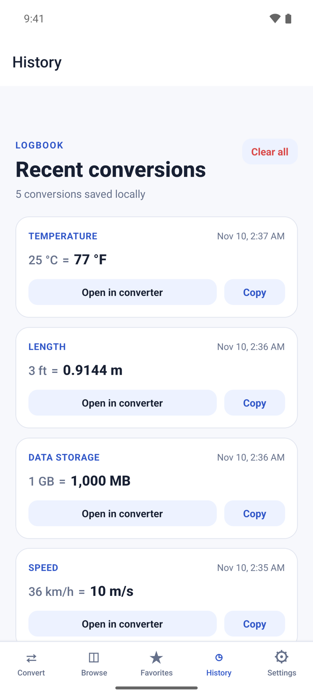

## แอปนี้ทำอะไรได้

Unit Converter แปลงค่าที่วัดได้จากหน่วยหนึ่งเป็นอีกหน่วยหนึ่ง พิมพ์ตัวเลข เลือกสองหน่วย แล้วผลลัพธ์จะขึ้นทันทีที่พิมพ์ ครอบคลุม 15 หมวดหมู่ ตั้งแต่ความยาว น้ำหนัก และอุณหภูมิ ไปจนถึงปริมาตรในการทำอาหาร อัตราสิ้นเปลืองเชื้อเพลิง และพื้นที่จัดเก็บข้อมูล

- แปลงค่าในเครื่องของคุณ ใช้งานได้โดยไม่ต้องต่ออินเทอร์เน็ต
- ไม่ต้องสมัครบัญชี รายการโปรดและประวัติเก็บอยู่ในโทรศัพท์ของคุณ
- แปลงถ้วยและช้อนเป็นกรัมสำหรับวัตถุดิบทั่วไป 20 อย่าง ผลลัพธ์เหล่านี้เป็นค่าโดยประมาณ
- ใช้ฟรี มีแบนเนอร์โฆษณาเล็ก ๆ เฉพาะหน้า Browse และ History ซื้อ Premium ครั้งเดียวเพื่อเอาโฆษณาออก

## เริ่มต้นใช้งาน

1. เปิด Unit Converter แอปจะเริ่มที่ **Convert** ในหมวด **Length**
2. พิมพ์ตัวเลขใต้ **VALUE** คำตอบจะแสดงใต้ **RESULT** ทันที
3. ไม่ต้องอนุญาตสิทธิ์ใด ๆ เพราะแอปไม่ใช้กล้อง ตำแหน่ง หรือไฟล์ของคุณ

## แปลงค่า

1. ที่ **Convert** แตะ **CATEGORY** แล้วเลือกหมวดหมู่ เช่น **Temperature**
2. แตะ **FROM** แล้วเลือกหน่วยที่คุณมี แตะ **TO** แล้วเลือกหน่วยที่ต้องการ
3. พิมพ์ตัวเลขใต้ **VALUE** ใช้จุดหรือจุลภาคเป็นทศนิยม และไม่ต้องใส่ตัวคั่นหลักพัน: พิมพ์ 1500 ไม่ใช่ 1,500
4. ดูคำตอบใต้ **RESULT**
5. แตะ **⇄** เพื่อสลับสองหน่วย หรือแตะ **Clear** เพื่อล้างค่าที่พิมพ์

## คัดลอกผลลัพธ์

1. แตะ **Copy result** ปุ่มจะเปลี่ยนเป็น **Copied**
2. วางลงในแอปใดก็ได้ ข้อความที่คัดลอกมีทั้งสองฝั่ง เช่น "5 mi = 8.04672 km"

ผลลัพธ์ทุกรายการที่คุณคัดลอกจะถูกบันทึกลงใน **History** ด้วย

## เลือกดูหมวดหมู่

1. แตะ **Browse** เพื่อดูทั้ง 15 หมวดหมู่ และจำนวนหน่วยในแต่ละหมวด
2. พิมพ์ในช่องค้นหาเพื่อหาหมวดหมู่หรือหน่วยจากชื่อหรือสัญลักษณ์ เช่น "Speed" หรือ "mph"
3. แตะหมวดหมู่เพื่อเปิดในหน้าแปลงค่า

## บันทึกหมวดหมู่โปรด

1. ที่ **Convert** เลือกหมวดหมู่ แล้วแตะ **☆ Save** ปุ่มจะเปลี่ยนเป็น **★ Saved**
2. แตะ **Favorites** เพื่อดูหมวดหมู่ที่คุณบันทึกไว้
3. แตะ **Convert now →** บนการ์ดเพื่อเปิดหมวดหมู่นั้นในหน้าแปลงค่า
4. หากต้องการเอาออกจากรายการโปรด ให้แตะ ★ บนการ์ดของหมวดนั้น

## ใช้การแปลงค่าเก่าอีกครั้ง

1. แตะ **History** จะแสดงผลลัพธ์ที่คุณคัดลอกไว้ โดยเรียงจากใหม่สุดก่อน เก็บล่าสุด 100 รายการ
2. แตะ **Open in converter** เพื่อโหลดหมวดหมู่ หน่วย และค่าเดิมกลับมา
3. แตะ **Copy** เพื่อคัดลอกบรรทัดนั้นอีกครั้ง
4. หากต้องการล้างรายการ ให้แตะ **Clear all** แล้วแตะ **Clear**

## เปลี่ยนธีม

1. แตะ **Settings**
2. ใต้ **Appearance** เลือก **System**, **Light** หรือ **Dark** โดย **System** จะทำตามโทรศัพท์ของคุณ

## เปลี่ยนภาษา

1. แตะ **Settings**
2. เปิดการตั้งค่าภาษา แล้วเลือกภาษา ตัวเลือกแรก System default จะใช้ภาษาเดียวกับโทรศัพท์ของคุณ

ชื่อหมวดหมู่ หน่วย และวัตถุดิบจะเปลี่ยนตามภาษา การค้นหาใน **Browse** หาชื่อได้ทั้งในภาษาของคุณและภาษาอังกฤษ

## Premium

Premium ชำระครั้งเดียว ไม่ใช่การสมัครสมาชิก ช่วยเอาโฆษณาทั้งหมดออก และไม่เพิ่มอย่างอื่น เพราะทุกหมวดหมู่และทุกหน่วยใช้ฟรีอยู่แล้ว

- เปิด **Settings** แล้วแตะ **Remove ads** ใต้ **Premium** ปุ่มจะแสดงราคา
- หากเคยซื้อ Premium แล้ว ให้แตะ **Restore purchase**

## คำถามที่พบบ่อย

**ใช้งานออฟไลน์ได้ไหม**
ได้ การแปลงค่าทั้งหมดทำงานในโทรศัพท์ของคุณ มีเพียงโฆษณาและการซื้อ Premium ที่ต้องใช้อินเทอร์เน็ต

**ทำไมการแปลงค่าของฉันไม่อยู่ใน History**
History เก็บเฉพาะผลลัพธ์ที่คุณคัดลอก แตะ **Copy result** ที่ **Convert** เพื่อบันทึกรายการ

**ทำไมผลลัพธ์ขึ้นว่า "Enter a valid number"**
ค่าที่พิมพ์มีบางอย่างที่แอปอ่านเป็นตัวเลขไม่ได้ เช่น มีจุดทศนิยมสองตัว ให้พิมพ์เฉพาะตัวเลข และใส่จุดหรือจุลภาคได้ไม่เกินหนึ่งตัว

**เดือนและปีแม่นยำไหม**
ไม่แม่นยำเต็มที่ ใน **Time** เดือนและปีใช้ความยาวเฉลี่ยของปฏิทิน และเมื่อคุณใช้หน่วยเหล่านี้ ผลลัพธ์จะแสดงหมายเหตุไว้

**แปลงสกุลเงินได้ไหม**
ไม่ได้ แอปนี้แปลงเฉพาะหน่วยวัดเท่านั้น

## ความเป็นส่วนตัว

การแปลงค่าทำงานในเครื่องของคุณ รายการโปรดและประวัติเก็บอยู่ในโทรศัพท์ของคุณ เวอร์ชันฟรีแสดงแบนเนอร์โฆษณาจาก Google AdMob อ่าน[นโยบายความเป็นส่วนตัว](https://varian1.github.io/all-in-one-unit-converter/privacy.html)ฉบับเต็มได้ที่นี่
