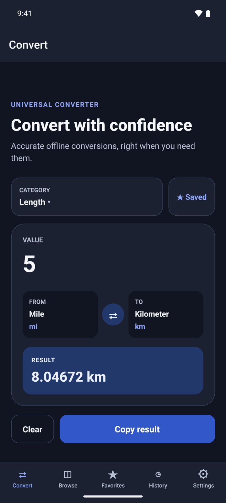

## Ano ang magagawa nito

Pinapalitan ng Unit Converter ang isang sukat mula sa isang unit papunta sa iba. Mag-type ng halaga, pumili ng dalawang unit, at lalabas ang resulta habang nagta-type ka. Sakop nito ang 15 kategorya, mula haba, timbang at temperatura hanggang sukat sa pagluluto, konsumo ng gasolina at laki ng data.

- Tumatakbo ang mga conversion sa device mo at gumagana kahit walang internet.
- Walang account. Nasa telepono mo lang ang mga paborito at history mo.
- Kino-convert ang tasa at kutsara sa gramo para sa 20 karaniwang sangkap. Tinatayang halaga lang ang mga resultang ito.
- Libre, may maliliit na banner ad sa Browse at History lang. Aalisin ng minsanang bayad sa Premium ang mga ito.

## Magsimula

1. Buksan ang Unit Converter. Magsisimula ito sa **Convert** na nasa kategoryang **Length**.
2. Mag-type ng numero sa ilalim ng **VALUE**. Agad na lalabas ang sagot sa ilalim ng **RESULT**.
3. Wala kang kailangang payagan: hindi ginagamit ng app ang camera, lokasyon o mga file mo.

## Mag-convert ng halaga

1. Sa **Convert**, i-tap ang **CATEGORY** at pumili ng isa, halimbawa **Temperature**.
2. I-tap ang **FROM** at piliin ang unit na hawak mo. I-tap ang **TO** at piliin ang unit na gusto mo.
3. Mag-type ng numero sa ilalim ng **VALUE**. Puwede ang tuldok o kuwit para sa decimal, at huwag maglagay ng thousands separator: i-type ang 1500, hindi 1,500.
4. Basahin ang sagot sa ilalim ng **RESULT**.
5. I-tap ang **⇄** para magpalit ang dalawang unit, o ang **Clear** para burahin ang halaga.

## Kopyahin ang resulta

1. I-tap ang **Copy result**. Magiging **Copied** ang button.
2. I-paste ito sa kahit anong app. Kasama sa nakopyang teksto ang dalawang panig, halimbawa "5 mi = 8.04672 km".

Nase-save din sa **History** ang bawat resultang kinopya mo.

## Tingnan ang mga kategorya

1. I-tap ang **Browse** para makita ang lahat ng 15 kategorya at kung ilang unit ang nasa bawat isa.
2. Mag-type sa search box para maghanap ng kategorya o unit ayon sa pangalan o simbolo nito, halimbawa "Speed" o "mph".
3. I-tap ang isang kategorya para buksan ito sa converter.

## I-save ang mga paborito mong kategorya

1. Sa **Convert**, pumili ng kategorya at i-tap ang **☆ Save**. Magiging **★ Saved** ang button.
2. I-tap ang **Favorites** para makita ang mga kategoryang na-save mo.
3. I-tap ang **Convert now →** sa isang card para buksan ang kategoryang iyon sa converter.
4. Para tanggalin ang paborito, i-tap ang ★ sa card nito.

## Gamitin ulit ang dating conversion

1. I-tap ang **History**. Nakalista rito ang mga resultang kinopya mo, pinakabago muna. Itinatago ang pinakahuling 100.
2. I-tap ang **Open in converter** para i-load ulit ang parehong kategorya, unit at halaga.
3. I-tap ang **Copy** para kopyahin ulit ang linya.
4. Para i-empty ang listahan, i-tap ang **Clear all** at pagkatapos ang **Clear**.

## Baguhin ang tema

1. I-tap ang **Settings**.
2. Sa ilalim ng **Appearance**, piliin ang **System**, **Light** o **Dark**. Sinusunod ng **System** ang setting ng telepono mo.

## Baguhin ang wika

1. I-tap ang **Settings**.
2. Buksan ang setting ng wika at pumili ng wika. Ang unang pagpipilian, System default, ay sumusunod sa wika ng telepono mo.

Nagbabago ayon sa wika ang mga pangalan ng kategorya, unit at sangkap. Sa paghahanap sa **Browse**, makikita ang mga pangalan sa wika mo at sa Ingles.

## Premium

Isang beses lang ang bayad sa Premium, hindi subscription. Aalisin nito ang lahat ng ad at wala nang iba pang idadagdag: libre ang bawat kategorya at unit.

- Buksan ang **Settings** at i-tap ang **Remove ads** sa ilalim ng **Premium**. Makikita sa button ang presyo.
- Kung nakabili ka na ng Premium dati, i-tap ang **Restore purchase**.

## Mga tanong

**Gumagana ba ito nang walang internet?**
Oo. Tumatakbo sa telepono mo ang lahat ng conversion. Ang mga ad at ang pagbili ng Premium lang ang nangangailangan ng internet.

**Bakit wala sa History ang conversion ko?**
Ang mga resultang kinopya mo lang ang itinatago ng History. I-tap ang **Copy result** sa **Convert** para mag-save ng isa.

**Bakit "Enter a valid number" ang sinasabi ng resulta?**
May laman ang halaga na hindi mabasa ng app bilang numero, tulad ng dalawang decimal point. Mag-type ng mga digit na may isang tuldok o kuwit lang.

**Eksakto ba ang buwan at taon?**
Hindi. Sa **Time**, average na haba ng kalendaryo ang gamit sa buwan at taon, at may paalala sa resulta kapag ginamit mo ang mga ito.

**Kaya ba nitong mag-convert ng pera?**
Hindi. Mga unit ng sukat lang ang kino-convert ng app.

## Privacy

Tumatakbo sa device mo ang mga conversion, at nasa telepono mo lang ang mga paborito at history mo. Ang libreng bersyon ay nagpapakita ng mga banner ad mula sa Google AdMob. Basahin ang buong [patakaran sa privacy](https://varian1.github.io/all-in-one-unit-converter/privacy.html).
